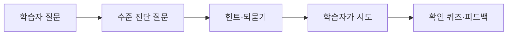
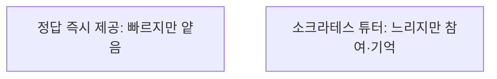

# AI 소크라테스 튜터 프롬프트

> **AI 소크라테스 튜터**는 정답을 바로 알려 주지 않고 **질문·힌트·자기 성찰 유도·확인 퀴즈**로 학습자가 스스로 풀게 돕는 AI 사용 방식이다. OpenAI의 "스터디 모드"가 대표 제품 사례다.

## 쉽게 말하면
숙제를 대신 해 주는 AI가 아니라 "여기서 뭐가 막혔어? 먼저 한 줄로 설명해 볼래?"라고 되묻는 과외 선생님 모드다. 답은 늦게 주지만 기억에는 오래 남는다.

## 자세히
(OpenAI "Introducing study mode in ChatGPT", 2025-07-29 확인. Anthropic 학습 모드 페이지는 404라 확인하지 못함)
- **스터디 모드**: "답만 주는 대신 문제를 **단계별로** 풀게 돕는" 학습 경험. 도구 메뉴의 "Study and learn"으로 켠다. 교사·과학자·교육 전문가와 작성한 **맞춤 시스템 지시문**으로 구현됐고, 능동 참여·인지 부하 관리·메타인지와 자기 성찰·호기심·실행 가능한 피드백을 목표로 한다.
- **기능**: ① **상호작용 프롬프트**(소크라테스식 질문, 힌트, 자기 성찰 질문) ② **구조화된 응답**(섹션으로 연결 강조, 과부하 감소) ③ **개인화**(수준 평가 질문과 이전 대화 기억) ④ **지식 확인**(퀴즈·서술형과 맞춤 피드백) ⑤ 대화 중 켜고 끌 수 있음.
- **한계**: 지금은 시스템 지시문 기반이라 대화마다 **일관성 없거나 실수**가 있을 수 있다고 인정하며, 이후 모델에 학습시킬 계획이라고 한다. 교육 연구는 "아직 형성 중"이라는 입장.
- **직접 만드는 튜터 프롬프트**(권고): 아래 예시처럼 역할·금지(정답 바로 말하기)·순서(진단 질문→힌트→확인)·종료 조건을 적는다. 질문 종류는 [소크라테스식 질문 유형](#socratic-questioning-types), 도움 수준은 [근접발달영역](#zone-of-proximal-development) 기준으로 조절.

## 그림으로 보기



## 예시
```
너는 소크라테스식 튜터다. 내가 질문하면 정답을 바로 말하지 마라.
1) 내가 아는 수준을 묻는 질문 1~2개
2) 막히면 힌트를 한 단계씩만
3) 마지막에 확인 질문 2개와 피드백
내가 "정답 알려 줘"라고 두 번 요청하면 그때 설명해도 된다.
```

## 헷갈리는 것과 비교
| 개념 | 차이 |
|---|---|
| AI 소크라테스 튜터 | 질문·힌트로 유도 |
| 일반 챗봇 답변 | 정답·요약 직접 제공 |
| [능동적 인출](#active-recall) | 떠올려 답하는 연습(튜터가 유도 가능) |
| [독립 리뷰어](#independent-reviewer) | 결과물 검토 역할 |

## 더 읽을거리
- [Introducing study mode in ChatGPT](https://openai.com/index/chatgpt-study-mode/)
