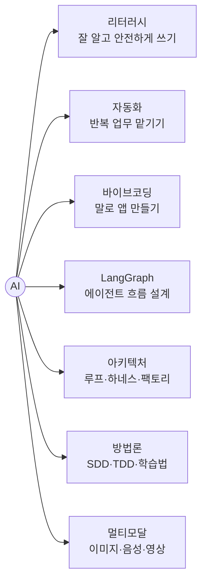

# AI

> 사람이 하던 지적 작업(읽기, 쓰기, 판단, 만들기)을 기계가 하게 만드는 기술 전체. 이 지도의 출발점이다.

## 쉽게 말하면

AI는 "많은 예시를 보고 패턴을 익힌 프로그램"이다. 요즘 말하는 AI는 대부분 **LLM(대규모 언어 모델)** 이다. 인터넷 규모의 글을 읽고 "다음에 올 말"을 맞히도록 훈련돼서, 질문에 답하고 글을 쓰고 코드를 만든다.

## 이 지도에서 뻗어 나가는 일곱 가지

| 가지 | 이런 질문에 답한다 |
| --- | --- |
| [리터러시](#literacy) | AI 답을 언제 믿고 언제 의심해야 하나? |
| [자동화](#automation) | 매주 하는 이 일을 AI에게 맡길 수 있나? |
| [바이브코딩](#vibecoding) | 코딩을 몰라도 내 도구를 만들 수 있나? |
| [LangGraph](#langgraph) | 여러 단계를 거치는 에이전트를 어떻게 설계하나? |
| [아키텍처](#architecture) | Claude Code 같은 에이전트는 속이 어떻게 생겼나? |
| [방법론](#methodology) | AI와 일하고, AI로 배우는 좋은 방법은? |
| [멀티모달](#multimodal) | 글 말고 그림·소리·영상은 어떻게 다루나? |

## 읽는 법

- 왼쪽 지도에서 가지를 누르면 펼쳐지고, 오른쪽에 그 노드의 글이 열린다.
- 회색 점은 **아직 정리 전** 노드다. 매일 점심 루틴이 조금씩 채우고, 새 가지를 뻗는다.
- 글마다 그림(흐름도·관계도), 비유, 예시, 헷갈리는 개념 비교, 더 읽을거리가 있다.
