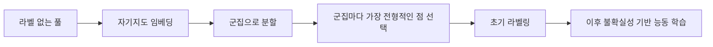
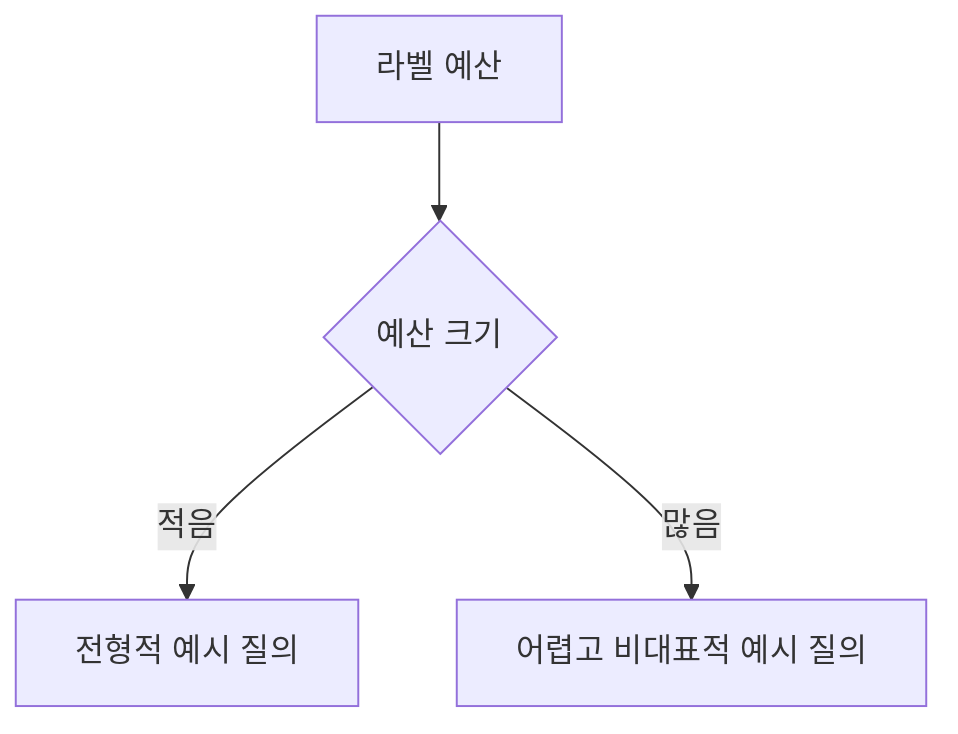

# 능동 학습 콜드 스타트

> 능동 학습의 콜드 스타트는 라벨이 거의 없을 때 "무엇부터 라벨링할지"를 정하기 어려운 문제다. 모델이 아직 쓸 만하지 않아 불확실성 기반 선택이 잘 안 되므로 초기 시드는 다른 기준(대표성·다양성)으로 고른다.

## 쉽게 말하면
새로 이사 온 동네를 처음 파악할 때, 어려운 골목부터 뒤지면 오히려 헤맨다. 먼저 번화가·주택가·상가처럼 지역마다 가장 전형적인 곳을 한 군데씩 둘러보고, 지도가 어느 정도 잡힌 뒤에 애매한 곳을 파고드는 편이 낫다.

## 자세히
- **핵심 주장(Hacohen·Dekel·Weinshall, ICML 2022, arXiv 2202.02794 초록·본문 열람)**: 최선의 질의 전략은 예산 크기에 따라 달라진다. 이론 모델에서 데이터를 쉬운 영역(R1)과 어려운 영역(R2)으로 나누면, 라벨이 적을 때는 쉬운 영역에서 더 뽑는 것이, 많을 때는 어려운 영역에서 더 뽑는 것이 오류를 더 줄인다. 저자는 이를 상전이에 가깝다고 표현한다. 즉 "전형적인 예시는 예산이 적을 때, 대표성이 낮은 예시는 예산이 많을 때" 질의하는 것이 낫다.
- **불확실성 샘플링이 실패하는 이유**: 라벨이 적으면 신경망이 과적합해 불확실성 추정이 부정확하다. 모든 라벨을 아는 오라클로 마진을 계산해도 저예산에서 성능이 나빴으므로 추정 오차만의 문제가 아니라고 논문은 확인한다.
- **TypiClust 3단계**: ① 라벨 없는 풀에서 자기지도 모델(SimCLR, ImageNet은 DINO)을 학습해 임베딩 확보 ② |L|+B개 군집으로 나눠 다양성 확보(K-means) ③ 아직 라벨이 없는 큰 군집 B개에서 전형도(가장 가까운 K=20개 이웃과의 평균 거리의 역수)가 가장 높은 점을 질의.
- **결과(저자 보고)**: CIFAR-10/100, TinyImageNet, ImageNet 부분집합에서 저예산 지도학습 때 다른 전략을 앞섰다. 준지도(FlexMatch)와 결합하면 CIFAR-10에서 라벨 10개로 93.2% 정확도, 무작위 선택 대비 39.4% 향상이다. 다른 데이터셋의 수치는 본문 앞부분에서 확인하지 못했다.
- **무작위의 위상(검색 요약)**: 저예산에서 무작위는 이기기 어려운 기준선이며 한 비교 연구에서는 TypiClust만 일관되게 앞섰고, 의료 영상 분할에서는 데이터셋에 따라 결과가 엇갈렸다. 불균형 데이터에서는 무작위 시드가 양성을 거의 못 뽑을 수 있다는 지적도 있다. 본문은 열지 못했다.
- **한계**: 이미지 분류 중심이며 자기지도 임베딩이 필요하다. 텍스트·표 형식 데이터에는 별도 검증이 필요하다(해석).

## 그림으로 보기

## 예시
- 신제품 리뷰 분류: 라벨 0개에서 시작할 때 문장 임베딩으로 20개 군집을 만들고 군집마다 대표 문장 1개씩 라벨링해 시드를 만든다.
- 교육 활용: "어려운 사례부터 라벨링하라"는 흔한 조언이 라벨이 적을 땐 틀릴 수 있음을 토론한다.

## 헷갈리는 것과 비교
| 개념 | 차이 |
| --- | --- |
| [검토용 능동 학습](#active-learning-review) | 상위 주제. 콜드 스타트는 그 초기 단계 문제 |
| 불확실성 샘플링 | 모델이 헷갈리는 건 선택. 라벨이 많을 때 유리 |
| 무작위 샘플링 | 단순한 기준선. 저예산에서는 강한 비교 대상 |

## 더 읽을거리
- [Active Learning on a Budget (arXiv 2202.02794)](https://arxiv.org/abs/2202.02794) — TypiClust와 예산별 전략 이론
