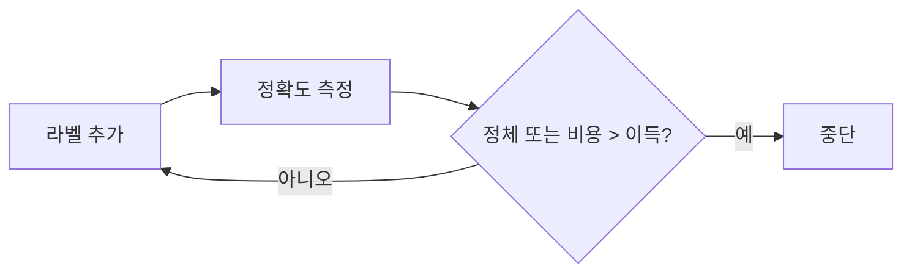

# 능동 학습 종료 기준

> 능동 학습에서 **언제 질문을 멈출지** 정하는 기준이다. 라벨 비용이 오류 비용보다 커지거나, 정확도가 정체되었을 때 멈춘다.

## 쉽게 말하면
공부 계획에서 "더 풀어도 점수가 안 오르는 시점"이나 "문제집 값이 점수 이득보다 비싸지는 시점"에 멈추는 것이다.

## 자세히
(Settles 2009 문헌 조사 6.7절을 직접 읽었다.)
- **두 관점(문헌)**: ① 새 학습 데이터를 얻는 **비용이 현재 모델의 오류 비용보다 커지는 지점** ② 학습기 정확도가 **정체(plateau)**에 이르러 데이터를 더 얻는 것이 낭비인 지점.
- **자체 종료 방법(문헌)**: Vlachos(2008), Bloodgood & Shanker(2009), Olsson & Tomanek(2009) 등은 학습기의 **안정성·자체 확신** 지표가 평평해지거나 나빠지면 종료한다는 아이디어. 예측 안정화 기반 방식이 있다.
- **저자의 경험(문헌)**: "실제 응용의 종료 기준은 경제적·외부 요인에 기반하며 보통 학습기가 스스로 정한 임계값보다 훨씬 먼저 온다."
- **비용 변동(문헌 6.3절)**: 라벨링 비용은 샘플마다 크게 다를 수 있고, 비용을 무시한 능동 학습이 **무작위 선택보다 나을 게 없을 수도 있다**(Settles 외 2008).

## 그림으로 보기

## 예시
- 라벨 500개마다 보류 세트 정확도를 재고, 두 번 연속 향상이 0.5%p 미만이면 중단(제안 임계값).

## 헷갈리는 것과 비교
| 기준 | 판단 근거 |
|---|---|
| 정체 기준 | 모델 지표 |
| 경제 기준 | 라벨 비용 대 이득 |
| [불확실성 샘플링](#uncertainty-sampling) | 무엇을 라벨링할지 |

## 더 읽을거리
- [Settles (2009)](https://burrsettles.com/pub/settles.activelearning.pdf) — 직접 읽음.
