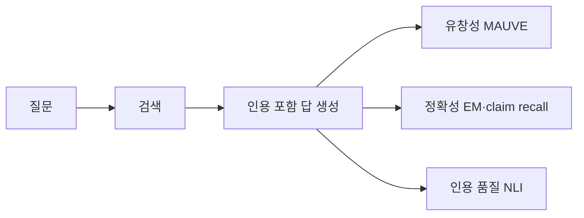

# ALCE 벤치마크

> LLM이 **출처 인용이 달린 답을 생성하는 능력을 자동으로 평가**하는 최초의 벤치마크(Gao 외, Princeton, 2023). 유창성·정확성·인용 품질 세 축을 잰다.

## 쉽게 말하면
논문 과제에 "각주 달린 보고서"를 쓰게 하고, 보고서의 말이 각주 자료에서 정말 나오는지를 사람이 아닌 채점기가 확인하는 시험이다.

## 자세히
(Gao·Yen·Yu·Chen, "Enabling Large Language Models to Generate Text with Citations"(arXiv 2305.14627) PDF를 직접 읽었다. 2023년 논문이라 이후 모델의 성능은 달라졌을 수 있다.)
- **목표(논문)**: LLM 출력의 환각을 줄이고 검증 가능성을 높이기 위해 *인용과 함께* 답하게 한다. 기존에는 상용 검색 엔진과 사람 평가에 의존해 재현·비교가 어려웠다.
- **구성**: 질문과 검색 코퍼스를 주고 **검색 → 인용 포함 답변 생성**을 하는 end-to-end 시스템을 요구한다. 데이터셋 3종: **ASQA**(긴 사실형, 위키 2018-12-20 코퍼스), **QAMPARI**(답이 엔티티 목록), **ELI5**(Reddit의 "다섯 살에게 설명하듯" 질문).
- **세 축 지표**: **유창성**(MAUVE; QAMPARI는 제외), **정확성**(ASQA는 정답 단답의 EM recall, QAMPARI는 precision·recall — 5개 이상 맞으면 recall-5 100%, ELI5는 하위 주장 3개를 LLM이 만들고 NLI 모델 **TRUE**로 확인하는 claim recall), **인용 품질**([인용 재현·정밀](#citation-recall-precision)).
- **결과(논문)**: 최고 모델도 **ELI5에서 생성의 약 50%가 인용 자료로 완전히 뒷받침되지 않는다**. 추가 발견: 검색 없이 답한 뒤 사후 인용(closed-book + post-hoc)은 정확성은 괜찮아도 인용 품질이 훨씬 낮다. 상호작용형 검색은 이 벤치마크에서 개선하지 못했다. 검색 문서를 요약하면 정확성은 오르나 인용 품질은 아니다. 여러 생성을 재순위하면 사람 평가 기준 인용 품질이 오른다. 문서를 더 넣어도 ChatGPT는 도움이 안 되나 GPT-4는 좋아진다.
- **남은 과제(논문)**: 더 나은 검색기, 더 긴 컨텍스트, 여러 출처를 종합하는 능력.
- **코드·데이터**: github.com/princeton-nlp/ALCE.

## 그림으로 보기

## 예시
- 사내 문서 Q&A 봇을 평가할 때 "답의 각 문장이 인용한 문단만으로 뒷받침되는가"를 NLI로 자동 점검한다(제안).
- 교육 소재: 같은 질문에 인용 있는 답과 없는 답을 비교해 검증 가능성이 어떻게 달라지는지 토론.

## 헷갈리는 것과 비교
| 개념 | 차이 |
|---|---|
| ALCE | 인용 달린 생성을 자동 평가하는 벤치마크 |
| [인용 재현·정밀](#citation-recall-precision) | ALCE의 인용 품질 지표 |
| [NLI 함의 검사](#nli-entailment-check) | 인용 뒷받침 여부를 판정하는 방법 |
| RAG 평가 | 검색·생성 전반(더 넓음) |

## 더 읽을거리
- [Gao et al. (2023) — Enabling LLMs to Generate Text with Citations](https://arxiv.org/abs/2305.14627) — 직접 읽음.
