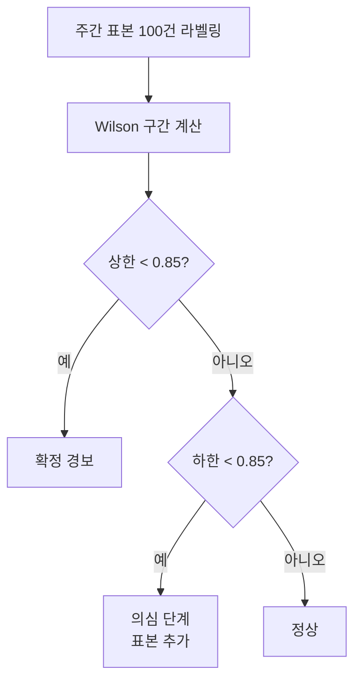

# 신뢰구간 상한 경보 규칙

> 감시 표본의 정밀도를 점추정치 하나로 판단하지 않고 **Wilson 신뢰구간의 상한(또는 하한)** 과 기준선을 비교해 경보를 정한다. "상한이 기준 아래면 경보"는 헛경보가 거의 없지만 늦고, "하한이 기준 아래면 경보"는 빠르지만 헛경보가 많다.

## 쉽게 말하면
체온계 눈금이 37.4도로 한 번 찍혔다고 바로 병원에 가지 않는다. "오차를 감안해도 열이 확실한가"(상한 규칙)를 따지면 헛걸음이 줄지만 늦게 간다. "열일 수도 있다"(하한 규칙)로 가면 자주 헛걸음한다.

## 자세히
- 표본이 작거나 비율이 0·1에 가까우면 일반 정규근사 구간이 부정확하므로 **Wilson 구간**을 쓴다(단측 95%, z=1.645).
- **직접 실행**(numpy 시뮬레이션: 표본 n=100, 기준 정밀도 0.90, 경보 임계값 0.85, 규칙별 경보 비율, 20,000회):

| 실제 정밀도 | 점추정 < 0.85 | **상한** < 0.85 | 하한 < 0.85 |
|---|---|---|---|
| 0.90 (하락 없음) | 0.040 | **0.001** | 0.553 |
| 0.85 (경계) | 0.432 | 0.064 | 0.945 |
| 0.80 | 0.871 | 0.440 | 0.998 |
| 0.75 | 0.990 | 0.848 | 1.000 |

  - **상한 규칙**: 하락 없음에서 헛경보 0.1%로 매우 보수적이지만, 실제로 0.80까지 떨어져도 44%만 경보 → **탐지가 느리다**.
  - **하한 규칙**: 하락이 없는데도 55%가 경보 → 실무에서 경보 피로를 일으킨다.
  - **점추정 규칙**은 중간이지만 표본이 작을수록 변동이 커 불안정하다.
- **선택 기준**: 오탐 대응 비용이 크면 상한 규칙+표본 누적, 놓치는 비용이 크면 점추정+이동 창, "의심 단계/확정 단계" 2단계 경보(하한→의심, 상한→확정)도 방법이다. 임계값·표본 수는 비용에 맞춰 정하며 정답은 없다.
- 한계: 독립 표본·고정 기준선을 가정했다. 시간에 따른 상관과 반복 검정(매주 확인)의 다중 검정 문제는 반영하지 않았다.

## 그림으로 보기


## 예시
```python
def wilson(x, n, z=1.645):
    p = x/n; d = 1 + z*z/n
    c = (p + z*z/(2*n))/d
    h = z*np.sqrt(p*(1-p)/n + z*z/(4*n*n))/d
    return c-h, c+h
lo, hi = wilson(correct, n)
if hi < 0.85: alert("확정")
elif lo < 0.85: alert("의심: 표본 추가")
```

## 헷갈리는 것과 비교
| 개념 | 차이 |
|---|---|
| 상한 규칙 | 헛경보 적음, 탐지 느림 |
| 하한 규칙 | 탐지 빠름, 헛경보 많음 |
| [감시 표본 크기 산정](#monitoring-sample-size) | 필요한 표본 수 계산 |
| [Wilson 구간](#wilson-interval) | 구간 자체의 정의 |

## 더 읽을거리
- [Wikipedia: Binomial proportion confidence interval](https://en.wikipedia.org/wiki/Binomial_proportion_confidence_interval) — Wilson 구간 공식과 비교.
- [Brown, Cai & DasGupta (2001), Interval Estimation for a Binomial Proportion](https://projecteuclid.org/journals/statistical-science/volume-16/issue-2/Interval-Estimation-for-a-Binomial-Proportion/10.1214/ss/1009213286.full) — 이항 비율 구간 비교 논문.
