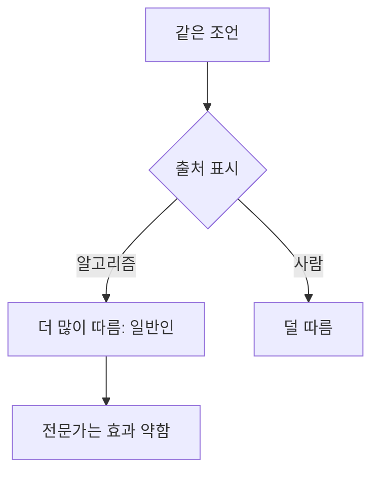

# 알고리즘 호감(algorithm appreciation)

> 일반인이 **같은 조언이라도 알고리즘이 준 것이라 믿으면 사람이 준 것보다 더 따르는** 경향이다(Logg·Minson·Moore, 2019). 알고리즘 회피와 반대 방향의 결과다.

## 쉽게 말하면
"이건 컴퓨터가 계산한 숫자야"라고 하면 "이건 동료의 의견이야"보다 고개를 더 끄덕이는 것이다. 단, 전문가는 오히려 알고리즘을 덜 따르는 경향이 있었다.

## 자세히
(Logg·Minson·Moore, *Organizational Behavior and Human Decision Processes* 2019 논문의 **초록 요약 페이지**만 읽었다. 본문은 읽지 못했다.)
- **설계**: 초록상 여섯 실험(표기는 1A~4). 시각 자극의 수치 추정(실험 1A), 노래 인기와 연애 매력 예측(1B·1C) 등.
- **핵심 결과**: 일반인은 조언이 알고리즘에서 왔다고 믿을 때 **더 많이 조언을 따랐다**. 연구자들은 반대 패턴(저항)을 예상했었다.
- **견고성**: 조언원이 나란히 제시되든 따로 제시되든 유지(실험 2).
- **약해지는 조건**: ① 외부 조언자가 아니라 **자기 추정과 알고리즘 추정 중 고르게** 할 때(실험 3) ② **예측 전문성**이 있을 때(실험 4).
- **역설**: 경험 많은 전문가가 일반인보다 알고리즘 조언을 덜 활용해 **정확도가 떨어졌다**.
- **회피와의 관계**: [알고리즘 회피](#algorithm-aversion) 연구는 알고리즘이 *실수하는 것을 본 뒤*를 다루고, 호감 연구는 *오류를 본 적 없는 상황*의 일반인을 다룬다. 어느 쪽도 보편적이라 보기 어렵고 과제·경험·전문성에 달렸다(위 두 자료 기준의 해석).

## 그림으로 보기

## 예시
- 신입 직원에게 "AI 분석 결과입니다"라고 건네면 과신해 그대로 따를 수 있다. 근거와 한계를 함께 적는다(제안).
- 교육 소재: 같은 숫자를 "AI가 계산" vs "동료가 계산"으로 표시해 반응을 비교해 보는 실습.

## 헷갈리는 것과 비교
| 개념 | 차이 |
|---|---|
| 알고리즘 호감 | 알고리즘이라 믿으면 더 따름 |
| [알고리즘 회피](#algorithm-aversion) | 실수를 본 뒤 불신 |
| 자동화 편향 | 자동 시스템의 판단을 과도하게 신뢰(이 글에서 다루지 않음) |

## 더 읽을거리
- [Logg, Minson, Moore (2019) — Algorithm appreciation (HKS 소개 페이지)](https://www.hks.harvard.edu/publications/algorithm-appreciation-people-prefer-algorithmic-human-judgment) — 초록 수준만 읽음.
