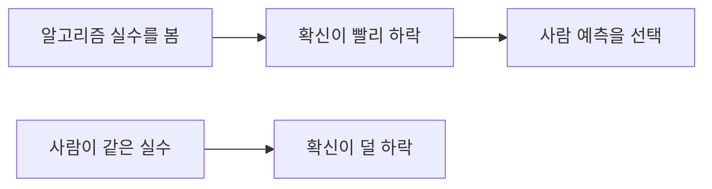

# 알고리즘 회피(algorithm aversion)

> 알고리즘이 **실수하는 모습을 한 번 본 뒤** 그것을 더 빨리 불신하고, 더 나은 알고리즘 대신 못한 사람의 예측을 고르는 경향이다(Dietvorst·Simmons·Massey, 2015).

## 쉽게 말하면
계산기와 암산 달인이 같은 문제를 푸는데, 계산기가 한 번 틀리면 "역시 기계는 못 믿어"가 되고 사람이 한 번 틀리면 "그럴 수 있지"가 되는 것이다. 같은 실수라도 기계에게 더 가혹하다.

## 자세히
(Dietvorst 외 2015, *J. Experimental Psychology: General* 144(1), 114–126 PDF를 직접 읽었다. 논문 본문 일부 표·부록은 훑지 못했다.)
- **현상(논문)**: 증거 기반 알고리즘이 인간 예측자보다 평균적으로 더 정확한데도(논문이 인용한 Grove 외 2000의 136개 연구 메타분석: 알고리즘이 평균 **10%** 우세), 예측을 맡길 때 사람은 인간을 자주 고른다.
- **실험 설계**: **5개 연구**. 참가자가 알고리즘의 예측을 보거나, 사람의 예측을 보거나, 둘 다 보거나, 아무것도 안 본 뒤 **자기 보너스를 알고리즘 또는 사람의 향후 예측에 연동**할지 고른다. 실제 데이터로 예측(예: MBA 지원자의 백분위 예측)했고 모델은 같은 데이터로 만든 통계 모델이다. 연구 3a는 410명, 3b는 1,036명(MTurk).
- **결과(논문)**: 알고리즘이 수행하는 것을 본 참가자는 그것에 **덜 자신**하고 열등한 사람 예측자 대신 알고리즘을 고르는 비율이 낮았다. **알고리즘이 사람을 이기는 것을 본 참가자에게서도** 같았다. 사람이 오차가 거의 2배였던 영역에서도 나타났다.
- **원인(논문)**: 같은 실수를 봤을 때 **알고리즘에 대한 확신이 사람보다 더 빨리 떨어진다**.
- **비용**: 선택하지 않은 참가자는 보너스를 잃었고, 의사결정마다 예측이 필요한 사회 전반에서도 손실이다.
- **한계**: 실험실·온라인 참가자 대상 실험이고 예측 과제다. 후속 연구는 다른 결과를 낸다(예: [알고리즘 호감](#algorithm-appreciation)).

## 그림으로 보기

## 예시
- 사내 AI 보조가 한 번 틀린 뒤 팀원들이 맞는 제안까지 무시하기 시작한다. 정확도와 오류 빈도를 처음부터 알려 두면 첫 실수의 충격이 줄 수 있다(제안).
- 교육 소재: "AI가 한 번 틀리면 우리는 어떻게 반응하나?" 토론.

## 헷갈리는 것과 비교
| 개념 | 차이 |
|---|---|
| 알고리즘 회피 | 실수를 본 뒤 알고리즘을 외면 |
| [알고리즘 호감](#algorithm-appreciation) | 알고리즘 조언을 더 무겁게 따름 |
| [AI 과소의존](#undertrust-ai) | 맞는 AI 조언을 버리는 결과 전반 |

## 더 읽을거리
- [Dietvorst, Simmons, Massey (2015) — Algorithm Aversion](https://faculty.wharton.upenn.edu/wp-content/uploads/2016/11/20-Dietvorst-Simmons-Massey-2015.pdf) — 직접 읽음.
