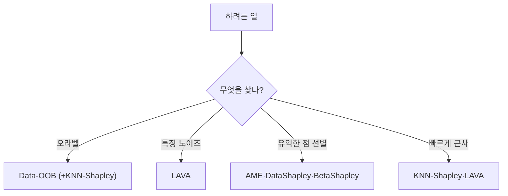
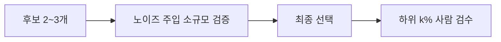

# 과제별 알고리즘 선택

> 데이터 가치 평가에는 **모든 과제에서 가장 좋은 단일 알고리즘이 없다.** OpenDataVal 벤치마크 결과를 근거로 "무엇에 쓸 가치인가"→"어떤 알고리즘을 먼저 시도할까"를 정하는 절차를 둔다.

## 쉽게 말하면
식칼, 빵칼, 과도 중 "가장 좋은 칼"은 없다. 빵을 썰 땐 빵칼이다. 가치 평가 알고리즘도 하려는 일(오라벨 찾기, 유익한 데이터 고르기, 빠른 계산)에 따라 고른다.

## 자세히
(OpenDataVal, arXiv 2306.10577 본문 확인; 11개 알고리즘, 이미지·텍스트·표 데이터)
- **핵심 결론(저자)**: "모든 과제에서 균일하게 가장 좋은 알고리즘은 없다." 그래서 사용자의 하위 과제에 맞는 알고리즘을 써야 한다.
- **벤치마크가 보여 준 장단**
  | 알고리즘 | 강한 과제 | 약한 과제 | 비고 |
  |---|---|---|---|
  | **Data-OOB** | 노이즈 라벨 탐지 | 점 제거(무작위보다 나쁜 경우도) | 저품질 점을 찾는 데 특화 |
  | **LAVA** | 노이즈 **특징** 탐지 | 노이즈 라벨 탐지(무작위 수준) | 모델 학습 없이 계산, 빠름 |
  | **AME** | 점 제거(유익한 점 찾기, LASSO 활용) | 노이즈 탐지(약함) | Data-OOB와 반대 성향 |
  | **KNN-Shapley** | 노이즈 라벨 탐지(2위권), 점 제거 | KNN 예측기에 한정 | **닫힌 형식이라 가장 빠른 축**([KNN 효용](#knn-utility)) |
  | DataShapley·BetaShapley | 균형 있는 성능 | 계산 비용 큼 | 한계 기여 추정에 많은 학습 필요, 다른 예측기에도 사용 가능 |
  | LOO·InfluenceFunction·DataBanzhaf·Volume-based Shapley | 노이즈 라벨 탐지에서 무작위 수준 | - | 점 제거에서는 DataBanzhaf·InfluenceFunction이 견조 |
  | DVRL | 데이터셋마다 편차 큼 | - | |
- **계산 시간(같은 논문)**: LAVA는 모델 학습이 없고 KNN-Shapley는 닫힌 형식이라 **가장 빠르다**. DataShapley·BetaShapley는 한계 기여 추정에 학습이 많이 필요해 **비싸다**. 나머지는 학습할 모델 수 하이퍼파라미터를 1,000으로 같게 두어 시간이 비슷했다.
- **선택 절차(권장)**
  1. **하위 과제 정의**([데이터 가치 평가 하위 과제](#data-valuation-downstream-tasks)): 오라벨 검수인지, 학습 데이터 선별인지, 특징 오염 점검인지.
  2. **후보 2~3개**: 오라벨 → Data-OOB(+KNN-Shapley 빠른 기준선), 특징 오염 → LAVA, 유익 점 선별 → AME/샤플리류.
  3. **소규모 검증**: 일부러 노이즈를 주입한 작은 데이터에서 F1/제거 곡선으로 후보를 비교한다([주입 검증](#injected-noise-validation)).
  4. 비용 제약이면 KNN-Shapley·LAVA로 시작.
  5. 최종적으로 하위 k%를 사람이 검수해 정밀도를 확인([삭제하지 않기](#valuation-vs-deletion)).
- **한계**: 위 평가는 OpenDataVal의 데이터셋·합성 노이즈·로지스틱 회귀 기반이다. 순위는 시드와 데이터에 따라 바뀔 수 있다([가치 순위 안정성](#valuation-ranking-stability)).

## 그림으로 보기

## 예시
- 고객 문의 라벨 10만 건의 오라벨 정제: Data-OOB로 하위 3% 후보, KNN-Shapley(임베딩 위)로 같은 하위 3%와의 겹침 확인 → 둘 다 지목한 점부터 검수.
- 학습 데이터 비용 절감(유익한 점 유지 후 나머지 샘플링): 점 제거 곡선이 좋은 AME·샤플리류를 후보로.

## 헷갈리는 것과 비교
| 선택 기준 | 설명 |
|---|---|
| 하위 과제 | 가장 먼저 정할 것 |
| 계산 비용 | 샤플리류는 비쌈, LAVA·KNN은 저렴 |
| 예측기 제약 | KNN-Shapley는 KNN 한정 |
| 안정성 | 시드·데이터에 따른 순위 변동 |

## 더 읽을거리
- [OpenDataVal (arXiv 2306.10577)](https://arxiv.org/abs/2306.10577) — 11개 알고리즘 벤치마크와 결론(PDF 본문 확인).
