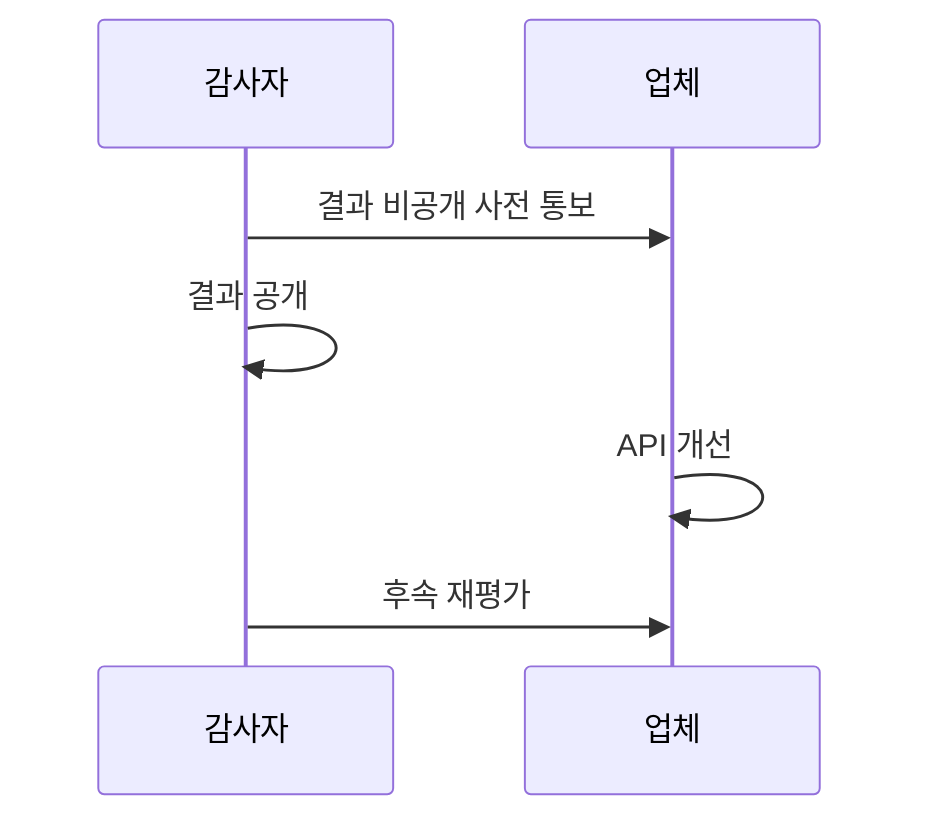
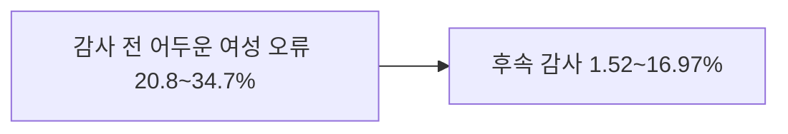

# 알고리즘 감사

> 외부 연구자가 제품(알고리즘)을 블랙박스로 시험해 집단별 성능 격차 같은 문제를 밝히고, 공개해 개선을 이끄는 검증 방식이다. Gender Shades가 대표 사례다.

## 쉽게 말하면
소비자 단체가 자동차를 사서 충돌 시험을 하고 결과를 공개하는 것과 같다. 제작사의 말이 아니라 독립 시험 결과로 책임을 묻는다.

## 자세히
(Gender Shades와 Raji & Buolamwini 2019 "Actionable Auditing"을 하위 에이전트가 읽은 노트 기준. 더 넓은 감사 문헌은 미확인.)
- **Gender Shades 방식**: Microsoft·IBM·Face++의 얼굴 성별 분류 API를 PPB로 블랙박스 평가하고, 발표 전에 업체에 **비공개로 먼저 통보**했다.
- **후속 감사(2018.8.21 결과)**: 세 업체 모두 7개월 안에 새 API를 냈고, 어두운 피부 여성 오류가 **17.7~30.4%p 감소**(현재 MSFT 1.52%, Face++ 4.1%, IBM 16.97%). 전체 오류는 MSFT 0.48%, Face++ 1.6%, IBM 4.41%.
- **비대상 업체**: 감사 대상이 아니었던 Amazon(어두운 여성 31.37%, 전체 8.66%)과 Kairos(22.50%, 6.60%)는 격차가 컸다. 즉 공개 감사가 대상 업체의 개선을 이끌었음을 시사한다(인과 단정은 어렵다, 제안).
- **설계 원칙(제안)**: ① 공개 가능한 평가 데이터 ② 사전 통보와 응답 기간 ③ 집단별 결과 투명 공개 ④ 반복 감사로 개선 확인.
- **한계**: 외부 감사는 API 접근 범위에 한정되고 학습 데이터·내부 구조는 볼 수 없다.

## 그림으로 보기

## 예시
- 사내 AI 도입 전 외부 테스트 세트로 집단별 성능표를 요구하는 구매 기준.
- 교육 활용: 외부 감사와 내부 감사의 차이를 사례로 설명.

## 헷갈리는 것과 비교
| 개념 | 차이 |
|---|---|
| 외부 감사 | 독립 제3자가 블랙박스 평가 |
| 내부 감사 | 개발사 내부 점검 |
| [교차 평가](#intersectional-evaluation) | 감사에서 쓰는 평가 설계 |

## 더 읽을거리
- [Actionable Auditing (AIES 2019)](https://dam-prod.media.mit.edu/x/2019/01/24/AIES-19_paper_223.pdf) — 후속 감사 결과.
- [Gender Shades (PMLR 81)](http://proceedings.mlr.press/v81/buolamwini18a/buolamwini18a.pdf) — 원 감사.
