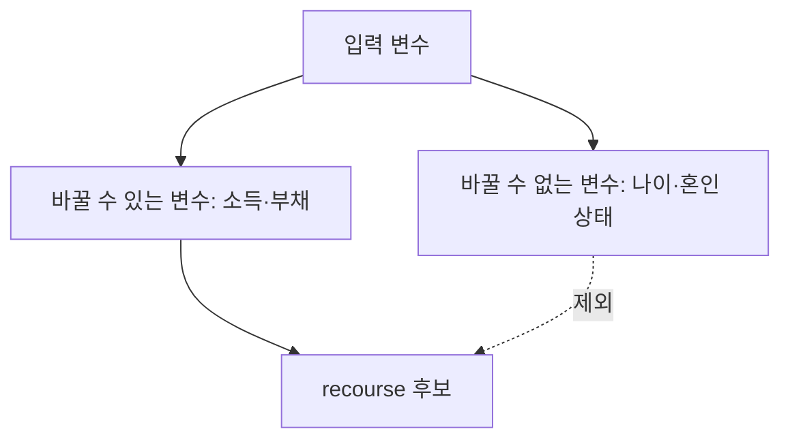

# 알고리즘적 대안 제시

> 모델이 거절·불리한 결정을 내렸을 때, "무엇을 어떻게 바꾸면 결과가 달라지는가"를 사람이 실제로 실행할 수 있는 형태로 알려 주는 일이다. 반사실 설명(counterfactual explanation)과 가까운 개념이다.

## 쉽게 말하면
대출 거절 통지서에 "점수가 낮아서"라고만 적혀 있으면 막막하다. 대신 "연체 기록 없이 6개월 유지하고 카드 한도 사용률을 30% 아래로 낮추면 승인될 수 있습니다"라고 쓰여 있으면 다음 행동을 정할 수 있다. 이 처방전이 알고리즘적 대안 제시(recourse)다.

## 자세히
(두 논문의 초록을 직접 확인. 구체 알고리즘·실험 수치는 초록에 없어 확인하지 못했다.)
- **반사실 설명(Wachter·Mittelstadt·Russell, arXiv:1711.00399, Harvard JOLT 2018)**: GDPR이 "설명을 받을 권리"를 주는지 논쟁이 있는 상황에서, 복잡한 시스템의 내부 작동을 설명하는 것은 법적·기술적 장벽이 있고 당사자에게 별 의미가 없을 수 있다고 본다. 대신 **"원하는 결과를 얻기 위해 세상에서 바꿀 수 있는 가장 작은 변화"** 를 알려 주는 무조건적 반사실 설명을 제안한다. 블랙박스를 열지 않고도 가능하다고 주장한다. 설명의 세 목표: ① 왜 그런 결정이 났는지 이해 ② 원치 않는 결과에 이의를 제기할 근거 ③ 현재 모델 기준으로 미래에 원하는 결과를 얻으려면 무엇이 바뀌어야 하는지. 저자들은 세 목표 각각이 GDPR에서 근거를 찾을 수 있다고 평가한다(저자 주장).
- **Recourse의 정의(Ustun·Spangher·Liu, arXiv:1809.06514, 초록 확인)**: "**실행 가능한(actionable) 입력 변수를 바꿔 모델의 결정을 바꿀 수 있는 능력**". 예: 소득은 바꿀 수 있지만 나이나 혼인 상태는 그렇지 않다. 저자들은 선형 분류기가 recourse를 제공하는지 점검하는 **정수 계획법 도구**를 만들고 신용 평가 문제에서 시험했다. 표준적인 모델 개발 관행이 사람들이 가진 recourse의 크기를 크게 바꿀 수 있으며, **recourse는 가정할 것이 아니라 실제로 평가해야 한다**고 주장한다.
- **실행 가능성이 핵심**: "나이를 5살 줄이세요" 같은 제안은 반사실로는 맞아도 대안이 될 수 없다. 변경 가능한 변수만 쓰고, 변경 비용·시간도 고려해야 한다(일반적 지적).
- **교육·정책 연결(제안)**: 자동화된 결정에 대한 설명 요구 권리 논의([설명요구 이용 현황](#explanation-request-trend), [공식 통계 출처](#automated-decision-stats-source))에서 "설명이 이용자에게 실제로 쓸모 있게 하려면"의 한 방법으로 소개할 수 있다.
- **한계**: 모델이 바뀌면 대안도 무효가 될 수 있고, 다수가 같은 대안을 따르면 모델의 기준이 변한다(일반적 지적, 이번에 출처 미확인).

## 그림으로 보기

## 예시
- 신용 평가 거절 통지: "최근 6개월 내 연체 건수 0, 카드 사용률 30% 미만이면 재심사 시 승인 가능"(가상 예시).
- 채용 선별 AI를 도입하는 기업이 불합격자에게 "어떤 자격·경력 항목이 보완되면 통과할 수 있는지"를 알려 주는 안내문 설계(제안).

## 헷갈리는 것과 비교
| 개념 | 차이 |
|---|---|
| 알고리즘적 대안 제시(recourse) | 사람이 실행 가능한 변경으로 결과 바꾸기 |
| 반사실 설명 | 결과를 바꾸는 가장 작은 변화를 서술 |
| 특징 중요도 설명 | 어떤 입력이 결정에 영향을 줬는지 |
| [PIPA 대응권](#pipa-automated-decision) | 자동화된 결정에 대한 법적 권리 |

## 더 읽을거리
- [Counterfactual Explanations without Opening the Black Box (arXiv:1711.00399)](https://arxiv.org/abs/1711.00399) — 반사실 설명 제안과 GDPR(초록 직접 확인).
- [Actionable Recourse in Linear Classification (arXiv:1809.06514)](https://arxiv.org/abs/1809.06514) — recourse 정의와 선형 분류기 점검(초록 직접 확인).
