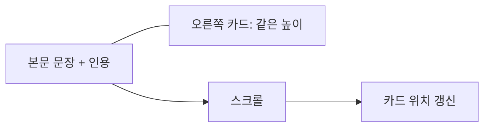

# 정렬 사이드바 인용

> 본문의 인용과 **세로 위치를 맞춘 출처 카드를 옆 사이드바에 상시 표시**하는 방식이다. 스크롤하면 카드 위치가 함께 갱신된다.

## 쉽게 말하면
책의 옆 여백 주석처럼, 문장 바로 옆에 근거 카드가 붙어 있어 시선만 옮기면 확인할 수 있다.

## 자세히
(He·Liu, arXiv 2601.14611 HTML 본문 앞부분을 직접 읽었다. 사전 인쇄본이다.)
- **설계(논문)**: 고정 사이드바가 **본문 인용과 세로로 정렬된** 출처 카드를 보여 준다. 카드는 슬라이드로 나타나고 스크롤·창 크기 변경에 맞춰 위치가 갱신된다.
- **결과(논문)**: 인용 밀도(응답 안의 인용 수, 연속 변수)가 높을수록 **비판적 사고 점수가 올랐다** — 종합하기(Synthesizing) β=0.07(p<.01), 출처 관련 사고 β=0.02(p<.01). 하지만 **밀도가 낮을 때는 부정적 주효과**(예: 종합하기 β=−1.53, p<.05), 유용성 평가도 기준 조건보다 낮았다(β=−1.41, p<.05).
- **의미(해석)**: 인용이 많은 답변에는 사이드바가 유리하고, 인용이 적을 때는 공간만 차지할 수 있다. 저자는 단일 최선이 없다며 적응형 인터페이스를 제안한다.
- **한계(논문)**: 프롬프트 분석 없음, 장기 효과 미지, 적응형 인터페이스는 미시험. 조건 수 불일치(4 vs 5)와 유용성 상호작용이 경계 수준(p≈.05).

## 그림으로 보기

## 예시
- 긴 보고서형 답변(인용 10개 이상)에는 사이드바, 짧은 답변에는 호버 카드를 쓰는 적응형 설계를 시험한다(제안).

## 헷갈리는 것과 비교
| 방식 | 인용이 많을 때 | 인용이 적을 때 |
|---|---|---|
| 정렬 사이드바 | 비판적 사고 점수 ↑ | 부정적 효과 |
| [호버 카드](#hover-card-citation) | 증거 평가 ↑, 부담 ↑ | – |
| [인용 밀도](#citation-density) | 효과를 바꾸는 변수 | |

## 더 읽을거리
- [He & Liu (arXiv 2601.14611)](https://arxiv.org/html/2601.14611v1) — 직접 읽음(앞부분).
