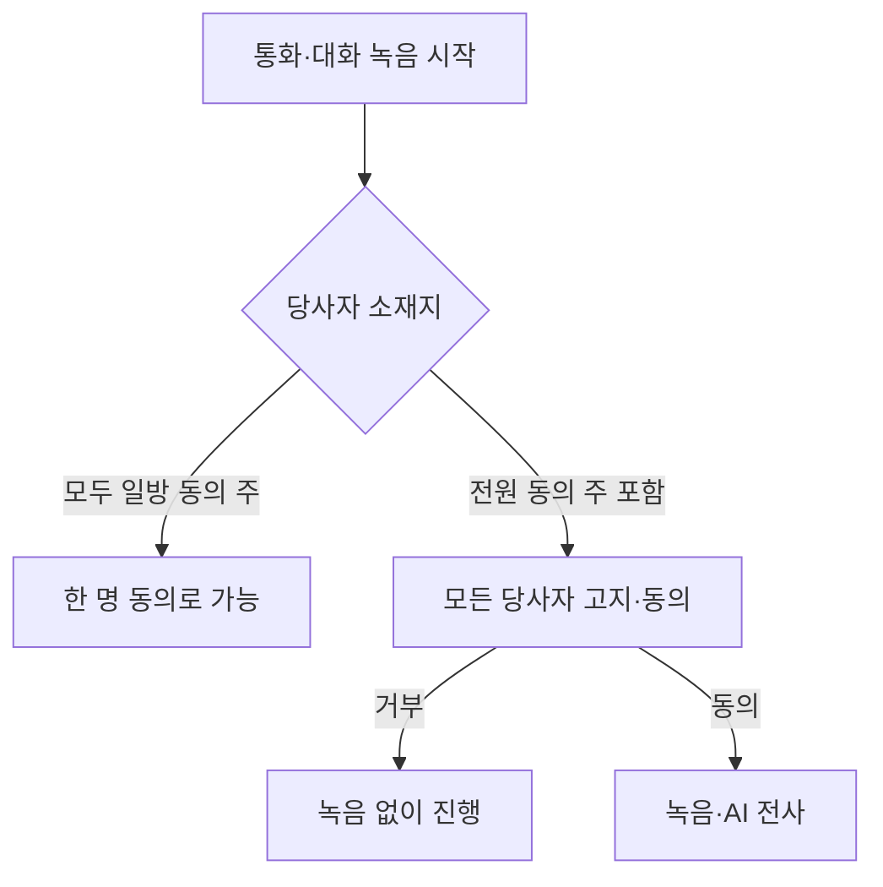

# 전원 동의(all-party consent)

> 대화를 녹음하려면 모든 대화 당사자가 동의해야 한다는 법 규칙. 대화 한쪽 동의로 충분한 "일방 동의(one-party)"와 대비된다. 미국은 주마다 다르다. (법률 자문 아님)

## 쉽게 말하면
회의 녹음을 시작할 때 "녹음해도 될까요?"를 모두에게 묻고 한 사람이라도 거절하면 못 하는 규칙이다. AI 서기·콜센터 AI는 통화마다 녹음·전사하므로 이 규칙에 직접 걸린다.

## 자세히
출처는 로펌·정보 사이트 요약(법조문 원문 아님). 시행 전 주 법 원문과 변호사 확인 필요.
- **연방 기준**: 연방 도청법은 대화 참여자 한 명이 동의하면 대체로 허용(범죄·불법 목적 제외). 요약 자료가 조문을 직접 인용하진 않았다(통상 18 U.S.C. § 2511(2)(d)로 알려짐).
- **전원 동의 주(자료마다 목록이 다름)**: 가장 흔한 목록은 캘리포니아, 델라웨어, 플로리다, 일리노이, 메릴랜드, 매사추세츠, 몬태나, 네바다, 뉴햄프셔, 펜실베이니아, 워싱턴(11개). 코네티컷·미시간·오리건·버몬트를 더하는 자료도 있고, 통화만 전원 동의인 혼합 주도 있다.
- **예시 조항(요약 자료 기준)**: 캘리포니아 형법 632조(비밀 대화), 플로리다 934.03(2)(d), 일리노이 720 ILCS 5/14-2, 펜실베이니아 18 Pa.C.S. 5704(동의 없는 녹음은 3급 중죄), 워싱턴 RCW 9.73.030(경범죄+민사 소송 가능).
- **주 경계 통화**: 한쪽이 전원 동의 주면 더 엄격한 규칙을 따르는 것이 안전하다는 설명이 일반적. 캘리포니아 대법원이 한쪽 당사자가 캘리포니아에 있으면 그 규칙이 적용된다고 본 판결이 있다고 한 자료가 적었다(미확인).
- **AI 적용**: 통화·진료 녹음 시작 전 고지와 동의 확보, 동의 거부 경로(녹음 없이 진행)를 설계. 소송 사례는 [CIPA 소송](#cipa-lawsuits), 한국은 [통신비밀보호법](#kr-communication-secrecy-law).

## 그림으로 보기

## 예시
- 콜센터 AI: 통화 첫머리 "품질 및 AI 기록을 위해 녹음됩니다. 동의하시면 계속하세요" 안내 후 계속 = 암묵 동의 근거로 쓰는 실무가 흔하다(법적 충분성은 사안별).
- 진료 AI 서기: 진료실 입장 때 서면 동의서 + 거부 옵션.

## 헷갈리는 것과 비교
| 개념 | 차이 |
|---|---|
| 일방 동의 | 당사자 한 명 동의면 충분 |
| 전원 동의 | 모든 당사자 동의 |
| [BAA](#business-associate-agreement) | 업체와의 정보 취급 계약(녹음 동의와 별개) |

## 더 읽을거리
- [Wiretap Laws in the United States (Kilpatrick)](https://ktslaw.com/en/Blog/GlobalPrivacy-and-CybersecurityLaw/2024/7/Wiretap-Laws-in-the-United-States) — 주별 도청법 정리(검색 결과로만 확인)
