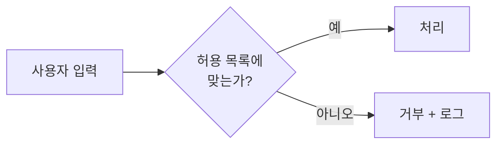
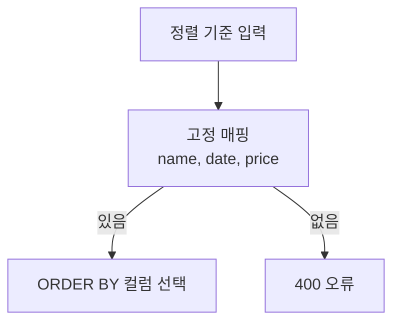

# 허용 목록 검증 (Allowlist Validation)

> 허용 목록 검증은 "허용할 값의 형태를 정의하고 그 외는 전부 거부"하는 입력 검증 방식이다. 위험한 것을 나열해 막는 거부 목록(denylist)의 반대다.

## 쉽게 말하면
행사장 입장에서 "명단에 있는 사람만 입장"하는 것이 허용 목록이고, "수상한 사람은 막기"가 거부 목록이다. 수상한 사람의 모습은 끝없이 변하지만 명단은 유한하다. 그래서 명단 쪽이 뚫리기 어렵다.

## 자세히
OWASP Input Validation Cheat Sheet 기준:
- **허용 목록**: 받아들일 값을 정의하고 나머지는 거부. 거부 목록으로 모든 악성 문자열을 잡으려 하면 실패한다. 아포스트로피를 지우는 식의 처리는 정상 입력(O'Brien)을 막으면서 안전도 보장하지 못한다.
- **구문(syntactic) 검증**: 타입·형식 확인(올바른 날짜인가). **의미(semantic) 검증**: 업무상 말이 되는가(종료일이 시작일보다 뒤인가).
- 서버에서 반드시 검증(클라이언트 검증은 사용자 안내용). 요청 크기·중첩 깊이 제한, 스키마로 필수·허용 필드를 정의, 잘못되면 부분 처리 말고 명확히 거부.
- 정규식은 값 **전체**에 매칭하고 길이를 제한하며 백트래킹 폭주를 피한다.
- 검증은 SQL 이스케이프·출력 인코딩·권한 검사를 **대체하지 못한다**. SQL 인젝션은 [파라미터화 쿼리](#sql-injection)가 본 방어이고, 허용 목록은 그 앞의 보조 방어선이다. 테이블·컬럼명처럼 파라미터로 못 넘기는 값은 허용 목록(고정 매핑)이 사실상 유일한 방법이다.

## 그림으로 보기



## 예시
```python
ALLOWED_SORT = {"name": "name", "date": "created_at", "price": "price"}
col = ALLOWED_SORT.get(request.args.get("sort"))
if col is None:
    abort(400)
sql = f"SELECT * FROM items ORDER BY {col}"  # 사용자 문자열이 아니라 매핑된 값만 들어감
```
AI 에이전트가 만든 도구 호출 인자도 같다. 모델이 넘긴 값은 "신뢰할 수 없는 입력"으로 보고 허용 값만 통과시킨다.

## 헷갈리는 것과 비교
| 개념 | 차이 |
|---|---|
| 허용 목록 | 정의된 것만 통과 |
| 거부 목록 | 알려진 나쁜 것만 차단(우회 쉬움) |
| 이스케이프/인코딩 | 값을 안전하게 "표현"하는 처리, 검증과 별개 |
| [SQL 인젝션](#sql-injection) 방어 | 파라미터화가 본 방어, 검증은 보조 |

## 더 읽을거리
- [OWASP Input Validation Cheat Sheet](https://cheatsheetseries.owasp.org/cheatsheets/Input_Validation_Cheat_Sheet.html) — 허용 목록·구문/의미 검증·실무 권고.
