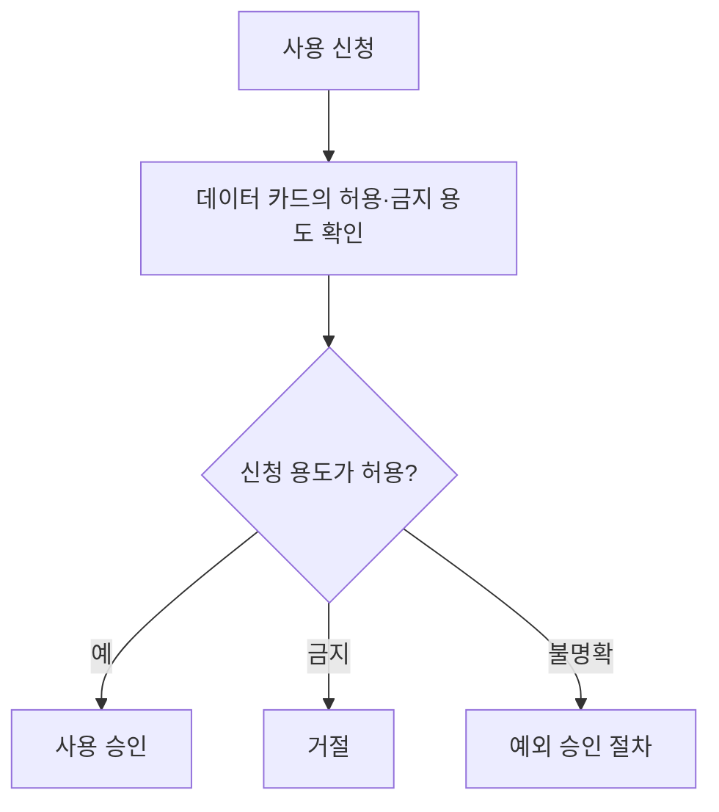
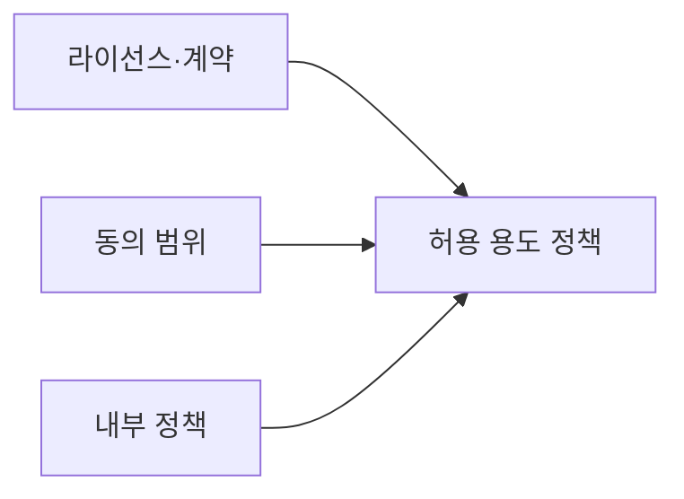

# 데이터 허용 용도 정책

> 데이터셋마다 **쓸 수 있는 용도(허용)와 쓰면 안 되는 용도(금지)를 명시하는 규칙**이다. 라이선스·계약·개인정보 동의 범위·편향 한계가 용도를 제한하므로, 카드에 적고 사용 신청 때 확인한다.

## 쉽게 말하면
약 상자의 "용도: 두통, 금지: 임산부"와 같다. 데이터도 "내부 검색 개선은 가능, 외부 모델 학습은 금지"처럼 용도를 붙여 두어야 사람들이 몰라서 어기는 일이 줄어든다.

## 자세히
- **카드 템플릿의 용도 칸(Hugging Face 데이터셋 카드 템플릿, 소스 파일 직접 확인)**: "Uses" 아래에 **Direct Use**(적합한 용도)와 **Out-of-Scope Use**(오용·악의적 사용·데이터셋이 잘 맞지 않는 용도)를 둔다. 또 **Bias, Risks, and Limitations**(기술적·사회기술적 한계)와 **Recommendations**(위험·편향·한계에 대한 안내. 기본 문구는 사용자가 위험을 알게 해야 한다는 내용), 데이터 출처·수집·주석 과정을 적는 Dataset Creation 항목이 있다.
- **메타데이터(HF 문서, 직접 확인)**: 카드 상단 YAML에 `license`, `language`, `task_categories`, `tags`를 적고 이는 검색·필터에 쓰인다. 허용 용도를 기계가 읽을 수 있게 하려면 `license` 같은 표준 키를 쓰되, 문서는 "용도 제한" 전용 키를 제시하지 않는다(이번에 확인한 범위).
- **정책 구성 요소(제안, 이 지도의 정리)**
  1. 허용 용도: 내부 분석, 제품 개선, 모델 학습(내부용) 등을 열거
  2. 금지 용도: 외부 공개, 경쟁 모델 학습, 개인 식별 시도 등
  3. 근거: 라이선스 조항·계약·동의 범위·내부 정책에 링크([데이터셋 라이선스 체크리스트](#dataset-license-checklist))
  4. 예외 승인 절차와 승인자
  5. 위반 시 조치와 점검 주기
- **연결**: 사내 카드 운영은 [사내 데이터 카드](#internal-data-card), 책임자는 [데이터 오너와 스튜어드](#data-owner-steward), 거버넌스 틀은 [5259-5](#iso-5259-part5-governance).
- **한계**: 용도 구분이 모호하면(예: "분석" vs "학습") 정의 예시를 함께 적어야 한다. 이 글은 HF 템플릿의 칸 구성을 근거로 한 제안이며 법적 효력을 보장하지 않는다.

## 그림으로 보기

## 예시
- 고객 상담 로그: 허용 "상담 품질 분석·내부 챗봇 평가", 금지 "외부 모델 사업자에 제공·개인 식별".
- 교육 소재: 같은 데이터에 대한 세 가지 사용 신청서를 주고 승인·거절 사유를 정당화해 보는 활동.

## 헷갈리는 것과 비교
| 개념 | 차이 |
|---|---|
| 허용 용도 정책 | 어디에 써도 되는지 규정 |
| 라이선스 | 법적 사용 조건(근거) |
| [사내 데이터 카드](#internal-data-card) | 정책을 담는 문서 |
| [데이터 카드 도입 규칙](#internal-data-card-adoption) | 카드 없이는 사용 금지 같은 운영 규칙 |

## 더 읽을거리
- [HF 데이터셋 카드 템플릿](https://raw.githubusercontent.com/huggingface/huggingface_hub/main/src/huggingface_hub/templates/datasetcard_template.md) — Uses/Out-of-Scope 칸(직접 확인).
- [HF Dataset Cards 문서](https://huggingface.co/docs/hub/datasets-cards) — 메타데이터·카드 개요(직접 확인).
