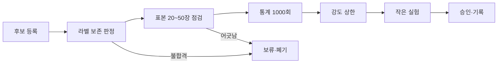
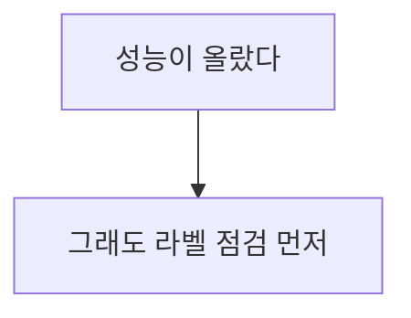

# 허용 목록 승인 절차

> 새 증강 변환을 파이프라인에 넣기 전에 **표본 점검 → 라벨 보존 판정 → 작은 실험**을 거쳐 승인하는 절차다. "써 보니 성능이 올랐다"만으로 넣지 않고, 라벨이 안 깨졌는지를 먼저 확인한다.

## 쉽게 말하면
새 재료를 식당 메뉴에 넣기 전에 시식(표본 점검), 알레르기 확인(라벨 보존), 소량 시험 판매(작은 실험)를 거치는 것과 같다. 승인 기록이 있으면 나중에 문제가 생겨도 원인을 추적할 수 있다.

## 자세히
- 단계(제안, 앞서 읽은 Albumentations 소개 문서의 권고를 절차화):
  1. **후보 등록**: 변환 이름·매개변수 범위·넣으려는 이유(예: 조명 변동 대응)를 한 줄로 적는다.
  2. **라벨 보존 판정**: "사람 어노테이터가 변환 뒤에도 같은 라벨을 달까?"([도메인 전문가 증강 검토](#domain-expert-augmentation-review)). 방향 의존 클래스·좌우 라벨은 별도 규칙([좌우 라벨 동반 반전](#laterality-label-flip)).
  3. **표본 점검**: 변환 적용본 20~50장에 정답을 겹쳐 그려 어긋남(박스가 물체를 벗어남, 마스크 틀어짐, 범위 밖 키포인트)을 본다. 문서는 증강 버그가 "예외를 거의 일으키지 않아" 시각 점검이 필요하다고 한다([박스 그려 보기 점검](#draw-bbox-sanity-check)).
  4. **통계 점검**: 1,000회 실행해 빈 샘플 비율·클래스 생존율이 기준 안에 있는지([증강 통계 스크립트](#augmentation-stats-script)).
  5. **강도 상한 결정**: 회전각처럼 박스 오차를 키우는 매개변수의 상한을 정한다(정사각 박스는 15°에서 면적 1.5배, [증강 강도 제한](#augmentation-strength-limits)).
  6. **작은 실험**: 같은 설정·여러 시드로 변환 유무를 비교한다([증강 기준선 관행](#augmentation-baseline-practice)). 개선이 시드 간 변동 안이면 넣지 않는다.
  7. **승인 기록**: 변환·범위·승인자·날짜·근거(표본 이미지 링크, 실험 결과)를 남기고, 데이터·과제가 바뀌면 재검토한다.
- 거부 기준 예시: 표본에서 라벨 불일치가 1건이라도 보이면 원인을 해결하기 전까지 보류, 빈 샘플 비율이 정한 상한 초과, 개선이 시드 변동 이내.
- 한계: 20~50장은 드문 오류를 놓칠 수 있다. 중요한 서비스는 표본 수를 늘리고 배포 후 모니터링으로 보완한다(제안).

## 그림으로 보기

## 예시
| 단계 | 산출물 |
|---|---|
| 후보 등록 | "ColorJitter 밝기 ±0.1, 조명 변동 대응" |
| 표본 점검 | 50장 이미지 + 점검 체크표 |
| 작은 실험 | 시드 3회 평균 mAP 비교표 |
- 교육: 팀에 승인 양식을 배포해 증강 도입을 표준화.

## 헷갈리는 것과 비교
| 개념 | 차이 |
|---|---|
| 허용 목록 승인 | 변환별 도입 절차 |
| 코드 리뷰 | 코드 품질 점검(라벨 의미 점검은 별도) |
| 모델 평가 | 학습 결과 점검(증강 입력 점검은 별도) |

## 더 읽을거리
- [Albumentations: What Is Image Augmentation?](https://albumentations.ai/docs/1-introduction/what-are-image-augmentations/) — 라벨 보존 기준과 표본 점검 권고(읽음).
