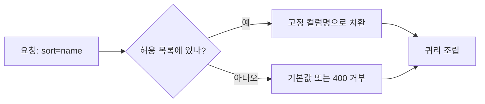

# 허용 목록 검증

> 허용 목록(allow-list) 검증은 사용자 입력을 그대로 쓰지 않고, 앱이 미리 정한 값 목록 중 하나로 변환하거나 거부하는 방식이다. 바인딩할 수 없는 SQL 부분(정렬 컬럼, ASC/DESC)에 쓴다.

## 쉽게 말하면
식당 주문에서 "메뉴판에 있는 번호만" 받는 것과 같다. 손님이 자유롭게 요리 이름을 적게 하면 주방이 이상한 요청까지 받는다. 메뉴판 밖의 요청은 기본 메뉴로 바꾸거나 거절한다.

## 자세히
OWASP SQL Injection Prevention Cheat Sheet 요지:
- 파라미터 마커는 **데이터 값**만 묶는다. 테이블명·컬럼명·`ASC`·`DESC` 같은 키워드는 묶지 못한다.
- 사용자가 고르게 해야 하면, 앱이 소유한 소수의 허용 토큰으로 **매핑**하고 그 밖은 거부한다. 정렬 방향은 요청을 리터럴 `ASC`/`DESC`로 바꾼다.
- 식별자를 따옴표로 감싸는 것은 문법만 보호할 뿐 어떤 테이블을 조회해도 되는지는 제한하지 못한다. 접근 제어를 위해 allow-list가 필요하다.
- 값 검증은 [파라미터화 쿼리](#sql-injection)를 대체하지 않는다. 데이터 값은 계속 바인딩한다.
- ORM에서도 정렬 필드를 문자열로 받는 순간 같은 문제가 생긴다([ORM 인젝션](#orm-injection)).

## 그림으로 보기


## 예시
```python
SORT = {"name": "name", "date": "created_at"}
DIR = {"asc": "ASC", "desc": "DESC"}
col = SORT.get(sort_by, "created_at")
d = DIR.get(order, "ASC")
q = f"SELECT * FROM products ORDER BY {col} {d}"
```
사용자 문자열은 SQL 텍스트에 들어가지 않고 코드가 가진 상수만 들어간다.
AI에게 "정렬 필드는 허용 목록 맵으로 처리해 줘"라고 지시한다.

## 헷갈리는 것과 비교
| 개념 | 차이 |
| --- | --- |
| 허용 목록 | 통과시킬 것만 명시 |
| 차단 목록 | 나쁜 것만 막음, 우회되기 쉬움 |
| 파라미터 바인딩 | 데이터 값 전용, 식별자엔 불가 |

## 더 읽을거리
- [OWASP SQL Injection Prevention Cheat Sheet](https://cheatsheetseries.owasp.org/cheatsheets/SQL_Injection_Prevention_Cheat_Sheet.html) — 식별자와 키워드 처리
- [OWASP Query Parameterization Cheat Sheet](https://cheatsheetseries.owasp.org/cheatsheets/Query_Parameterization_Cheat_Sheet.html) — 파라미터화 쿼리
