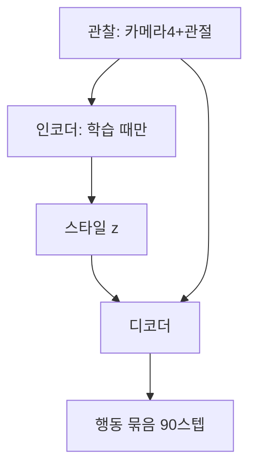

# ALOHA와 ACT

> **ALOHA**는 약 2만 달러 예산으로 만든 오픈소스 양팔 원격조종 하드웨어이고, **ACT**는 그 시연 데이터로 행동을 묶음(chunk)째 예측하도록 학습하는 [모방 학습](#imitation-learning) 알고리즘이다(Zhao 외, 2023, arXiv 2304.13705).

## 쉽게 말하면
ALOHA는 사람이 두 팔로 조종하며 "이렇게 하는 거야" 하고 보여 주는 연습 도구, ACT는 그 동작을 한 동작씩이 아니라 "몇 초 분량의 동작 한 토막"씩 외워 따라 하는 학생이다. 토막 단위로 생각하니 중간에 흔들려도 덜 틀어진다.

## 자세히
- 프로젝트 페이지 기준 ALOHA는 $20k 예산 하드웨어로, 지퍼타이 끼우기(정밀)·탁구공 저글링(동적)·NIST 보드 체인 조립(접촉이 많은 작업) 등을 원격조종으로 시연한다.
- ACT 구조: 조건부 VAE의 디코더로 학습. 인코더가 행동열+관절 값을 스타일 변수 z로 압축하고, 둘 다 트랜스포머. **테스트 때는 인코더를 버리고 z=0**.
- 설정: 관절 위치를 50Hz로 출력, 에피소드 600~1,000 스텝, 과제당 **시연 50개**, 카메라 4대(고정 2·손목 2, 480×640 RGB). **chunk 크기**는 프로젝트 페이지 요약에서는 90으로 읽었으나, 논문 PDF의 하이퍼파라미터 표(2026-11-28 직접 확인)에는 **100**으로 적혀 있다 — 논문 값을 따른다.
- 효과: 저자 주장으로, 묶음 예측이 유효 시야(horizon)를 줄여 [오차 누적](#compounding-error)을 낮춘다. 초록은 약 10분 시연으로 80~90% 성공이라 요약하지만, **논문 본문의 실제 로봇 6과제 결과는 편차가 크다**(직접 읽음): Slot Battery **96%**, Put On Shoe **92%**, Slide Ziploc **88%**, Cup Open **84%**, Prep Tape **64%**, Thread Velcro **20%**. 즉 "80~90%"는 일부 과제의 값이고 가장 어려운 과제는 20%였다.
- 저가 하드웨어의 부정확함을 모델이 보정하게 한다는 점이 의의.

## 그림으로 보기

## 예시
- 간식 상자에서 지퍼백 열기를 50번 원격조종으로 시연해 학습.
- 교육: "한 걸음씩 vs 한 구간씩 계획"을 길찾기에 빗대어 설명.

## 헷갈리는 것과 비교
| 개념 | 차이 |
|---|---|
| ALOHA | 하드웨어(시연 수집) |
| ACT | 알고리즘(행동 묶음 예측) |
| [UMI 그리퍼](#umi-gripper) | 로봇 없이 손에 쥐고 시연 수집 |

## 더 읽을거리
- [ALOHA 프로젝트 페이지](https://tonyzhaozh.github.io/aloha/) — 설정·과제(읽음).
- [ACT 논문](https://arxiv.org/abs/2304.13705) — 실제 로봇 6과제 결과(본문 읽음).
