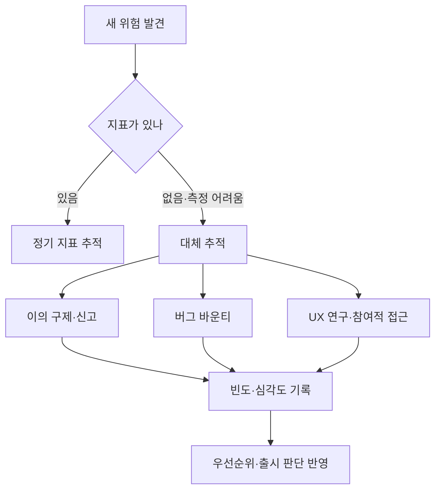

# 대체 추적 방식

> 현재 측정 기술로는 평가하기 어렵거나 지표가 아직 없는 AI 위험을, 숫자 지표 대신 다른 방법(이의 구제, 버그 바운티, 사용자 경험 연구, 영향받는 공동체 참여 등)으로 추적하는 접근. NIST AI RMF MEASURE 3.2가 다룬다.

## 쉽게 말하면
체온계로 못 재는 병도 있다. 그럴 때는 환자의 호소를 듣고, 외부 전문가에게 보이고, 증상이 나타나면 신고받는 식으로 지켜본다. 지표가 없다고 위험을 무시하지 않는 것이 핵심이다.

## 자세히
출처: NIST AIRC Playbook의 MEASURE 3.2(열어서 읽음).
- **초점**: 현재 측정 기술로 위험을 평가하기 어렵거나 지표가 아직 없는 환경에서의 위험 추적 방식. 위험은 복잡하고, 시간이 지나며 나타나고, 재기 어려울 수 있다.
- **제안 행동(요약)**:
  - 현재 측정이 놓치는 새로 생기는 위험을 추적하는 절차를 만든다. 예: 잘못된 출력에 대한 구제(recourse), 버그 바운티, 인간 중심 설계, 사용자 경험 연구, 영향받는 공동체의 참여적 접근
  - 새 위험 추적 담당자를 정하고 쓰고 있는 방법을 목록화
  - 재기 어려운 위험의 발생 빈도와 심각도를 기록하고, 측정 우선순위·자원 배분·개선 평가·출시 여부 결정에 쓴다
- **전문가 검토에 관해**: 3.2가 전문가 검토를 명시적 대체 수단으로 이름 붙이지는 않는다. 관련 지침은 3.3과 4.1에 있고, 도메인 전문가와 함께 피드백을 분석하고 인간 요인·사회기술 전문가와 협의하라고 한다(그래서 "전문가 검토"를 대체 추적 방식의 일부로 보는 것은 이 지도의 해석이다).
- 새로 얻은 측정 방식은 정기 모니터링·개선에 편입할 수 있다.

## 그림으로 보기

## 예시
- 생성형 AI의 미묘한 문화적 편향: 지표가 없으므로 지역 사용자 인터뷰, 외부 버그 바운티, 신고 채널의 사례 모음으로 추적하고 분기마다 빈도·심각도를 정리.
- 점검 질문: "지표 없는 위험의 담당자가 지정돼 있나? 그 기록이 출시 결정에 쓰이나?"

## 헷갈리는 것과 비교
| 개념 | 차이 |
|---|---|
| [이의 제기 채널](#user-appeal-channel) | 3.3, 대체 추적의 입력 중 하나 |
| [위험의 시간별 추적](#risk-tracking-over-time) | 상위 활동 |
| 지표 기반 모니터링 | 숫자 지표가 있는 위험용 |
| [MEASURE 함수](#measure-function) | 상위 단계 |

## 더 읽을거리
- [NIST AIRC Playbook — Measure](https://airc.nist.gov/AI_RMF_Knowledge_Base/Playbook/Measure) — MEASURE 3.2 설명과 제안 행동(열어서 확인)
