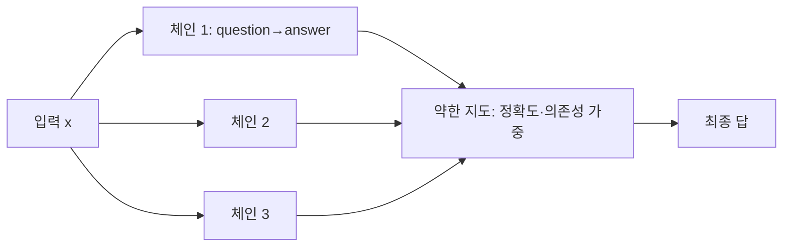
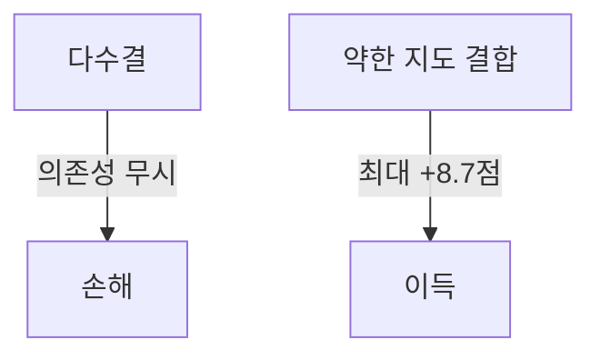

# AMA 프롬프트 결합

> Ask Me Anything(AMA, 2022)은 한 과제를 여러 형태의 프롬프트 체인으로 물어 얻은 답들을 약한 지도(라벨 모델)로 합쳐, 작은 오픈소스 모델도 큰 모델 수준의 성능을 내게 하는 방법이다.

## 쉽게 말하면
한 문제를 한 가지 방식으로만 묻지 않고 "이 말은 맞나요?", "무엇이 사실인가요?"처럼 여러 말투로 물은 다음, 믿을 만한 답변자에게 더 큰 가중치를 두고 합치는 것이다.

## 자세히
(Arora 외, "Ask Me Anything", arXiv 2210.02441 전문을 직접 읽고 확인.)
- **프롬프트 체인**: answer(question(x)). question() 프롬프트가 진술을 질문(예/아니오, 빈칸 등)으로 바꾸고 answer() 프롬프트가 그 질문에 답한다. 체인을 여러 개 만들어 입력마다 여러 표를 얻는다.
- **형식 발견**: 개방형 QA·빈칸 프롬프트가 "True/False로 답하라" 같은 제한 형식보다 낫다. CB·RTE·WSC를 개방형으로 바꾸면 **72% 개선**(3.2절).
- **결합**: 다수결은 프롬프트별 정확도 차이와 의존성을 무시한다. 오류의 자카드 지수가 독립일 때보다 **69% 높다**(오류가 상관됨). AMA는 약한 지도(Snorkel 계열, Varma 2019 의존성 구조)로 합쳐 다수결 대비 **최대 8.7점**, 9개 과제에서 의존성을 복원하면 최대 9.6점 추가.
- **결과**: 20개 벤치마크, 4개 계열 14개 오픈소스 모델(125M~175B). 평균 **10.2% ± 6.1%**p(상대 21.4% ± 11.2%) 개선. **GPT-J-6B가 20개 중 15개에서 few-shot GPT-3 175B와 같거나 더 낫다**(파라미터 약 30배 적음). 입력에 정답 지식이 있는 독해 과제에서 이득이 크고 폐쇄형 지식 질문은 작다.
- 과제별 수치와 체인 개수는 이번에 확인하지 않았다.

## 그림으로 보기

## 예시
- 계약서 조항 분류를 질문 형식 3가지로 묻고 라벨 모델로 합쳐 단일 프롬프트와 비교.
- 교육 활용: "같은 질문을 다르게 묻고 합치면 더 안정된다"는 프롬프트 설계 수업.

## 헷갈리는 것과 비교
| 개념 | 차이 |
|---|---|
| AMA | 다양한 프롬프트 + 약한 지도 결합 |
| 자기 일관성(self-consistency) | 같은 프롬프트 여러 샘플의 다수결 |
| [LLM을 LF로](#llm-as-labeling-function) | AMA의 응용 관점 |

## 더 읽을거리
- [Ask Me Anything (arXiv 2210.02441)](https://arxiv.org/abs/2210.02441) — 방법·결과.
