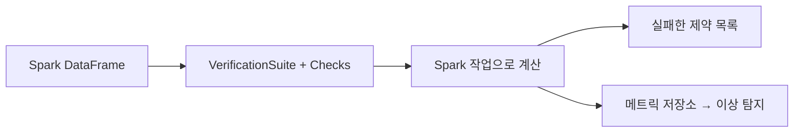
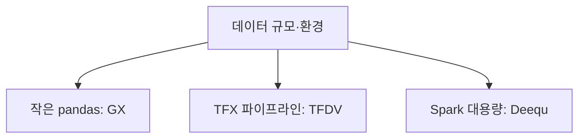

# Amazon Deequ

> Apache Spark 위에서 만든 오픈소스(Apache 2.0) 라이브러리로, 대용량 데이터에 "데이터를 위한 단위 테스트"를 정의해 품질을 측정한다. 파이썬 래퍼 PyDeequ가 있다. 소규모 pandas 데이터가 아니라 Spark에서 돌리는 큰 테이블에 맞는 도구다.

## 쉽게 말하면
작은 가게 검수는 사람이 해도 되지만, 하루에 수억 건이 들어오는 물류 센터에서는 자동 검수 라인이 필요하다. Deequ는 Spark라는 거대한 컨베이어 벨트 위에서 "빈칸 없나, 중복 없나"를 한꺼번에 검사해 주는 검수기다.

## 자세히
(GitHub README를 직접 열어 확인. 이번에 Spark 환경에서 직접 실행해 보지는 못했다.)
- **핵심 기능(README)**
  - **VerificationSuite**: 진입점. 데이터셋에 Check들을 붙여 실행하면 Deequ가 Spark 작업으로 번역·평가하고 실패한 제약을 보고한다.
  - **Check 예시**: `isComplete`(결측 없음), `isUnique`(유일), `hasSize`(행 수), `isContainedIn`(허용 값 안에 있음), URL 패턴, 근사 분위수 검사 등.
  - **제약 제안(Constraint suggestion)**: 큰 데이터셋에 대해 제약을 자동 제안.
  - **메트릭 저장소**: 계산된 품질 지표를 저장·조회.
  - **이상 탐지**: 품질 지표가 시간에 따라 이상하게 변하는지 감지.
  - **프로파일링·증분 계산**: 데이터가 늘거나 파티션이 바뀔 때 지표를 갱신.
  - **DQDL 지원**: `RowCount < 10`, `IsUnique "item"` 같은 선언적 규칙.
- **README 예시(Scala)**: 상품 레코드 DataFrame에 `productName` 완전성과 `id` 유일성 등을 검사해 실패한 제약을 출력한다. 예시에서는 `productName` 완전성(0.8)과 `description`의 URL 검사(0.4) 두 개가 실패한다.
- **버전·환경(README)**: Deequ 2.1.0 이상은 Java 11, 이전 2.0.x는 Java 8이 필요하다. 릴리스마다 `-spark-3.5` 같은 접미사로 대상 Spark 버전이 정해져 있어 자신의 Spark 버전에 맞는 것을 고른다. Spark 3.0.x 이하는 1.x 릴리스이며 `legacy-spark-3.0` 브랜치에서 지원한다.
- **다른 도구와 비교(제안)**: pandas 크기의 데이터와 파이썬 중심이면 [Great Expectations](#great-expectations), TFX 파이프라인이면 [TFDV](#tfdv), Spark 대용량이면 Deequ가 맞는 후보다. 어느 쪽이 낫다는 정량 비교는 이번에 확인하지 못했다.
- **한계**: 규칙은 사람이 정해야 하고, Spark·JVM 환경 구성의 부담이 있다(일반적 지적).

## 그림으로 보기



## 예시
README 예시의 구조(개념):
```scala
// 개념 예: productName 완전성과 id 유일성을 검사
Check(CheckLevel.Error, "integrity checks")
  .isComplete("productName")
  .isUnique("id")
```
(코드는 README 설명을 바탕으로 줄인 개념 예로 직접 실행하지 않았다.)

## 헷갈리는 것과 비교
| 개념 | 차이 |
|---|---|
| Deequ | Spark 기반, 대용량 |
| PyDeequ | Deequ의 Python 래퍼 |
| [Great Expectations](#great-expectations) | 범용 Python, Expectation 중심 |
| [데이터 검증 도구](#data-validation-tools) | 상위 개념 |

## 더 읽을거리
- [awslabs/deequ](https://github.com/awslabs/deequ) — 기능·예시·버전 요건(README 직접 확인).
