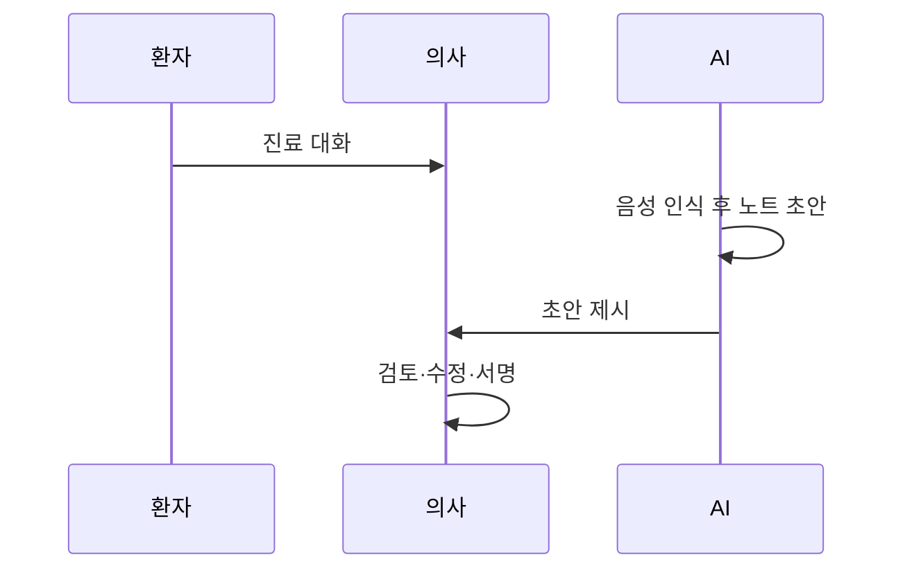

# 앰비언트 스크라이브

> 진료 대화를 듣고 의무 기록 초안을 자동으로 쓰는 AI. 의사는 초안을 검토·수정해 서명한다.

## 쉽게 말하면
회의록 담당자가 옆에서 받아 적고 정리해 주는 것과 같다. 의사는 환자를 보고, 기록은 초안으로 받는다.

## 자세히
- **작동(일반 지식)**: 음성 인식 → LLM이 노트 초안 작성 → 임상의 검토.
- **UCLA Health 무작위 시험(NEJM AI, 2025-11-26 보도자료)**: 의사 238명·14개 전문과·약 72,000 진료, 2024-11~2025-01, 3개 군(Microsoft DAX Copilot, Nabla, 일반 진료). Nabla는 노트 작성 시간 9.5% 감소(95% CI -17.2~-1.8, P=0.02; 평균 4:30→3:49), DAX는 -1.7%로 유의하지 않았다(P=0.66). 두 도구 모두 번아웃 점수 약 7% 개선(저자는 "경미"하다고 평가). 임상적으로 의미 있는 부정확이 "가끔" 발생(주로 누락·대명사 오류), 경미한 이상 사례 1건. 한계: 단일 기관·단기.
- **환자 동의**: UCLA는 환자 10% 미만이 거부했다고 밝힌다. 녹음 동의 부족을 이유로 한 집단소송 보도가 있으나(검색 확인) 주장 단계다.
- 오류율에 관한 블로그 수치(환각 11.5% 등)는 원 연구를 확인하지 못해 인용하지 않는다.

## 그림으로 보기

## 예시
외래 진료 종료 직후 SOAP 노트 초안이 EHR에 뜨고, 의사가 누락된 약 용량을 고쳐 서명한다.

## 헷갈리는 것과 비교
| 개념 | 차이 |
| --- | --- |
| 스크라이브 | 문서화 보조 |
| [FDA 규제 AI 기기](#fda-ai-devices) | 진단·판독 중심, LLM 표시 계획 중 |
| [의료 AI](#ai-in-healthcare) | 상위 개념 |

## 더 읽을거리
- [UCLA Health: AI scribes may reduce documentation time](https://www.uclahealth.org/news/release/ucla-study-finds-ai-scribes-may-reduce-documentation-time) — 시험 결과(보도자료)
