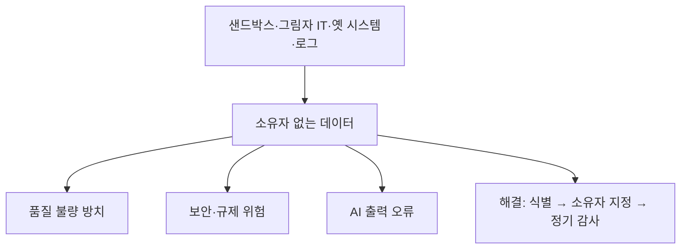
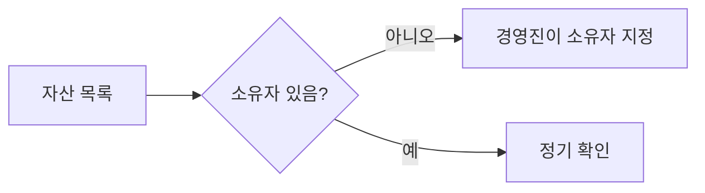

# 책임이 모호한 데이터

> **주인이 없거나, 주인이 여럿이라 아무도 책임지지 않는 데이터**다. 품질이 나빠져도, 보안 구멍이 생겨도, 지워야 할 때가 와도 "누가 결정하나"가 비어 있어 방치된다. ISO/IEC 5259-5는 5.2절에서 "책임이 모호한 데이터"를 거버넌스가 다뤄야 할 배경 문제로 둔다.

## 쉽게 말하면
공용 냉장고에 오래 방치된 반찬통을 떠올리면 된다. 누구 것인지 모르니 버릴지 말지 결정할 사람이 없고, 계속 쌓여 냄새만 난다. 데이터도 이름표가 없으면 점점 쌓이고 아무도 정리하지 못한다.

## 자세히
(ISO/IEC 5259-5의 5.2절 **제목**만 VDE 미리보기 목차에서 직접 확인했고 본문은 못 읽었다. 아래 내용은 TechTarget 글을 직접 읽은 것과 검색 요약이며 벤더·미디어 관점의 실무 설명이다.)
- **어디서 생기나(TechTarget 글, 직접 읽음)**: 메신저·회의 도구의 대화록·녹화, 이메일 같은 소통 데이터 / **그림자 IT**(IT 통제 밖의 비승인 기술) / 샌드박스·임시 프로젝트의 테스트·개발 DB, 중간 산출물, **AI/ML 학습 데이터** / 바탕화면 폴더·끊긴 스프레드시트·옛 시스템·외부 업체 데이터·더는 안 쓰는 다크 데이터 / 로그·IoT 센서·API 페이로드 같은 운영·기계 데이터. 분류하기 어렵고 눈에 안 띄며 여러 부서에 걸쳐 있어서, 누구도 소유하지 않거나 너무 많은 이가 책임 없이 나눠 갖는다.
- **위험(같은 글)**: 비싼 데이터 유출, 규제 위반, 품질 불량으로 인한 부정확한 분석·자동화·AI 출력, 재정·평판 피해. 검색 요약에는 소유자가 없으면 모니터링이 없고 접근 권한이 낡으며 접근·시정 결정을 내릴 사람이 없다는 설명도 있다(보안 용어집 계열, 직접 확인 못 함).
- **글이 인용한 수치(2026년 보고서, 2차 인용)**: Thales 2026: 자기 데이터가 어디 저장돼 있는지 전부 아는 조직 34%, 데이터를 완전히 분류할 수 있는 조직 39%. Flexera 2026: CIO의 약 70%가 사업부가 비승인 기술을 쓴다고 믿음. 원 보고서는 열어 보지 않았다.
- **해결책(글)**: 경영진이 소유자 없는 데이터셋을 식별하고 각각에 소유자를 지정한다. 소유자 없는 데이터와 과다 공유 데이터 모두에 소유를 부여한다. 데이터 소유자·스튜어드·CDO 같은 정의된 역할이 데이터 표준 충족과 추적 가능한 계보를 맡는다. 구체 실행 계획은 글에 없다. 정기 감사 권고는 검색 요약에 있다.
- **측정 아이디어(일반 원칙)**: 카탈로그에서 "소유자 필드가 채워진 자산 비율", 마지막 소유자 확인 시각, 퇴사·이동으로 소유자가 사라진 자산 수.
- **AI와의 연결(해석)**: 학습·평가용 임시 데이터셋과 실험 산출물이 대표적인 주인 없는 데이터다. 모델이 어떤 데이터로 학습됐는지 설명하려면 소유자가 있어야 한다.

## 그림으로 보기

## 예시
- 분석팀이 만든 임시 학습 데이터셋을 담당자가 이동한 뒤에도 공유 드라이브에 남아 있고, 챗봇이 그 파일을 참조한다 → 소유자·만료일 필드가 없는 상태.
- 교육 소재: "우리 팀 공유 폴더에서 주인 모를 파일 세 개 찾기".

## 헷갈리는 것과 비교
| 개념 | 차이 |
|---|---|
| 책임이 모호한 데이터 | 소유·책임자가 비었거나 불분명한 상태 |
| [DQ 책임 체계](#data-quality-accountabilities) | 이를 막으려는 역할 정의 |
| 다크 데이터 | 수집만 하고 쓰지 않는 데이터(주인 없는 데이터와 겹침) |
| [좀비 문서](#zombie-documents) | 원본은 지웠는데 색인에 남은 문서 |

## 더 읽을거리
- [The data ownership blind spots putting organizations at risk (TechTarget)](https://www.techtarget.com/data-technologies/tip/The-data-ownership-blind-spots-putting-organizations-at-risk) — 발생 경로·위험·조치(직접 읽음, 미디어).
- [ISO/IEC 5259-5 미리보기 PDF (VDE)](https://vde-verlag.de/iec-normen/preview-pdf/info_isoiec5259-5%7Bed1.0%7Den.pdf) — 5.2절 제목 확인(목차만).
