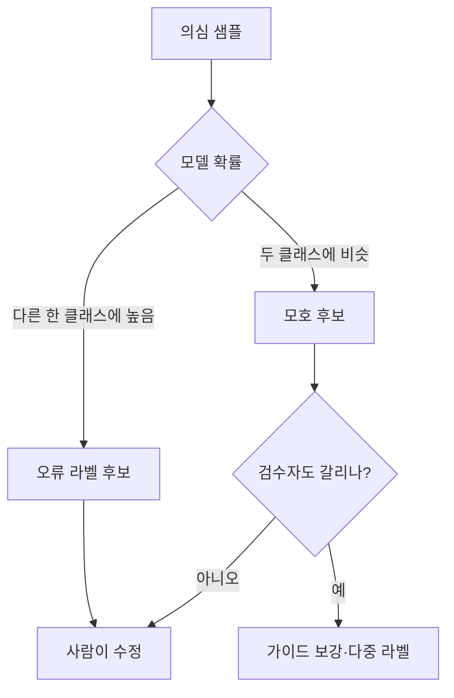
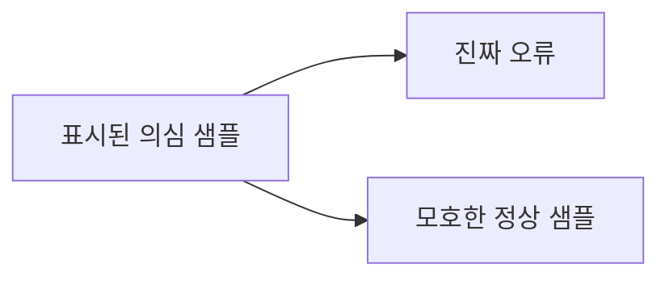

# 모호한 샘플 vs 오류 라벨

> 라벨 오류 탐지 도구가 "의심"이라고 표시한 샘플 중에는 라벨이 실제로 틀린 것(오류 라벨)도 있고, 두 클래스 사이에 걸쳐 사람이 봐도 답이 갈리는 것(모호한 샘플)도 있다. 둘은 고치는 방법이 달라서 검수 때 구분해야 한다.

## 쉽게 말하면
시험 채점 중 "정답과 다르게 적은 답안"이 모두 오답은 아니다. 정답지가 잘못 쓰인 문제(오류 라벨)도 있고, 문제 자체가 애매해서 두 답이 다 맞는 문제(모호한 샘플)도 있다. 앞의 것은 정답지를 고치면 되고, 뒤의 것은 문제를 고치거나 채점 기준을 정해야 한다.

## 자세히
- **탐지 도구의 판단 기준(cleanlab 문서)**: confident learning은 라벨과 참 라벨의 "신뢰할 만한 결합분포(confident joint)"를 추정하고, 대각선 밖에 있는 샘플, 즉 주어진 라벨과 다른 클래스로 확신 있게 예측되는 샘플을 라벨 이슈로 센다. 교차 검증 같은 out-of-sample 예측 확률을 권장한다. `filter_by` 옵션(`prune_by_noise_rate` 기본, `confident_learning`, `predicted_neq_given`, `low_self_confidence` 등)에 따라 표시되는 집합이 달라지고, `frac_noise`로 일부만 받을 수 있다. 문서 이 페이지는 모호한 샘플이나 클래스 겹침을 직접 다루지 않는다.
- **같은 문서군의 관찰**: cleanlab 튜토리얼에서는 건강 점수가 라벨의 약 28%를 의심했지만 실제 오류는 약 20%였고, 겹치는 클래스 사이 샘플이 많이 걸렸다([정리→재학습 라운드](#relabel-retrain-rounds)).
- **구분 방법(해석)**: ① 확률이 두 클래스에 거의 반반이면 모호 후보, 한 다른 클래스에 높은 확률이면 오류 후보 ② 이중 검수에서 검수자끼리도 갈리면 모호([이중 검수](#double-annotation-review)) ③ 검수자 모두 같은 새 라벨에 동의하면 오류.
- **처리 방식(해석)**: 오류 라벨은 수정한다. 모호한 샘플은 지우기보다 라벨 가이드에 판정 규칙을 추가하거나 다중 라벨·"기타" 클래스를 허용한다. 모호 샘플을 일괄 삭제하면 경계 사례를 못 배워 일반화가 약해질 수 있다(해석).

## 그림으로 보기

## 예시
- 감정 분류에서 "나쁘진 않네요"를 부정으로 적었다면 오류 라벨일 수 있고, 긍정과 중립 사이에서 검수자가 갈린다면 모호하다.
- 교육 활용: 문장 10개를 학습자들이 독립적으로 라벨링해 불일치 문장이 모호 샘플임을 체험한다.

## 헷갈리는 것과 비교
| 개념 | 차이 |
| --- | --- |
| 오류 라벨 | 정답이 하나인데 라벨이 틀림 → 수정 |
| 모호한 샘플 | 정답이 하나로 정해지지 않음 → 규칙·다중 라벨 |
| [이중 검수](#double-annotation-review) | 둘을 가르는 사람 측 도구 |
| [정리→재학습 라운드](#relabel-retrain-rounds) | 정리 후 반복 방식 |

## 더 읽을거리
- [cleanlab filter 문서](https://docs.cleanlab.ai/stable/cleanlab/filter.html) — filter_by·frac_noise 옵션
- [cleanlab in-depth tutorial](https://docs.cleanlab.ai/stable/tutorials/indepth_overview.html) — 과대 탐지 사례
