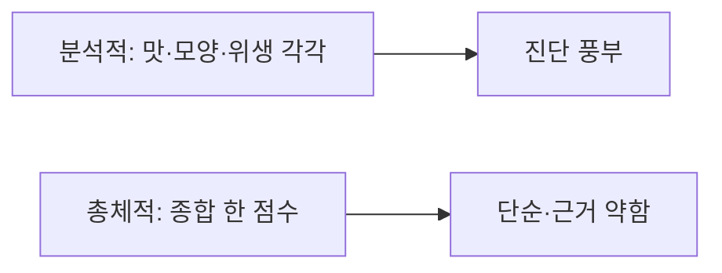
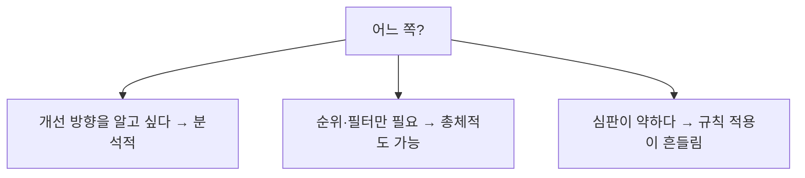

# 분석적 vs 총체적 루브릭

> 심판 LLM에게 **차원별로 나눠 점수**(분석적)를 매기게 할지, **한 줄 총점**(총체적)을 매기게 할지의 선택. 분석적은 진단 정보가 풍부하고 총체적은 단순하지만 근거를 설명하기 어렵다.

## 쉽게 말하면
요리 심사에서 "맛 8, 모양 6, 위생 9"로 항목별로 매기는 방식과 "종합 7점"으로 한 번에 매기는 방식의 차이다. 항목별은 어디가 약한지 알려 주고, 종합은 빠르다.

## 자세히
(검색 결과 요약 기준. 어느 쪽이 더 신뢰할 만한지를 직접 비교한 통제 연구는 찾지 못했다.)
- 총체적(G-Eval 방식)의 한계: 한 숫자는 자기 근거를 설명하거나 세밀한 진단을 뒷받침하지 못한다는 비판이 있고, 분석 차원으로 쪼개는 것이 보통의 해법으로 제시된다.
- 에세이 채점 연구(Kucia 외, arXiv 2604.00259): 강한 오픈 가중치 모델이 총체적 채점에서 사람과 중간~높은 일치(QWK 약 0.6)를 보이지만 **다특성 분석적 채점으로는 고르게 이어지지 않았다.** 또 분석적 채점에서 **짧은 키워드 프롬프트가 긴 루브릭형 프롬프트보다 대체로 낫다**고 보고.
- Autorubric(arXiv 2603.00077): 가중 기준과 다중 심판 합산의 분석적 루브릭. 진단 정보는 유용하나 LLM 평가는 주로 총괄 목적(순위·필터링)이라고 밝힌다.
- 판정 방식 비교(Kumar & Rathore, AACL 2026): 쌍 비교·FLASK식 루브릭 분해·G-Eval 총체 점수를 견줘 방식 선택이 어떤 단일 개입보다 신뢰도를 더 흔든다고 한다.
- REFLECT: 명시적 루브릭 차원은 **심판이 충분히 강해 일관되게 적용할 때만** 도움이 된다.
- 요약: 분석적은 진단이 좋지만 사람 일치율이 항상 높지는 않다. 심판 강도·프롬프트 스타일·과제에 따라 다르다.
- 실무 권장(Anthropic 글 참조, [채점기 유형](#grader-types)): 차원마다 **별도 심판**을 쓰는 방식이 권장된다.

## 그림으로 보기

## 예시
- 고객응대 답변을 정확성·공손함·간결성 3차원으로 각각 따로 채점해 약한 차원을 찾음.
- 교육: 같은 답 30개를 두 방식으로 채점해 사람 채점과의 일치율 비교.

## 헷갈리는 것과 비교
| 개념 | 차이 |
|---|---|
| 분석적 | 차원별 점수·진단 |
| 총체적 | 한 총점·간단 |
| [위치 편향](#position-bias) | 어떤 루브릭이든 점검할 심판 편향 |

## 더 읽을거리
- [Kucia 외: 에세이 채점 (arXiv 2604.00259)](https://arxiv.org/pdf/2604.00259) — 총체적 vs 분석적 채점(검색 요약).
- [Autorubric (arXiv 2603.00077)](https://arxiv.org/html/2603.00077) — 분석적 루브릭 프레임워크(검색 요약).
