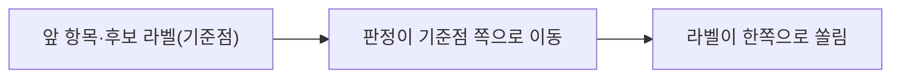
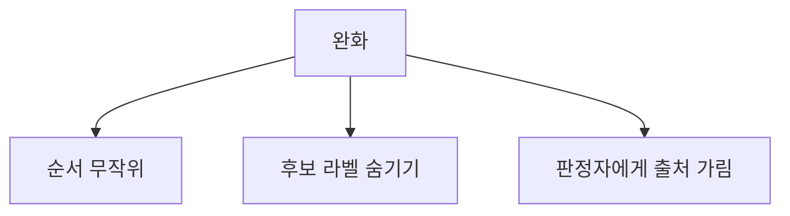

# 라벨링 앵커링

> 라벨링 앵커링은 라벨러가 앞서 본 항목·미리 제시된 후보 라벨·이전 판정 같은 기준점에 영향을 받아 다음 판정이 한쪽으로 쏠리는 편향이다.

## 쉽게 말하면
앞 사람이 "이건 90점"이라고 말한 뒤에 점수를 매기면 내 점수도 90 근처로 끌려간다. 라벨링도 앞에서 본 것이 기준점이 되어 다음 판정을 끌어당긴다.

## 자세히
- **심리학 근거(Wikipedia, Tversky & Kahneman 1974)**: 앵커링은 판단이 무관한 기준점에도 영향을 받는 경향이다. 곱셈 추정 실험에서 1×2×…×8을 오름차순으로 본 사람의 중앙값 추정은 512, 내림차순은 2,250이었다(정답 40,320). 룰렛 실험에서 10에서 멈춘 뒤 추정은 평균 25%, 65에서 멈춘 뒤는 45%였다. 명백히 틀린 기준점도 영향을 준다(간디 사망 나이 실험: 평균 50 vs 67). 무작위 기준점 실험 중 일부는 재현에 실패했고, 경고를 줘도 영향이 완전히 사라지지 않았다. 전문가도 영향을 받는다(부동산 중개인 연구에서 중개인은 부정했지만 학생과 같은 정도로 영향을 받음).
- **라벨링에 옮겨 보면(해석)**: ① 후보 라벨을 미리 보여 줄 때 그대로 수용하는 쪽으로 쏠림 ([후보 라벨 표시 트레이드오프](#pre-label-display-tradeoff)) ② 앞 항목들이 대부분 긍정이면 다음도 긍정으로 보는 연속 효과 ③ 점수형 라벨은 직전 점수에 끌림 ④ 판정자가 주석자 라벨을 먼저 보고 확정하는 경우.
- **줄이는 방법(해석, 효과 크기는 직접 확인하지 않음)**: ① 샘플 순서를 무작위로 섞는다([항목 무작위 배정](#random-assignment-of-items)) ② 후보 라벨을 숨기고 먼저 독립 판정하게 한 뒤 비교 ③ 판정자에게 주석자 신원·라벨을 가리고 보여 준다([판정 인터페이스](#adjudication-interface)) ④ 항목 간 휴식으로 연속 효과 완화 ⑤ 점수형은 기준 예시를 곁에 고정 표시.
- **주의**: 경고만으로는 해결되지 않는다고 하므로 설계(순서·표시 방식)로 막는다.

## 그림으로 보기

## 예시
- 후보 라벨을 보여 줬더니 수락률이 95%였다면 앵커링을 의심하고, 일부 샘플은 후보 없이 독립 라벨링해 비교한다.
- 교육 활용: 같은 문장 묶음을 순서만 바꿔 라벨링하게 해 점수가 달라지는지 본다.

## 헷갈리는 것과 비교
| 개념 | 차이 |
| --- | --- |
| 앵커링 | 기준점에 끌림 |
| 라벨러 드리프트 | 시간이 갈수록 기준이 변함 |
| [자동 미리 라벨의 닻 효과](#pre-label-anchoring-bias) | 모델 제안이 기준점일 때 |
| [항목 무작위 배정](#random-assignment-of-items) | 순서·배정을 섞어 완화 |

## 더 읽을거리
- [Anchoring effect (Wikipedia)](https://en.wikipedia.org/wiki/Anchoring_effect) — 정의, 고전 실험, 전문가도 영향을 받음
