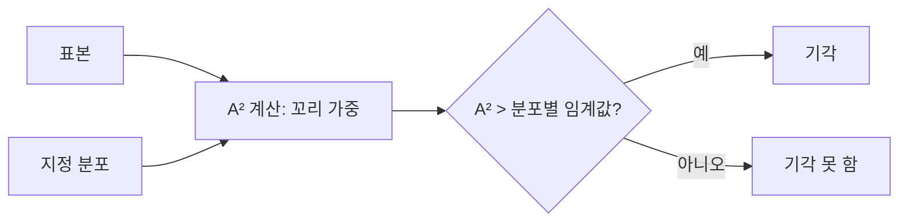
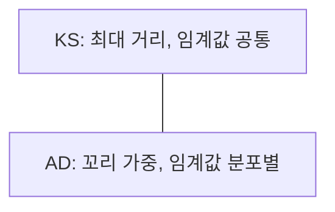

# Anderson-Darling 검정

> [KS 검정](#ks-test)을 변형한 적합도 검정으로, **분포의 꼬리에 더 큰 가중**을 둔다. 임계값이 검정하는 분포마다 달라 더 민감하지만 분포별 값이 필요하다. (NIST 핸드북 열람 2026-11-28)

## 쉽게 말하면
KS가 두 그래프의 "가장 크게 벌어진 한 곳"을 본다면, Anderson-Darling은 양 끝(드물게 나오는 극단값 쪽)의 차이를 더 크게 쳐서 본다.

## 자세히
- 가설: 귀무가설 = 데이터가 지정한 분포를 따른다. 대립가설 = 따르지 않는다. 검정은 한쪽 방향이며 **통계량 A²가 임계값을 넘으면 기각**한다.
- KS와의 차이: ① **꼬리 가중** — "KS 검정보다 꼬리에 더 큰 가중을 준다" ② **임계값** — KS는 모수가 완전히 지정되면 분포와 무관한 임계값을 쓰지만, Anderson-Darling은 **분포별 임계값**이 필요해 더 민감하되 각 분포마다 계산해야 한다.
- 임계값이 공개된 분포: 정규, 균등, 로그정규, 지수, 와이불, 극값 I형, 일반화 파레토, 로지스틱.
- 주의: 출처마다 상수와 임계값이 다르므로 사용하는 임계값에 통계량의 척도를 맞춰야 한다. 핸드북은 임계값 표를 싣지 않으며 통계 소프트웨어가 보통 보고한다.
- 활용(내 해석): 문서 길이·응답 시간처럼 꼬리가 중요한 분포의 이동 탐지에서 [드리프트 모니터링](#drift-monitoring)의 지표 후보가 될 수 있다. 이번 출처는 이동 탐지 용도를 직접 다루지 않았다.
- 한계: 이 글은 일표본 적합도 검정 설명이며 두 표본 버전은 다루지 않았다.

## 그림으로 보기

## 예시
- 응답 시간 데이터가 로그정규를 따르는지 꼬리까지 민감하게 확인.
- 교육: 같은 표본에 KS와 AD를 돌려 결과 차이를 비교.

## 헷갈리는 것과 비교
| 개념 | 차이 |
|---|---|
| Anderson-Darling | 꼬리 가중, 분포별 임계값 |
| [KS 검정](#ks-test) | 중심부에 민감, 임계값 공통 |
| Cramér-von Mises | KS의 또 다른 개선판 |

## 더 읽을거리
- [NIST: Anderson-Darling test](https://www.itl.nist.gov/div898/handbook/eda/section3/eda35e.htm) — 정의와 KS와의 차이(읽음).
