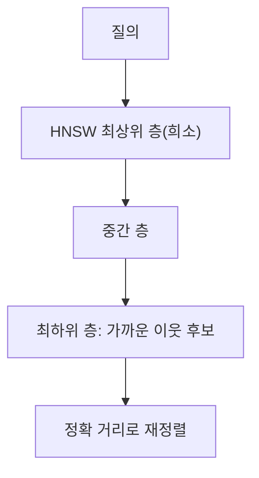
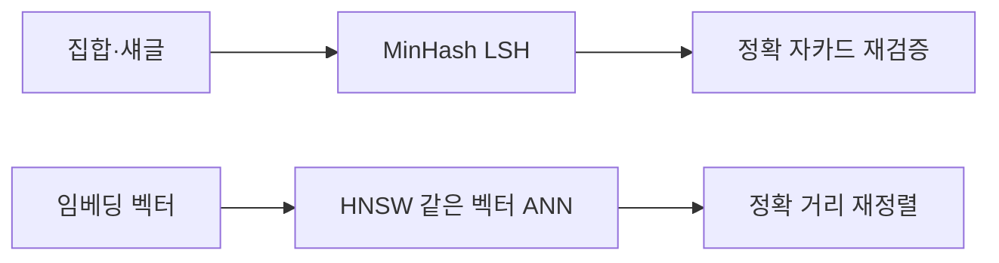

# LSH와 근사 최근접 탐색

> **LSH**는 해시로 "비슷한 것끼리 같은 버킷"에 모으는 근사 이웃 탐색 방법이고, **HNSW** 같은 그래프 기반 방법은 이웃 관계를 **여러 층의 근접 그래프**로 만들어 위에서부터 내려가며 찾는다. 집합 유사도(자카드)에는 MinHash LSH, 임베딩 벡터에는 그래프·벡터 인덱스가 흔히 쓰인다.

## 쉽게 말하면
도서관에서 비슷한 책을 찾는 두 방법이 있다. 하나는 책마다 "분류 번호표"를 붙여 같은 번호표끼리 모아 두는 것(LSH), 다른 하나는 서가 사이에 지름길 지도를 만들어 큰 길에서 시작해 골목으로 좁혀 가는 것(HNSW)이다.

## 자세히
(HNSW: Malkov & Yashunin, arXiv 1603.09320 초록 확인)
- **HNSW**: 저장된 원소의 **중첩 부분집합**마다 근접 그래프를 쌓은 **다층 그래프**. 각 원소의 최상위 층은 **지수적으로 감소하는 확률**로 무작위 선택되어 서로 다른 거리 척도의 연결이 퍼진다. 검색은 **희소한 상위 층에서 시작해 내려간다.** 저자들은 이 구조가 이전 NSW보다 낫고 **로그 복잡도 확장**을 보인다고 주장하며, 이전 오픈소스 벡터 전용 방법보다 크게 우수하다고 보고한다. 이웃 선택 휴리스틱이 **높은 재현율과 군집이 강한 데이터**에서 큰 이득을 준다고 한다. 건너뛰기 목록(skip list)과 비슷해 분산 구현이 쉽다고 덧붙인다.
- **LSH(앞 글들 참조)**: MinHash는 자카드 유사도를 근사, 밴드로 나눠 후보를 뽑고 정확 계산으로 재검증([LSH 후보 재검증](#lsh-post-verify), [서명 길이](#lsh-signature-length)). Jia 외 KNN-Shapley 논문은 LSH로 상위 K* 이웃을 찾아 근사 가치를 구했다([LSH 근사 KNN-Shapley](#lsh-approximate-knn-shapley)).
- **비교(요약; 일부는 일반 지식)**
  | 항목 | LSH(MinHash 밴딩) | HNSW(그래프) |
  |---|---|---|
  | 대상 | 집합(자카드), 일부 벡터 거리 | 벡터(임베딩) |
  | 핵심 | 해시 버킷 충돌 | 다층 근접 그래프 탐색 |
  | 조정 노브 | 서명 길이 b×r, 임계값 | 층·이웃 수·탐색 폭(구현별) |
  | 보장 | 유사도에 대한 확률 곡선 P(s) | 경험적 재현율-속도(보장은 약함, 일반 지식) |
  | 갱신 | 해시 삽입 쉬움 | 그래프 삽입 비용(일반 지식) |
  | 재검증 | 보통 필요 | 상위 후보를 정확 거리로 재정렬하기도 함 |
- **선택 지침(권장)**
  1. 문서 **집합/섀글** 중복 탐지 → MinHash LSH([섀글 크기](#shingle-size-choice)).
  2. **임베딩 이웃 탐색**(의미 중복, RAG 검색, KNN 가치 평가) → 벡터 ANN(HNSW 계열)([SemDeDup](#semdedup), [임베딩 가치 평가](#embedding-space-valuation)).
  3. 둘 다 **재현율을 샘플로 측정**한다(정확 탐색과 비교해 목표 재현율 확인).
  4. 후보를 정확 거리로 재검증하고, 파라미터·시드를 기록.
- **한계**: 이 글은 HNSW의 초록과 앞선 LSH 계산만 근거로 하며, 성능 비교표의 일부 항목은 일반 지식이라 라이브러리·데이터에 따라 달라진다. 재현율-속도 수치는 직접 측정이 필요하다.

## 그림으로 보기



## 예시
```python
# 재현율 측정 (개념 코드)
exact = brute_force_topk(queries, base, k=10)
approx = ann_index.search(queries, k=10)
recall = np.mean([len(set(a) & set(e)) / 10 for a, e in zip(approx, exact)])
```
- 문서 중복 제거는 MinHash LSH, 같은 문서의 임베딩으로 유사 질문 검색은 HNSW 인덱스를 쓰는 식으로 용도별 분리.

## 헷갈리는 것과 비교
| 개념 | 설명 |
|---|---|
| 정확 최근접 | 전수 비교, 느림 |
| LSH | 해시 충돌 기반 근사 |
| HNSW | 다층 그래프 탐색 근사 |
| 재현율(ANN) | 정확 이웃 중 찾은 비율 |

## 더 읽을거리
- [Efficient and robust approximate nearest neighbor search using HNSW (arXiv 1603.09320)](https://arxiv.org/abs/1603.09320) — 다층 그래프 방식과 주장(초록 열어 확인).
- [Efficient Task-Specific Data Valuation for Nearest Neighbor Algorithms (arXiv 1908.08619)](https://arxiv.org/abs/1908.08619) — LSH로 이웃을 찾아 가치를 근사(PDF 본문 확인).
