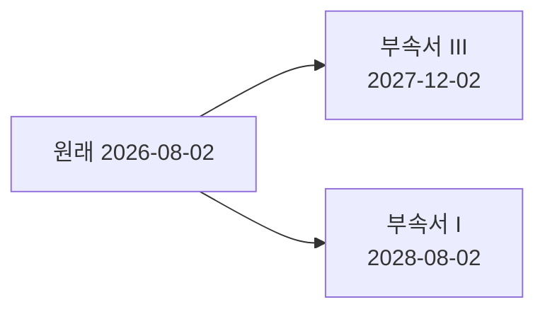
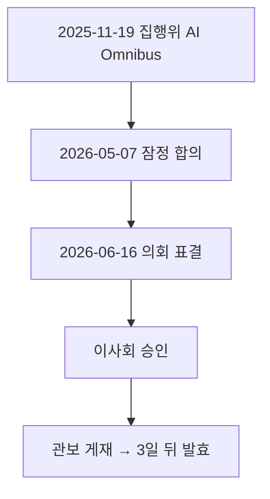

# 부속서 III 적용 연기

> EU AI Act에서 사람·일자리·교육 등을 다루는 독립형 고위험 AI(부속서 III)의 의무 적용일이 2026-08-02에서 2027-12-02로 미뤄진 경위. 표준 마련 지연과 기업 부담 문제가 배경이다.

## 쉽게 말하면
시험 날짜는 정해졌는데 교재(표준)가 늦게 나왔다는 민원이 쌓여, 시험을 1년 반쯤 뒤로 미루기로 한 것과 비슷하다. 단, 미룬 것은 일부 의무이며 이미 시행 중인 금지 조항 등은 별개다.

## 자세히
출처: Sidley 법률 뉴스 글(2026-06-22, 열람)과 artificialintelligenceact.eu 113조 페이지(열람). 법률 자문이 아니고, 최종 채택·시행 여부는 관보로 확인해야 한다.
- **배경**: 집행위가 2025-11-19에 AI Omnibus를 발표했다. 표준 공개 지연과 준수 비용에 대한 산업계·이해관계자의 우려가 배경이며, 핵심은 원래 2026-08-02 적용 예정이던 고위험 AI 일정을 미루는 것이었다(Sidley).
- **새 날짜(합의 내용, Sidley)**
  - 2027-12-02: 독립형 고위험(부속서 III), 예: 채용·고용 관련 AI
  - 2028-08-02: 규제 제품에 내장된 고위험(부속서 I), 예: AI 의료기기
  - 2026-12-02: 비동의 성적 이미지·아동 성착취물을 생성하는 AI에 대한 새 금지
  - 2027-08-02: AI 규제 샌드박스 설치 기한
- **절차(Sidley 기준)**: 2026-05-07 이사회·의회 잠정 합의 → 2026-06-16 의회 채택 표결 → 유럽이사회(이사회) 승인 대기 → 관보 게재 후 3일 뒤 발효. 양 입법기관은 2026-08-02 전 완료를 목표로 했다.
- **113조 페이지(열람)**: 이 페이지에는 고위험(부속서 III) 2027-12-02, (부속서 I) 2028-08-02가 적혀 있고 "amended" 표시와 충돌하는 문구(2027-08-02)도 섞여 있다. 이 사이트의 반영 상태가 곧 채택·시행을 뜻하는지는 확인하지 못했다.
- **무엇이 안 미뤄지나**: 113조 페이지는 1·2장(금지 등)이 2025-02-02부터, GPAI 관련 장이 2025-08-02부터 적용된다고 적는다(일부 금지 항목은 2026-12-02라는 표기도 있음). 즉 연기는 고위험 의무 중심이다.
- **50조와의 관계**: 합성 콘텐츠 식별 의무는 기존 출시 시스템에 한해 2026-12-02까지 유예된다고 보도됐다([50조 투명성 의무](#article-50-transparency)).
- 검색 요약에는 White & Case, CMS, Hogan Lovells 등 여러 법률 사무소 글이 같은 날짜를 전했으나 직접 열람하지 못했다(White & Case는 403).

## 그림으로 보기

## 예시
- HR 채용 AI를 만드는 기업: 합의대로면 고위험 의무 준비 기한이 2027-12-02까지 늘어나지만, 준비 작업(위험관리·문서화)은 미룰수록 부담이 커진다(해석).
- 교육 실습: 자기 회사 AI 기능이 부속서 III인지 I인지, 어떤 날짜가 적용되는지 표로 정리.

## 헷갈리는 것과 비교
| 개념 | 차이 |
|---|---|
| 부속서 III | 독립형 고위험(고용·교육 등) |
| 부속서 I | 규제 제품 내장 AI |
| 금지 조항 | 이미 적용(연기 대상 아님) |
| [AI Act 적용 일정](#ai-act-enforcement-timeline) | 전체 일정 틀 |

## 더 읽을거리
- [Sidley: Provisional agreement to delay key AI Act obligations](https://datamatters.sidley.com/2026/06/22/eu-lawmakers-reach-provisional-agreement-to-delay-key-eu-ai-act-obligations/) — 날짜와 절차(열람)
- [AI Act Article 113](https://artificialintelligenceact.eu/article/113/) — 적용일 조문(열람, 개정 표시 혼재)
