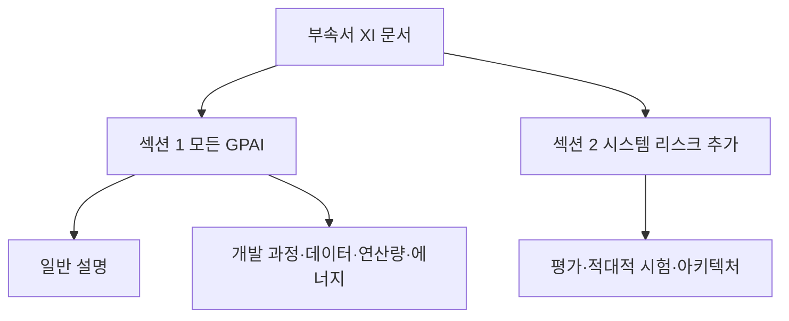

# 부속서 XI 기술 문서

> EU AI Act 53조 1항 (a)에 따라 범용 AI(GPAI) 모델 제공자가 유지하고 AI Office·국가 당국의 요청 시 제공해야 하는 기술 문서의 항목 목록. 모델 설명, 개발 과정, 학습 데이터, 연산량·에너지가 핵심이다.

## 쉽게 말하면
자동차 제조사가 제출하는 "차량 사양서와 제작 이력서"와 같다. 어떤 용도인지, 어떻게 만들었는지, 무엇으로 학습했는지, 얼마나 에너지를 썼는지를 문서로 갖춘다.

## 자세히
출처는 artificialintelligenceact.eu의 부속서 XI(열람)와 53조(열람). 문서는 모델 크기와 위험 프로파일에 "적절하게" 갖춘다고 적혀 있다. 법률 자문이 아니다.
- **섹션 1(모든 GPAI 제공자)**
  - 일반 설명: 의도한 과제와 통합될 수 있는 AI 시스템 유형, 적용되는 허용 사용 정책, 출시일과 배포 방식, 아키텍처와 매개변수 수, 입출력 형태·형식, 라이선스.
  - 요소와 개발 과정의 상세 설명: 통합에 필요한 기술적 수단(사용 지침·인프라·도구), 설계 사양·학습 방법과 기법·핵심 설계 선택과 근거·가정·최적화 목표, 학습·시험·검증 데이터(유형·출처·큐레이션 방법·양·범위·주요 특징·확보·선택 방식·부적합한 출처와 식별 가능한 편향 점검), 학습에 쓴 연산량(예: 부동소수점 연산)과 학습 시간, 알려진 또는 추정된 에너지 소비(모르면 연산 자원으로 추정 가능).
- **섹션 2(시스템 리스크 GPAI 제공자의 추가 항목)**: 평가 전략(기준·지표·한계 식별 방식 포함)과 결과, 적대적 시험(레드팀 등)과 정렬·미세조정 같은 모델 적응, 해당하는 경우 시스템 아키텍처(소프트웨어 구성요소의 상호 구축·통합 방식).
- **연결(53조)**: (a) 기술 문서 유지, (b) 하류 제공자에게 부속서 XII 정보 제공, (c) 저작권 정책, (d) 학습 콘텐츠 요약. 자유·오픈소스 라이선스로 가중치·아키텍처·사용 정보를 공개한 모델은 (a)(b) 면제이나 시스템 리스크 모델은 제외된다.
- **행동강령 연결**: 행동강령 투명성 장에 이 정보를 기록하는 모델 문서 양식(Model Documentation Form, DOCX)이 있다(집행위 안내 페이지). 양식의 세부 칸은 이번에 열지 않았다.
- 53조 5·6항에 따라 집행위가 위임법으로 측정·계산 방법과 부속서 XI·XII를 개정할 수 있다.

## 그림으로 보기

## 예시
- 가상 모델 문서에 "학습 연산량 약 5×10^24 FLOP, 에너지 소비는 연산 자원으로 추정"처럼 기록(숫자는 가상).
- 교육 실습: 자기가 아는 오픈 모델의 공개 카드에서 섹션 1 항목 중 비어 있는 것을 찾아 표시.

## 헷갈리는 것과 비교
| 개념 | 차이 |
|---|---|
| 부속서 XI | 당국용 기술 문서 |
| 부속서 XII | 하류 제공자용 정보 |
| 학습 데이터 요약 | 공개 요약(53조 1항 d) |
| [FLOP(연산량)](#flop-compute) | 문서에 기록할 연산량 |

## 더 읽을거리
- [AI Act Annex XI](https://artificialintelligenceact.eu/annex/11/) — 문서 항목(열람)
- [AI Act Article 53](https://artificialintelligenceact.eu/article/53/) — 제공자 의무(열람)
