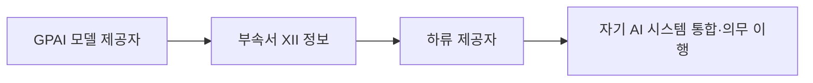
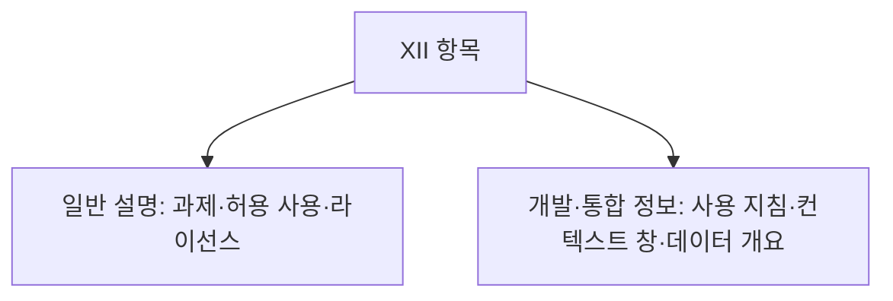

# 부속서 XII 정보 항목

> EU AI Act 53조 1항 (b)에 따라 범용 AI(GPAI) 모델 제공자가 그 모델을 자기 AI 시스템에 통합하려는 하류 제공자에게 제공해야 하는 정보 목록. 하류 제공자가 모델의 능력과 한계를 이해하고 자기 의무를 이행할 수 있게 하는 것이 목적이다.

## 쉽게 말하면
부품 공급사가 완제품 제조사에게 주는 "부품 데이터시트"와 같다. 어떤 용도로 만들었는지, 입출력 규격이 무엇인지, 무엇으로 학습했는지를 알아야 제조사가 안전하게 조립한다.

## 자세히
출처는 artificialintelligenceact.eu의 부속서 XII(열람)와 53조(열람). 열람한 페이지는 1~2항 일부만 보여 준다. 법률 자문이 아니다.
- **1. 모델의 일반 설명**: (a) 의도한 과제와 통합될 수 있는 AI 시스템 유형, (b) 적용되는 허용 사용 정책, (c) 출시일과 배포 방식, (d) 해당 시 외부 하드웨어·소프트웨어와의 상호작용, (e) 해당 시 관련 소프트웨어 버전, (f) 아키텍처와 매개변수 수, (g) 입출력 형태와 형식, (h) 모델 라이선스.
- **2. 모델 요소와 개발 과정**: (a) AI 시스템에 통합하는 데 필요한 기술적 수단(배포자용 사용 지침, 도구, 인프라 등), (b) 입출력 형태·형식과 최대 크기(예: 컨텍스트 창 길이), (c) 해당하는 경우 학습·시험·검증 데이터의 유형·출처·큐레이션 방법.
- **부속서 XI와의 차이**: XI는 AI Office·당국용 기술 문서로 개발 과정, 연산량, 에너지 소비 등이 더 상세하다. XII는 하류 제공자를 위해 통합에 필요한 정보 중심이다. 하류 제공자에게 지식재산과 영업비밀은 보호하면서 정보를 주도록 53조 1항 (b)가 요구한다([부속서 XI 기술 문서](#annex-xi-documentation)).
- **행동강령과의 연결**: 행동강령 투명성 장은 하류 제공자의 추가 요청에 예외 상황이 없으면 14일 이내 답하도록 한다([모델 문서 양식](#model-documentation-form)).
- **오픈소스 예외(53조 2항)**: 자유·오픈소스 라이선스로 가중치·아키텍처·사용 정보를 공개한 모델은 (a)(b) 의무가 면제되나 시스템 리스크 모델은 제외된다.
- 한계: 열람한 페이지가 목록 앞부분만 보여 주었다. 3항 이후가 있다면 확인하지 못했다.

## 그림으로 보기

## 예시
- 모델 API를 사내 챗봇에 통합하는 회사는 컨텍스트 창 최대 길이, 허용 사용 정책, 라이선스 조건을 제공자에게서 문서로 받는다.
- 교육 실습: 어떤 오픈 모델의 모델 카드에서 XII 항목이 몇 개나 채워져 있는지 표시.

## 헷갈리는 것과 비교
| 개념 | 차이 |
|---|---|
| 부속서 XII | 하류 제공자용 정보 |
| 부속서 XI | 당국용 기술 문서 |
| 학습 콘텐츠 요약 | 일반 공개용 |
| [제공자 vs 배포자](#deployer-vs-provider) | 하류 제공자가 되는 경우의 역할 구분 |

## 더 읽을거리
- [AI Act Annex XII](https://artificialintelligenceact.eu/annex/12/) — 항목(열람)
- [AI Act Article 53](https://artificialintelligenceact.eu/article/53/) — GPAI 의무(열람)
