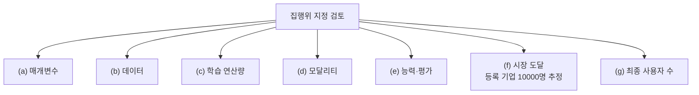
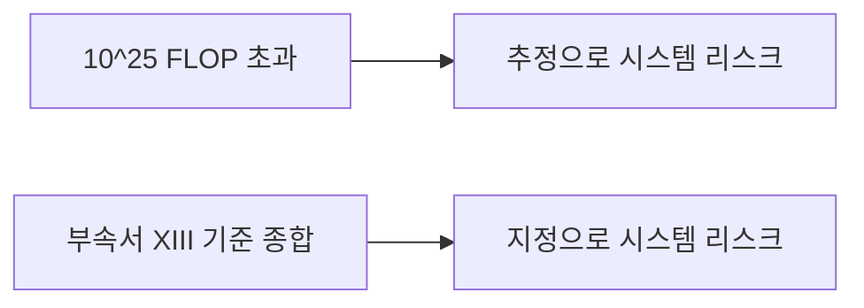

# 부속서 XIII 기준

> EU AI Act에서 집행위가 어떤 범용 AI 모델이 "높은 영향 능력(51조 1항 a)과 동등한 능력·영향"을 갖는지 지정할 때 고려하는 기준 목록. 학습 연산량 10^25 FLOP 추정만이 유일한 기준은 아니라는 뜻이다.

## 쉽게 말하면
화물차를 "대형"으로 분류할 때 무게만 보지 않고 길이, 적재량, 운행 범위를 함께 보는 것과 같다. 연산량이 기준에 못 미쳐도 다른 기준으로 시스템 리스크 모델로 지정될 수 있다.

## 자세히
출처는 artificialintelligenceact.eu의 부속서 XIII(열람)와 51조(열람). 이 페이지는 일곱 개 기준 (a)~(g)를 적고 있다. 법률 자문이 아니다.
- **(a) 매개변수 수**
- **(b) 데이터셋의 품질·규모**: 예를 들어 토큰 수.
- **(c) 학습 연산량**: 부동소수점 연산량 또는 학습 비용·학습 시간·에너지 소비 같은 대리 지표.
- **(d) 입출력 형태(모달리티)**: 텍스트→텍스트, 텍스트→이미지, 멀티모달, 생물 서열 같은 특정 데이터 유형. 각각을 "높은 영향 능력"에 대한 최신 기술 수준 기준과 비교.
- **(e) 능력과 평가**: 벤치마크 결과, 추가 학습 없이 수행하는 과제 수, 새 과제 적응성, 자율성·확장성, 접근 가능한 도구.
- **(f) 시장 도달 범위**: 내부 시장에 높은 영향을 주는지. EU에 설립된 등록 기업 사용자 최소 10,000명에게 제공되면 높은 영향이 있다고 추정한다.
- **(g) 최종 사용자 수**: 등록 최종 사용자의 수.
- **연결**: 51조 1항 (b)에 따라 집행위가 직권으로 또는 과학 패널의 자격 경보 후 이 기준으로 모델을 시스템 리스크로 지정한다. 51조 2항은 10^25 FLOP 초과 시 높은 영향 능력을 추정한다([시스템 리스크 모델](#systemic-risk-model)).
- **한계**: 페이지는 기준별 가중치나 임계값(시장 도달 10,000명 추정 외)을 주지 않는다. 지정 결정이 구체적으로 어떻게 이뤄지는지는 별도 지침·사례를 봐야 하며 이번에 확인하지 못했다.

## 그림으로 보기

## 예시
- 연산량이 10^25 FLOP보다 낮지만 다중 모달 능력과 시장 도달 범위가 매우 큰 모델은 부속서 XIII 기준으로 검토 대상이 될 수 있다(가상 사례).
- 교육 실습: 가상 모델의 스펙을 (a)~(g)에 맞춰 채워 어떤 기준이 가장 설득력 있는지 토론.

## 헷갈리는 것과 비교
| 개념 | 차이 |
|---|---|
| 10^25 FLOP 추정 | 연산량만으로 추정(51조 2항) |
| 부속서 XIII 기준 | 여러 기준으로 지정(51조 1항 b) |
| [시스템 리스크 모델](#systemic-risk-model) | 두 경로로 분류되는 대상 |
| [FLOP(연산량)](#flop-compute) | (c)의 측정 방식 |

## 더 읽을거리
- [AI Act Annex XIII](https://artificialintelligenceact.eu/annex/13/) — 기준 목록(열람)
- [AI Act Article 51](https://artificialintelligenceact.eu/article/51/) — 분류(열람)
