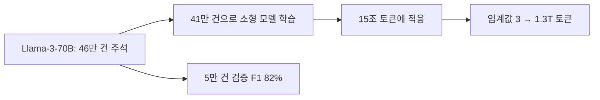
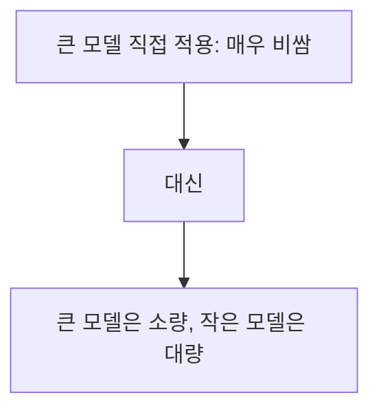

# 주석 후 증류 패턴

> **비싼 큰 LLM이 소량의 데이터에 라벨을 달고, 그 라벨로 작고 싼 모델을 학습시켜 전체 데이터에 적용하는** 비용 절감 패턴이다. 큰 모델의 판단을 작은 모델에 "증류"해 수조 토큰 규모로 확장한다.

## 쉽게 말하면
경력 많은 심사위원(큰 LLM)이 샘플 46만 장만 채점하고, 그 채점 기록을 보고 배운 조교(작은 모델)가 나머지 수십억 장을 채점한다. 심사위원이 전부 채점하는 것보다 훨씬 싸다.

## 자세히
(FineWeb 논문, arXiv 2406.17557 PDF 본문을 직접 읽음)
- 단계: ① **주석**: Llama-3-70B-Instruct가 FineWeb 웹페이지 **460,000개**를 0~5점으로 채점([가산식 프롬프트](#additive-scoring-prompt)) ② **증류/학습**: 그중 **410,000개**로 Snowflake-arctic-embed-m 위 선형 회귀를 학습(임베딩 동결, 20 에폭, lr 3e-4), 나머지 **50,000개**로 검증·체크포인트 선택([동결 임베딩 회귀](#frozen-embedding-regression)) ③ **대규모 적용**: 학습된 분류기를 FineWeb **15조 토큰**에 적용, 임계값 3으로 **1.3조 토큰**의 FineWeb-Edu 구성([임계값](#classifier-threshold-tradeoff)).
- 비용 구조: 비싼 LLM은 46만 건에만, 싼 분류기는 15조 토큰 전체에 쓴다. 분류기 적용에 H100 6,000시간이 들었다([추론 비용](#classifier-inference-cost)).
- 품질 확인: 분류기는 LLM 주석을 정답으로 본 검증에서 임계값 3에 **F1 82%**. 분류기가 LLM을 완벽히 복제하는 것은 아니며, 오차와 LLM 편향이 함께 전파된다. 결과는 벤치마크로 최종 확인했다(MMLU 33→37% 등, 1.71B·350B 토큰 실험).
- 이 패턴이 쓰이는 곳(제안): 품질·독성·주제 분류, 개인정보 탐지, 사내 문서 라우팅 등 라벨이 필요하지만 사람 비용이 큰 곳.
- 주의(제안): ① 표본이 대표성을 가져야 한다 ② 사람이 소량 정답 세트로 LLM 주석을 점검 ③ 증류 모델의 임계값·오류를 별도로 평가 ④ LLM 주석의 편향을 점검([LLM 주석 편향](#llm-annotation-bias)).

## 그림으로 보기

## 예시
- 사내 지식 문서 100만 건을 분류해야 할 때: LLM이 5,000건을 라벨링 → 작은 분류기 학습 → 전체 적용.
- 교육: 선생님(큰 모델)이 예시 답안을 만들고 학생(작은 모델)이 따라 배우는 구조.

## 헷갈리는 것과 비교
| 개념 | 차이 |
|---|---|
| 주석 후 증류 | LLM 라벨로 작은 분류기 학습 |
| 지식 증류(전통) | 교사 모델의 확률 분포를 학생이 모방 |
| 제로샷 LLM 전수 분류 | 정확하지만 규모에 비싸다 |

## 더 읽을거리
- [The FineWeb Datasets (arXiv 2406.17557)](https://arxiv.org/abs/2406.17557) — 주석→분류기→대규모 적용 흐름(PDF 본문 읽음).
