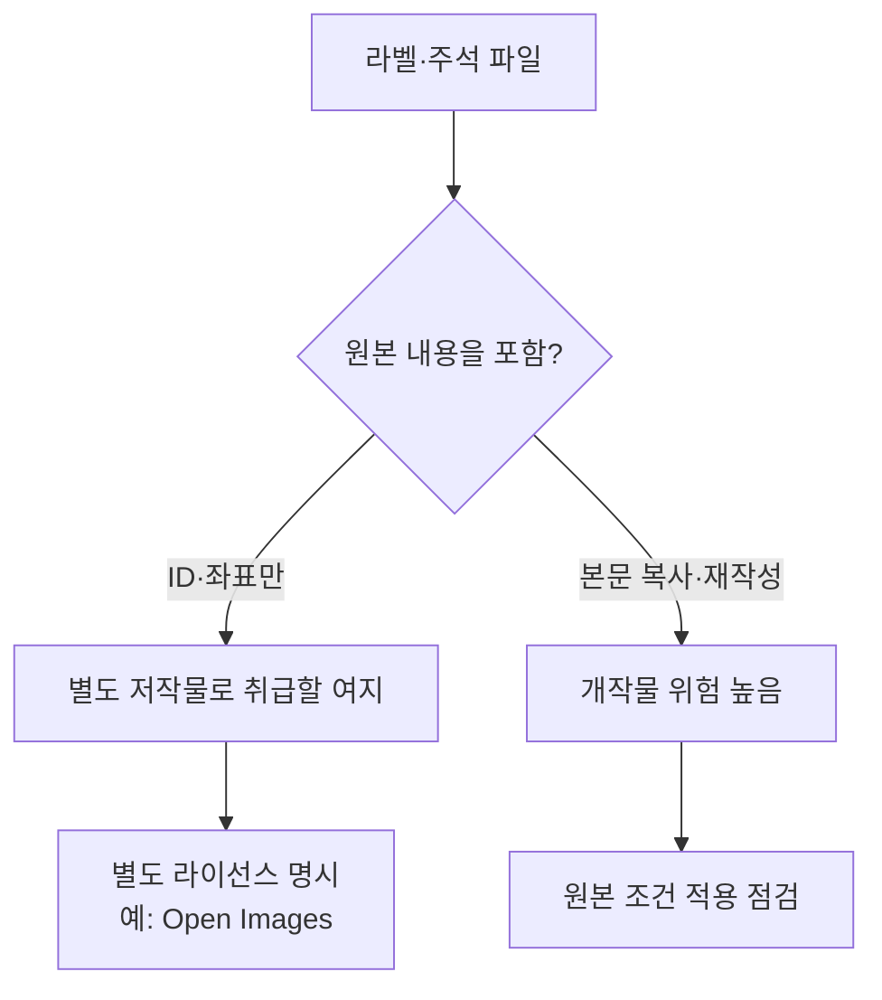
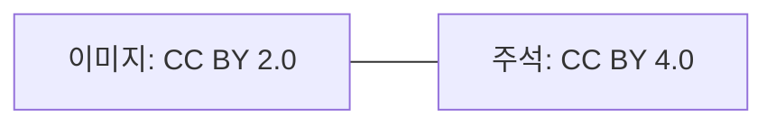

# 주석·라벨은 개작인가

> 원본 데이터를 건드리지 않고 **라벨·주석만 따로 만든 파일**이 원본의 "개작물(derivative/adaptation)"에 해당하는지의 질문이다. 해당하면 ND 라이선스에서는 공유가 막힐 수 있고, SA 라이선스에서는 같은 조건으로 공개해야 할 수 있다. 문구상 답이 정해져 있지 않아 실무 관행과 법무 판단이 필요하다.

## 쉽게 말하면
책을 복사하지 않고 "3쪽 둘째 줄은 인용구"라고 적은 독서 메모를 만들었다고 하자. 이 메모가 원래 책의 '2차 저작물'인지, 아니면 내가 쓴 별개의 글인지가 문제다. 메모가 책 본문을 길게 옮겨 적었다면 후자라고 보기 어렵다.

## 자세히
(CC BY-NC-ND 4.0과 BY-SA 4.0 원문, Open Images 데이터 설명 페이지를 직접 열어 확인. 법률 자문이 아니다.)
- **원문 정의**: CC 4.0은 개작물(Adapted Material)을 "원본에서 **파생되었거나 원본을 바탕으로 한**" 자료로서 저작권 허락이 필요한 방식으로 변경된 것으로 정의한다. 라벨 파일이 "원본을 바탕으로 한 것"인지는 이 정의만으로는 판단되지 않는다. ND는 개작물의 **공유**를 막고(3(a)(1)), SA는 개작물을 공유할 때 같은 조건을 요구한다(3(b))([비공개 개작의 회색지대](#private-adaptation-gap), [카피레프트 오픈 데이터](#copyleft-open-data)).
- **실무 사례 — Open Images(공식 설명 페이지)**: 주석은 Google LLC가 **CC BY 4.0**으로, 이미지는 **CC BY 2.0**으로 표시된 것으로 **서로 다른 라이선스를 쓴다**고 적는다. 또 각 이미지의 라이선스 상태에 대해 어떤 보증도 하지 않으니 사용자가 이미지별로 확인하라고 안내한다. 즉 주석을 원본과 **분리된 별도 저작물**로 취급해 별도 라이선스를 붙이는 관행이 있다. 이것이 법적으로 항상 인정된다는 뜻은 아니다.
- **구분 기준(제안)**: 
  | 라벨 파일의 모습 | 원본 포함 여부 | 개작물로 취급될 위험(제안) |
  |---|---|---|
  | 이미지 ID/URL + 경계 상자 좌표, 클래스 이름 | 원본 내용 없음 | 낮은 편 |
  | 텍스트 오프셋 + 라벨(원문은 별도 보관) | 원문 없음 | 낮은 편 |
  | 문장 전체를 복사해 라벨을 붙인 CSV | 원문 포함 | 높음(원본 복제) |
  | 원본을 요약·번역·재작성한 결과 | 변형된 원본 | 높음 |
  | 모델이 만든 사전 라벨(원본 입력 없이 저장) | 원본 내용 없음 | 낮은 편이나 모델 약관 별도 |
  표는 원문 구조에서 이끌어 낸 위험 평가이며 법적 결론이 아니다.
- **운영(제안)**: ① 라벨은 **ID·오프셋 기반의 스탠드오프(stand-off) 형식**으로 분리해 원본을 복제하지 않기 ② 라벨 파일의 라이선스를 **원본과 별도로 명시**(Open Images 방식) ③ 원본의 ND·SA 조건을 확인해 라벨 파일에 원본 내용이 섞이지 않았는지 점검 ④ 원본 배포 없이 ID 목록만 배포하고 사용자가 원본을 직접 받게 함 ⑤ 판단 근거를 [데이터 카드의 라이선스 기록](#data-card-license-record)에 남김.
- **한계**: 위 표는 일반적 경향이며 관할·사실관계에 따라 다르다. 원본에 인격권·개인정보가 있다면 라이선스 외 문제도 있다(CC는 저작권만 다룬다고 FAQ에서 밝힌다).

## 그림으로 보기

## 예시
- ND 라이선스 판결문 코퍼스에 NER 라벨을 붙임: 문서 ID와 글자 오프셋만 담은 파일로 라벨을 배포하고, 판결문 원문은 사용자가 원 출처에서 받게 한다. 원문 복사본을 함께 배포하면 ND 위반 위험이 커진다.
- 교육 소재: "라벨 파일은 누구의 것인가" 토론 — Open Images 사례와 위 표.

## 헷갈리는 것과 비교
| 개념 | 차이 |
|---|---|
| 주석·라벨은 개작인가 | 라벨 파일의 법적 지위 |
| [비공개 개작의 회색지대](#private-adaptation-gap) | 내부 가공본·모델의 지위 |
| [CC NoDerivatives](#cc-noderivatives) | ND 조항 |
| 스탠드오프 주석 | 원본과 분리해 ID·오프셋으로 연결하는 주석 형식 |

## 더 읽을거리
- [Open Images V7 Facts & Figures](https://storage.googleapis.com/openimages/web/factsfigures_v7.html) — 주석 CC BY 4.0, 이미지 CC BY 2.0, 보증 부인(직접 확인).
- [CC BY-NC-ND 4.0 법적 문서](https://creativecommons.org/licenses/by-nc-nd/4.0/legalcode.en) — 개작물 정의와 공유 금지(직접 확인).
