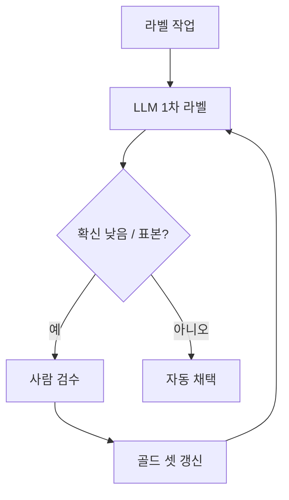
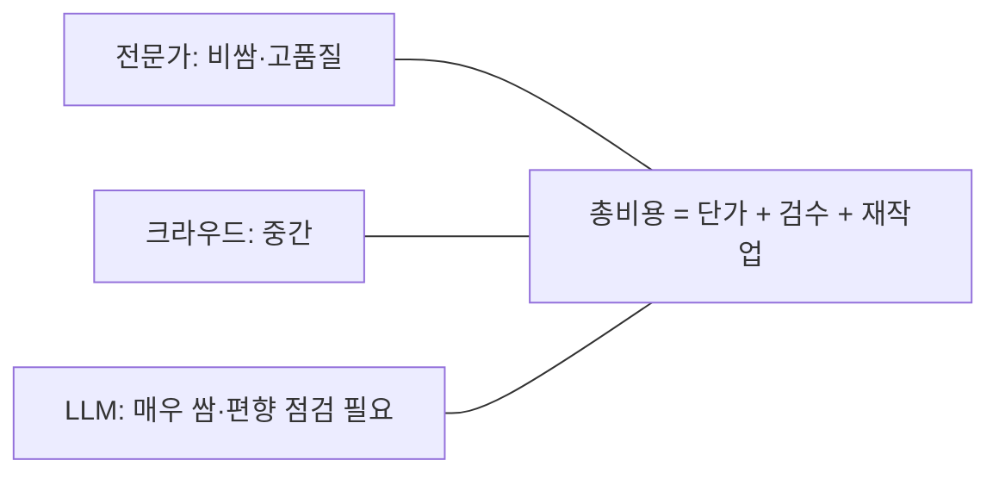

# 주석 비용 비교

> 같은 라벨 작업을 전문가·크라우드(MTurk 등)·LLM이 했을 때 건당 비용과 품질을 견줘 어떤 방식을 어디에 쓸지 정하는 판단 틀이다.

## 쉽게 말하면
이사 짐을 옮길 때 이삿짐센터(전문가), 일용직 여러 명(크라우드), 로봇(LLM)의 견적이 다르다. 싼 쪽이 항상 좋지는 않다. 파손(오라벨)이 나면 다시 해야 하니, **건당 가격 × 재작업·검수 비용**까지 합쳐 봐야 한다.

## 자세히
(arXiv 초록을 직접 열어 확인.)
- **대표 근거(Gilardi 외, arXiv 2303.15056, PNAS 2023)**: 트윗 2,382건에 대한 관련성·입장·주제·프레임 탐지 작업에서 zero-shot ChatGPT가 5개 작업 중 4개에서 크라우드워커보다 정확했고, 코더 간 일치도는 전 작업에서 크라우드·훈련된 주석자보다 높았다. 건당 **0.003달러 미만**, MTurk의 약 **20배 저렴**(초록 기준. 검색 요약에는 약 30배·5개 작업 68달러 대 657달러라는 보도도 있어 표현이 엇갈림).
- **해석 시 주의**: 2023년 모델·가격 기준이고 단일 표본·영어 중심이다. 저자도 다른 작업·언어에 추가 연구가 필요하다고 한다. 작업 난이도가 높거나 도메인 전문성이 필요하면 격차가 줄거나 뒤집힐 수 있다(제안).
- **총비용 계산(제안)**: ①건당 단가 ②검수·표본 점검 비율 ③오류로 인한 재라벨 ④기준(골드) 라벨 만들기 비용 ⑤개인정보·보안 요건(외부 API 전송 가능 여부).
- **혼합 전략(제안)**: LLM이 먼저 라벨 → 불확실·불일치 건만 사람 검수 → 사람 골드 셋으로 LLM 정확도 주기 측정.

## 그림으로 보기

## 예시
- 고객 후기 1만 건 감성 라벨: LLM이 전부 라벨 → 5% 표본을 사람이 검수해 일치율 확인 후 채택 여부 결정.
- 교육 활용: 비용표를 직접 채워 보며 "싸다 = 좋다"가 아님을 토론.

## 헷갈리는 것과 비교
| 개념 | 차이 |
|---|---|
| 주석 비용 비교 | 방식별 단가·품질 판단 틀 |
| [LLM 주석자](#llm-as-data-annotator) | LLM이 라벨을 다는 방법 자체 |
| 정확도 | 비용과 별개 지표. 둘을 함께 본다 |

## 더 읽을거리
- [ChatGPT Outperforms Crowd-Workers for Text-Annotation Tasks (arXiv 2303.15056)](https://arxiv.org/abs/2303.15056) — 정확도·일치도·건당 비용 근거.
