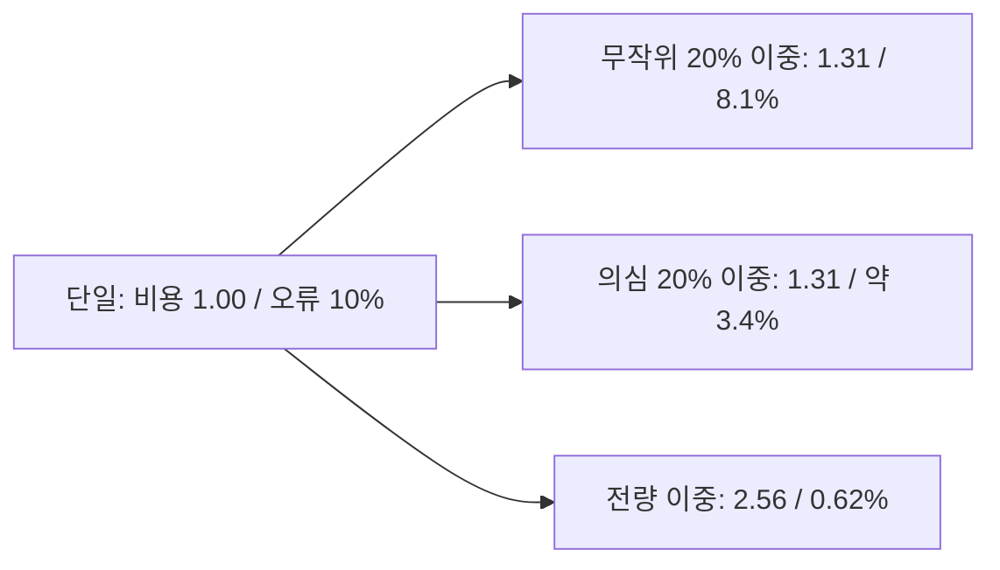
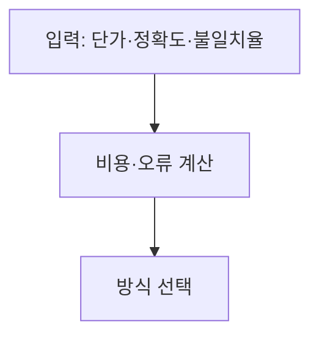

# 라벨링 비용 모델

> 라벨링 비용 모델은 단일 라벨, 전량 이중 라벨, 일부만 이중 라벨, 모델 의심도 기반 선택 이중 라벨 같은 운영 방식을 공통 단위(라벨 1건 = 비용 1)로 환산해 비용과 남는 오류를 비교하는 계산 틀이다.

## 쉽게 말하면
시험지를 한 명이 채점할지, 두 명이 전부 채점할지, 일부만 두 명이 채점할지를 "채점자 시간 합계"와 "남는 채점 오류"로 비교하는 계산이다. 싸게 하면 오류가 남고, 비싸게 하면 오류가 준다.

## 자세히
- **가정(내 계산용)**: 샘플 1만 개, 라벨 1건 비용 1, 판정(전문가) 1건 비용 3, 5클래스, 주석자 정확도 0.9 독립, 오답은 나머지 클래스에 균등, 두 사람의 불일치율 약 18.8%, 판정자 오류 2%. (모두 가정이며 [불일치율로 오류율 추정](#error-rate-from-disagreement)처럼 현장 값으로 바꿔야 한다.)
- **직접 계산(샘플당 비용과 최종 오류율)**:

| 운영 방식 | 샘플당 비용 | 남는 오류율 | 비고 |
| --- | --- | --- | --- |
| 단일 라벨 | 1.00 | 10.0% | 기준 |
| 전량 이중 + 불일치 판정 | 2.56 | 0.62% | 오류 약 16분의 1, 비용 2.6배 |
| 무작위 10% 이중 + 판정 | 1.16 | 9.06% | 품질 측정용, 오류는 거의 안 줄음 |
| 무작위 20% 이중 + 판정 | 1.31 | 8.12% | 〃 |
| 모델 의심 20%만 이중 + 판정(가정: 의심 20%에 단일 오류의 70% 집중) | 1.31 | 약 3.4% | 같은 비용에서 오류를 크게 줄임 |

  표본 이중 라벨은 **품질을 재는 용도**이지 오류를 줄이는 용도가 아니다. 같은 비용 1.31로 무작위 20%는 오류 8.1%, 모델 의심 20%는 약 3.4%다. 마지막 줄은 "의심 샘플에 오류가 70% 몰려 있다"는 가정에 의존하므로 [precision@k 검수 효율](#precision-at-k-review)로 실제 집중도를 먼저 재야 한다.
- **구성 요소(해석)**: 라벨 단가, 판정 단가, 이중 비율, 불일치율, 교육·품질 관리 고정비, 재작업 비용. 불일치율이 높을수록 판정 비용이 늘어 전량 이중의 단가가 커진다.
- **용도(해석)**: 예산 승인 전에 방식별 비용·오류 표를 만들어 목표 오류율에 맞는 방식을 고른다([목표 일치도 정하기](#target-agreement-setting), [품질 표본 추출 계획](#quality-sampling-plan)).

## 그림으로 보기

## 예시
- 코드 개념: `cost = N*(1 + f + f*d*adj)`로 표본 이중 비용을 계산, `f`=이중 비율, `d`=불일치율, `adj`=판정 단가.
- 교육 활용: 학습자가 단가와 정확도를 바꿔 표를 다시 만든다.

## 헷갈리는 것과 비교
| 개념 | 차이 |
| --- | --- |
| 비용 모델 | 방식별 비용·오류 비교 |
| [이중 검수](#double-annotation-review) | 하나의 운영 방식 |
| [후보 정밀도와 검증 비용](#candidate-precision-cost) | 후보 검증 비용 구조 |
| [표본 이중 라벨](#sampled-double-annotation) | 품질 측정용 부분 이중 |

## 더 읽을거리
- [cleanlab filter 문서](https://docs.cleanlab.ai/stable/cleanlab/filter.html) — 모델 의심 후보 뽑기
- [Cheap and Fast — But is it Good? (Snow 외, 2008)](https://aclanthology.org/D08-1027/) — 라벨 비용 대비 품질 사례
