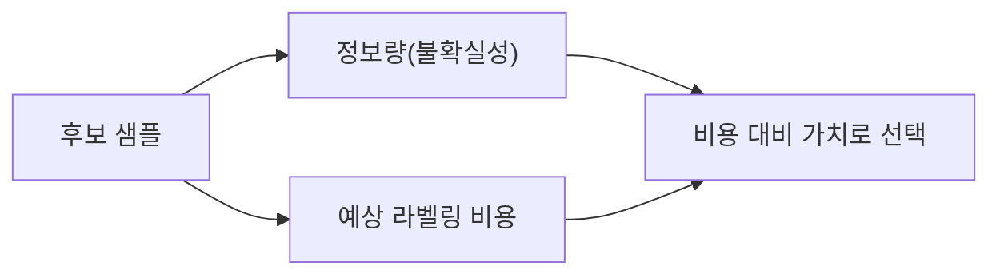

# 비용 민감 라벨링

> 샘플마다 **라벨링 비용이 다르다는 사실**을 반영해 질의 대상을 고르는 능동 학습 접근이다.

## 쉽게 말하면
문제집 해설을 맡길 때 짧은 문제와 긴 지문 문제의 시간이 다르다면 "헷갈리는 정도"만이 아니라 "얼마나 시간이 걸리는지"도 함께 따져 맡겨야 한다.

## 자세히
(Settles 2009 문헌 조사 6.3절을 직접 읽었다.)
- **기본 가정의 문제(문헌)**: 대부분의 능동 학습은 라벨 비용이 고정이라고 가정하지만 실제로는 **샘플마다 크게 다를 수 있다**.
- **결정이론적 접근(Kapoor 외 2007)**: 후보 질의를 **라벨링 비용 + 미래 오분류 비용**의 합으로 평가. 두 비용을 같은 화폐 단위로 맞춰야 한다(예: 주석 초당 /bin/bash.01, 오분류당 0). 실험에서는 라벨 비용이 음성메일 길이에 선형이라고 가정했다.
- **비용을 모르는 경우(Settles 외 2008a)**: 소요 시간 등 비용을 모를 때 **비용 회귀 모델**을 작업 모델과 함께 학습하고 "메타 특징"으로 비용을 예측. 4개 데이터셋 분석에서 비용이 샘플마다 크게 다르며, **비용을 무시하면 무작위 선택과 별 차이가 없을 수도 있다**.
- **주의(문헌)**: 정보량 측정값을 비용으로 나누는 단순한 방법이 항상 효과적이지는 않다.

## 그림으로 보기

## 예시
- 긴 계약서와 짧은 이메일의 라벨링 시간을 기록해 문서 길이로 비용을 예측하고 우선순위에 반영(제안).

## 헷갈리는 것과 비교
| 접근 | 비용 처리 |
|---|---|
| 기본 능동 학습 | 비용 고정 가정 |
| 비용 민감 | 샘플별 비용 반영 |
| [종료 기준](#al-stopping-criteria) | 언제 멈출지 |

## 더 읽을거리
- [Settles (2009)](https://burrsettles.com/pub/settles.activelearning.pdf) — 직접 읽음.
