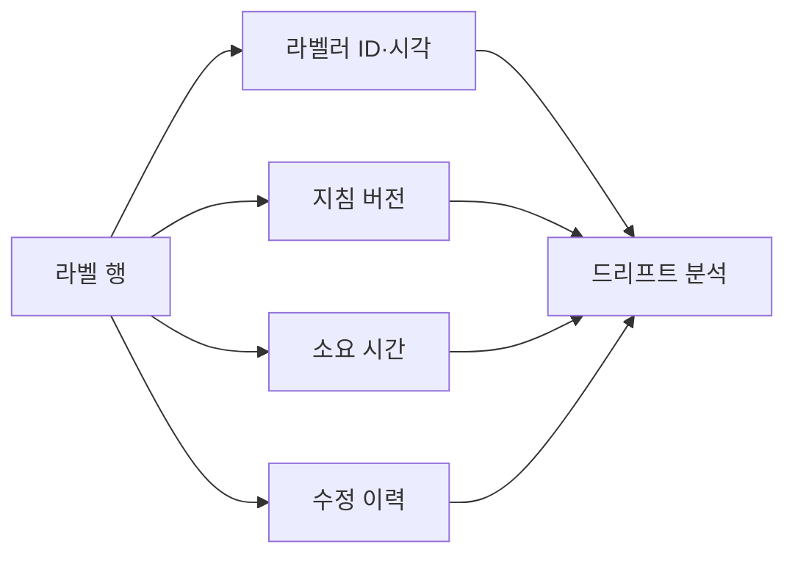
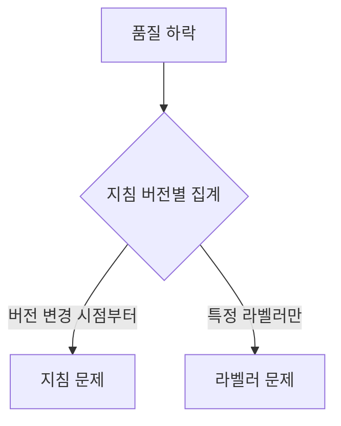

# 라벨 메타데이터 기록

> 라벨 메타데이터 기록은 라벨 값뿐 아니라 누가·언제·어떤 지침 버전으로·얼마나 걸려서 라벨했는지를 함께 저장하는 것이다. 품질 하락의 원인을 추적하고 라벨러 드리프트를 감지하는 기본 재료가 된다.

## 쉽게 말하면
성적표에 점수만 있으면 점수가 이상할 때 이유를 모르지만, "누가 채점했나·언제·어떤 채점 기준표 버전"이 같이 있으면 원인을 찾을 수 있다.

## 자세히
- **근거(Finlayson & Erjavec, arXiv 1602.05753)**: 주석 프로젝트에서 흔히 간과되는 일이 주석 과정 자체의 메타데이터를 남기는 것이라고 한다. 최소한 어떤 주석자가 어떤 문서를 주석했는지, 어떤 문서가 이미 주석됐는지를 알아야 하고, 더 자세히는 문서별 작업 시간, 개별 주석의 출처(원래 어떻게 생성됐고, 어떤 순서로, 누가, 어떻게 수정했는지)까지 볼 수 있다. 이 정보로 주석 과정을 분석해 개선하거나 주석자 생산성과 효율을 잰다. Story Workbench는 개별 주석 단위로 출처와 시간 데이터를 포착한다. 주석 단계 항목에도 지침 버전 추적, 메타데이터 수집(주석에 걸린 시간·주석자 신원)이 들어 있다.
- **저장 항목(해석)**:

| 항목 | 용도 |
| --- | --- |
| 샘플 ID, 라벨, 라벨러 ID | 기본 |
| 라벨 시각 | 드리프트·피로 분석 |
| 지침 버전 | 지침 변경 전후 비교([라벨러 훈련 라운드](#annotator-training-rounds)) |
| 소요 시간 | 지나치게 짧으면 스패머 의심([스패머 탐지](#spammer-detection)) |
| 수정 이력(누가·무엇을·언제) | 판정 추적([판정 사유 기록](#adjudication-rationale-log)) |
| 도구 제안 표시 여부 | 앵커링 분석([라벨링 앵커링](#anchoring-in-labeling)) |
| 배정 방식·배정 시각 | 배정 편향 분석([항목 무작위 배정](#random-assignment-of-items)) |

- **개인정보(해석)**: 라벨러 ID는 가명 처리하고 접근 권한을 제한한다. 평가 목적 외 사용을 금지하는 정책을 둔다.
- **활용 예(해석)**: 지침 v1.3 이후 불일치율이 높아졌다면 지침 버전별로 집계해 원인이 지침인지 사람인지 구분한다. 라벨러 C의 평균 소요 시간이 갑자기 절반으로 줄었다면 드리프트·부주의 신호다.

## 그림으로 보기

## 예시
- 테이블 열: `sample_id, label, annotator_id, labeled_at, guideline_ver, seconds_spent, suggested_label_shown`.
- 교육 활용: 같은 라벨 데이터에 메타데이터 열을 더해 어떤 질문에 답할 수 있게 되는지 토론한다.

## 헷갈리는 것과 비교
| 개념 | 차이 |
| --- | --- |
| 라벨 메타데이터 | 라벨 생성 과정의 기록 |
| 데이터 자체의 특징(feature) | 모델 입력 |
| [판정 사유 기록](#adjudication-rationale-log) | 판정 사유에 특화 |
| [라벨링 관리도](#control-chart-for-labeling) | 메타데이터 집계 지표를 감시 |

## 더 읽을거리
- [Overview of Annotation Creation: Processes & Tools (arXiv 1602.05753)](https://arxiv.org/abs/1602.05753) — 주석 메타데이터와 출처 추적
