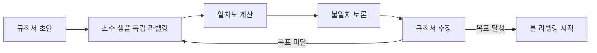
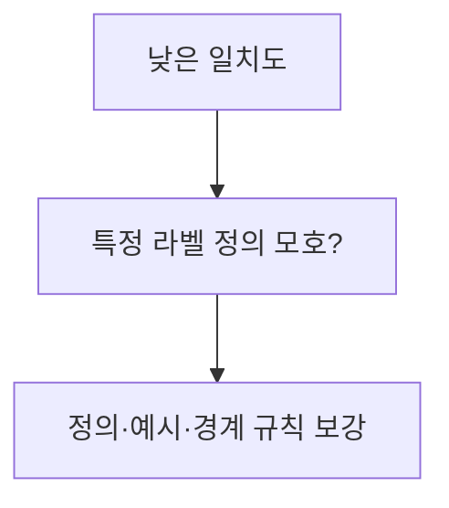

# 시범 라벨링 라운드

> 본 라벨링을 시작하기 전에 소수의 샘플을 여러 사람이 독립적으로 라벨링해 보고, 일치도와 의견 차이를 보며 라벨링 규칙서를 고치는 사전 연습 단계다.

## 쉽게 말하면
요리 대회 심사위원들이 본 심사 전에 시식 샘플 몇 개로 "맛있음의 기준"을 맞추는 시간이다. 처음에는 점수가 제각각이지만, 이유를 얘기하며 기준을 정리하면 본 심사에서 점수가 흔들리지 않는다.

## 자세히
(TRAM 프로젝트의 Data Annotation Best Practices 위키와 Snorkel 가이드 페이지를 직접 열어 확인, 수치 권장은 검색 결과의 실무 가이드 인용.)
- **무엇을 하나**: 라벨러들이 샘플 문서로 연습하며 규칙서를 익힌다. 여러 명이면 애매한 부분을 자유롭게 토론한다. 이 단계의 평가자 간 일치도가 "시범을 더 해야 하는가"를 알려 준다.
- **반복 구조(Snorkel)**: 초안 작성 → 여러 명이 같은 글을 독립적으로 라벨링 → 불일치 토론 → 규칙서 수정을 반복. 첫 라운드는 정해지지 않은 사항이 많아 불일치가 가장 많고, 토론이 가장 값진 시간이다. 준비는 가벼워도 된다(참고 자료 몇 개나 글 하나).
- **규모(검색 결과 인용, 실무 가이드)**: 새 과제는 소규모 라벨러 그룹이 100~200개 샘플로 시범을 한다. 어떤 논문 사례는 전문가 4명이 같은 100문장으로 시범을 했다.
- **목표 일치도는 미리 정한다**: 예로 kappa 0.8 이상을 목표, 0.7 미만이면 교육·규칙 보강. 이 값은 경험칙이지 표준이 아니다(검색 결과 요약).
- **해석**: 특정 라벨에서 일치도가 낮다면 라벨러 탓이 아니라 그 라벨의 정의가 모호하다는 신호다.
- 규칙서는 시범 중에도, 본 작업 중에도 계속 바뀐다. 본 작업 중 발견되는 사례는 [경계 사례 기록](#guideline-edge-case-log)으로 쌓는다.

## 그림으로 보기

## 예시
- 고객 문의 감정 라벨(긍정·중립·부정·불만) 5,000건을 맡기기 전에, 담당자 3명이 150건을 독립 라벨링 → "정중한 항의"는 부정인지 불만인지 갈림 → 규칙서에 한 줄 추가.
- 교육 활용: 수강생이 직접 20건으로 시범 라벨링을 하고 일치도를 보면 "AI 정답지는 사람이 합의해 만든 것"임을 체감한다.

## 헷갈리는 것과 비교
| 개념 | 차이 |
|---|---|
| 시범 라운드 | 본 작업 전 소수로 연습·규칙 정비 |
| [이중 라벨링과 판정](#double-annotation-adjudication) | 본 작업에서 같은 항목을 둘이 라벨링 |
| [보정 문항](#calibration-items) | 본 작업 중 정기적으로 일치도 점검 |

## 더 읽을거리
- [TRAM: Data Annotation Best Practices Guide](https://github.com/center-for-threat-informed-defense/tram/wiki/Data-Annotation-Best-Practices-Guide) — 시범·이중·판정·공통 문서(열어 확인).
- [Snorkel: Guideline goal](https://docs.snorkel.ai/docs/0.93/user-guide/best-practices/guideline-goal) — 규칙서 반복 개발 라운드(열어 확인).
