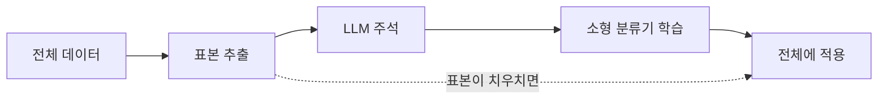
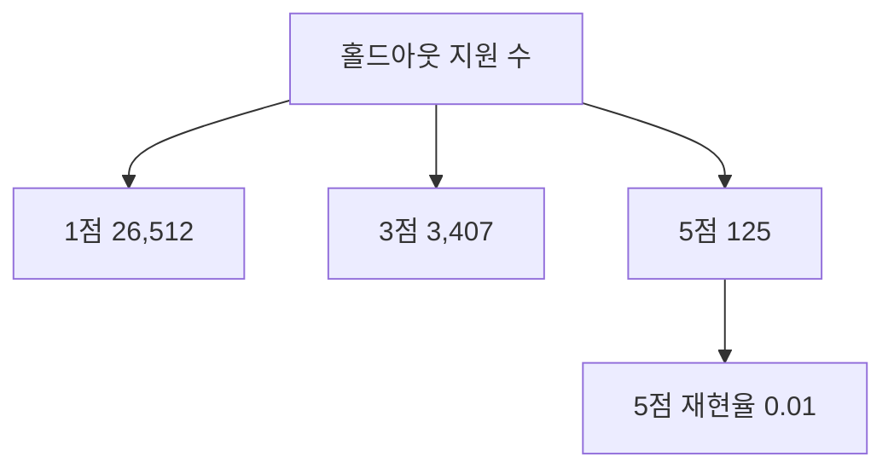

# 주석 표본 대표성

> "주석 후 증류"에서 큰 LLM이 라벨을 다는 **소량 표본이 분류기를 적용할 전체 데이터를 닮아야** 한다. 표본이 치우치면 분류기는 그 치우침을 그대로 배워 전체에 퍼뜨린다.

## 쉽게 말하면
전국 입맛을 알고 싶은데 한 동네 식당 평가만 모아서 조교에게 가르치면, 조교는 그 동네 입맛으로 전국 식당을 채점한다. 표본이 작아서 문제인 게 아니라 **어디서 뽑았느냐**가 문제다.

## 자세히
- 출처: FineWeb-Edu 분류기 모델 카드(Hugging Face, 직접 읽음). Llama3-70B-Instruct가 FineWeb 웹 샘플 약 45만 개(모델 카드 표기)에 0~5점을 매겼고, Snowflake-arctic-embed 위 회귀 헤드를 20에폭·학습률 3e-4로 학습했다. 검증은 라벨 46,867개 홀드아웃이다.
- 모델 카드의 한계 문구: 성능은 학습 데이터와 주석 LLM의 **품질·대표성에 달려 있고**, FineWeb 밖의 분포(특히 OOD 샘플)에서는 달라질 수 있다. 초·중등 수준 콘텐츠에 초점을 맞춰 대학·전문 자료에는 약할 수 있고, 학술적으로 보이는 문체에 높은 점수를 주도록 과적합될 수 있어 `int_score >= 3` 임계값을 권한다.
- 표본의 클래스 불균형이 수치로 드러난다: 홀드아웃 지원 수가 0점 5,694, 1점 26,512, 2점 10,322, 3점 3,407, 4점 807, **5점 125개**뿐이다. 이진 F1은 82%지만 클래스별 F1은 1점 0.81, 3점 0.53, 4점 0.44, 5점 0.02(재현율 0.01)로 희귀 구간을 거의 못 맞힌다. 전체 정확도 0.71, 매크로 F1 0.50. 즉 표본에 드문 점수는 모델도 못 배운다.
- 점검 방법(일반 권장): ① 출처 도메인·길이·언어 분포를 표본과 전체에서 비교 ② 희귀 구간은 층화 추출로 더 뽑기 ③ 적용 대상이 바뀌면(예: 사내 문서) 새 표본으로 다시 주석 ④ 사람 정답 소량으로 LLM 주석 자체를 점검.
- 한계: 모델 카드의 홀드아웃 라벨은 사람이 아닌 Llama3 주석이라, 위 수치는 "LLM과 얼마나 일치하나"이지 "진짜 품질을 맞히나"가 아니다.

## 그림으로 보기

## 예시
| 점수 | 지원 수 | F1 |
|---|---|---|
| 1 | 26,512 | 0.81 |
| 3 | 3,407 | 0.53 |
| 5 | 125 | 0.02 |
- 업무 장면: 공개 웹으로 학습한 품질 분류기를 사내 매뉴얼에 그대로 쓰기 전에, 사내 문서 300건에 라벨을 달아 점수 분포부터 비교한다.

## 헷갈리는 것과 비교
| 개념 | 차이 |
|---|---|
| 주석 표본 대표성 | 표본이 전체를 닮았는가 |
| [주석 후 증류 패턴](#annotate-then-distill) | 이 문제가 생기는 전체 절차 |
| 표본 크기 | 많다고 대표적인 것은 아님. 어디서 뽑았는지가 핵심 |
| [LLM 주석 편향](#llm-annotation-bias) | 라벨러(LLM)의 치우침. 표본 치우침과 별개 |

## 더 읽을거리
- [fineweb-edu-classifier 모델 카드](https://huggingface.co/HuggingFaceFW/fineweb-edu-classifier) — 학습 데이터·클래스별 지표·한계(직접 읽음).
