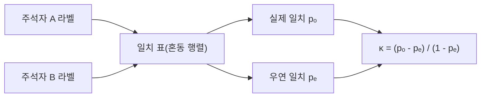
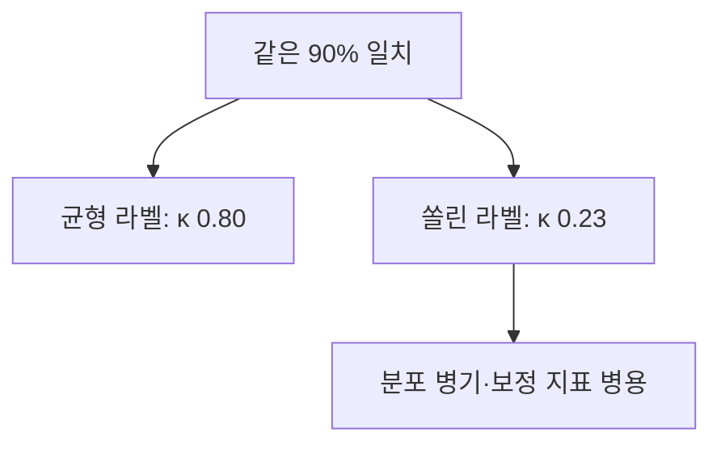

# 주석자 일치도 지표

> 라벨러(사람·LLM) 둘 이상이 **얼마나 같은 라벨을 달았는지**를 우연히 일치할 확률까지 빼고 재는 지표. 코헨 카파(κ)와 크리펜도르프 알파(α)가 대표적이다.

## 쉽게 말하면
동전 던지기로 정해도 두 사람이 앞면·뒷면을 우연히 절반쯤은 같게 낸다. 그래서 "90% 같았다"가 아니라 "우연히 같은 것을 뺀 뒤 얼마나 더 같은가"를 본다.

## 자세히
- **코헨 카파(scikit-learn 문서, 직접 읽음)**: κ = (pₒ − pₑ) / (1 − pₑ). pₒ는 실제 일치 비율, pₑ는 두 주석자가 각자의 라벨 분포대로 무작위로 달았을 때의 기대 일치 비율. 범위 −1~1, 1은 완전 일치, 0은 우연 수준. `weights="linear"|"quadratic"`로 순서형 라벨(1점 vs 5점이 1점 vs 2점보다 심각)에 가중치를 줄 수 있다. 문서 예시(5건, 세 라벨)에서 κ=0.6875이고 이를 직접 계산해도 같았다. 문서는 "강한 일치" 기준표를 제시하지 않는다.
- **직접 계산한 유병률 효과(가상 100건, 이진 라벨)**:
  - 균형 데이터(긍정 50·부정 50), 일치 90건 → pₑ=0.50, **κ=0.80**.
  - 쏠린 데이터(긍정 93건 근처로 쏠림), 같은 90건 일치 → pₑ≈0.87, **κ≈0.23**, 크리펜도르프 α(명목, 두 주석자)도 ≈0.24.
  같은 90% 일치인데 라벨이 한쪽으로 쏠리면 κ가 크게 낮아진다. 그래서 라벨 분포를 같이 보고하고 필요하면 PABAK이나 Gwet AC1 같은 보정 지표를 병용한다([PABAK](#pabak), [Gwet AC1](#gwet-ac1)).
- **크리펜도르프 α**: 주석자가 3명 이상이거나 일부 항목이 비어 있어도 쓰는 일치도(명목·순서·구간 척도 지원). 불일치를 기대 불일치와 비교해 1−(관측/기대)로 계산한다.
- **해석 주의**: ① 높은 일치도는 타당성(정확함)을 보장하지 않는다([신뢰성과 타당성](#reliability-vs-validity)) ② 임계값 기준표는 분야마다 다르다 ③ LLM 대 사람의 일치도는 사람 사이 일치도 상한을 함께 봐야 해석된다([통계적 튜링 테스트](#statistical-turing-test-annotation)).
- 참고 문헌: Artstein·Poesio(2008) "Inter-coder agreement for computational linguistics"(scikit-learn 문서가 인용, 원문 미확인).

## 그림으로 보기



## 예시
| 상황(가상) | pₒ | pₑ | κ |
|---|---|---|---|
| 라벨 균형 | 0.90 | 0.50 | 0.80 |
| 라벨 쏠림 | 0.90 | 0.87 | 0.23 |
```python
from sklearn.metrics import cohen_kappa_score
cohen_kappa_score(y1, y2, weights="quadratic")  # 순서형 라벨
```
- 업무 장면: 긴급도 라벨(상·중·하)을 사람 2명과 LLM 1명이 달 때 쌍별 κ와 전체 α를 함께 표로 낸다.

## 헷갈리는 것과 비교
| 개념 | 차이 |
|---|---|
| 정확도(일치율) | 우연 일치를 빼지 않음 |
| 코헨 κ | 주석자 2명, 우연 보정 |
| 크리펜도르프 α | 여러 명·결측 허용 |
| [코헨 카파](#cohens-kappa) | 이 지표를 따로 다룬 노드 |

## 더 읽을거리
- [scikit-learn cohen_kappa_score](https://scikit-learn.org/stable/modules/generated/sklearn.metrics.cohen_kappa_score.html) — 공식·가중치·예시(직접 읽음).
