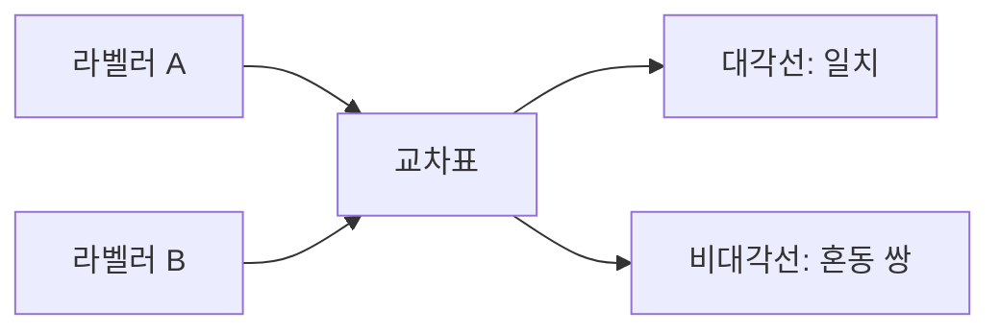
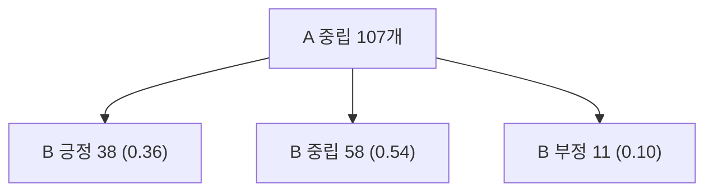

# 라벨러 간 혼동 행렬

> 라벨러 간 혼동 행렬은 두 라벨러가 같은 샘플에 붙인 라벨을 행(라벨러 A)과 열(라벨러 B)로 교차 집계한 표다. 대각선 밖에 숫자가 몰린 칸이 두 사람이 자주 엇갈리는 클래스 쌍(혼동 쌍)이다.

## 쉽게 말하면
두 채점자가 같은 답안 300개를 "부정/중립/긍정"으로 채점한 결과를 한 표에 모으면, 어디서 의견이 갈리는지 한눈에 보인다. "중립"과 "긍정" 칸에 숫자가 몰려 있다면 그 둘의 경계가 모호하다는 신호다.

## 자세히
- **표 읽는 법(scikit-learn 문서)**: `confusion_matrix(y_true, y_pred)`에서 행은 참 클래스, 열은 예측 클래스이고 `[i, j]`는 i에 속하지만 j로 예측된 개수다. 라벨러 간에 쓰면 행=라벨러 A, 열=라벨러 B로 읽는다(둘 중 누가 "참"인지는 없다). `normalize='true'`는 행 합이 1이 되어 "A가 어떤 클래스라고 한 것 중 B가 각각 어떻게 답했나"를 보여 준다. 위키 등은 축 규칙이 반대일 수 있다고 문서가 밝힌다.
- **직접 만든 예(300개, 가상 두 라벨러. 둘 다 "중립"을 흐리게 판정하도록 설정, 일치율 0.66)**:

| A \ B | 부정 | 중립 | 긍정 |
| --- | --- | --- | --- |
| 부정 | 63 | 26 | 9 |
| 중립 | 11 | 58 | 38 |
| 긍정 | 5 | 13 | 77 |

  A가 "중립"이라 한 107개 중 B가 "긍정"이라 한 것이 38개(0.36)로 가장 큰 비대각선이다. 그다음은 A "부정" → B "중립" 26개(0.27). 이 데이터는 일부러 중립을 흐리게 만든 가상 예이며 실제 비율은 아니다.
- **쓰임(해석)**: ① 가장 큰 비대각선 쌍을 골라 가이드에 판정 규칙·예시를 추가([혼동 쌍 중심 라벨 가이드](#confusion-pair-guideline)) ② 대칭이 아니면(A→B와 B→A가 크게 다르면) 한 라벨러가 한쪽으로 치우친 것 ③ 일치율이 낮을 때 원인을 클래스 쌍 단위로 좁힌다([평가자 간 일치도](#inter-annotator-agreement)).
- **주의(해석)**: 클래스가 많으면 행렬이 커져 읽기 어렵다. 상위 혼동 쌍 3~5개만 뽑아 본다.

## 그림으로 보기



## 예시
```python
from sklearn.metrics import confusion_matrix
cm = confusion_matrix(a_labels, b_labels, normalize="true")
```
- 교육 활용: 학습자 두 명이 같은 문장 30개를 라벨링하고 직접 3×3 표를 만들어 가장 엇갈린 쌍을 찾는다.

## 헷갈리는 것과 비교
| 개념 | 차이 |
| --- | --- |
| 라벨러 간 혼동 행렬 | 두 사람의 라벨 교차표 |
| 모델 혼동 행렬 | 참 라벨 vs 모델 예측 |
| [클래스별 일치도](#specific-agreement) | 클래스마다 일치를 요약한 수치 |
| [판단 불가 선택지](#cannot-decide-option) | 모호한 샘플을 따로 모으는 설계 |

## 더 읽을거리
- [scikit-learn 모델 평가: confusion matrix](https://scikit-learn.org/stable/modules/model_evaluation.html#confusion-matrix) — 행·열 의미와 normalize 옵션
