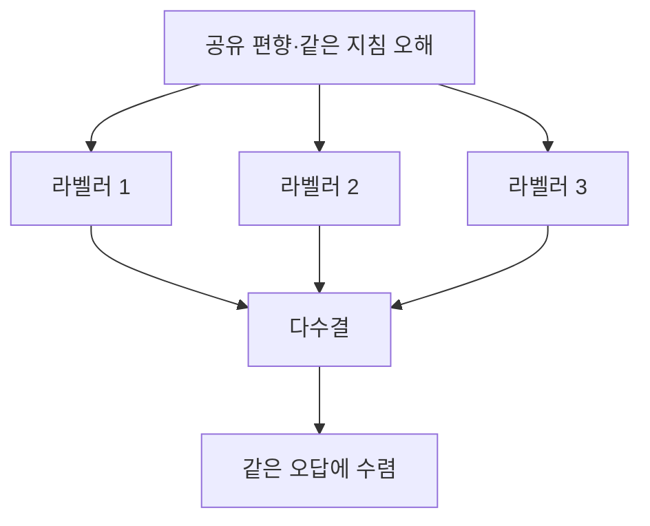
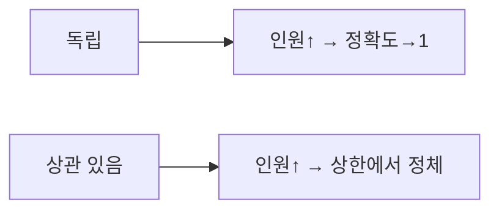

# 라벨러 독립 가정

> 다수결 중복 라벨링은 "각 라벨러의 실수가 서로 무관하다"는 가정에 기대는데, 라벨러들이 같은 편향·같은 지침 오해를 공유하면 인원을 늘려도 정확도가 어느 선에서 멈춘다.

## 쉽게 말하면
같은 잘못된 교재로 공부한 10명에게 물으면 10명 모두 같은 오답을 낸다. 사람이 많아도 정보는 한 사람분이다.

## 자세히
(Sheng 외 KDD 2008 PDF와 위키백과 배심원 정리 문서를 직접 열어 확인. 위키는 2차 요약이라 세부 조건은 원 논문에서 재확인 필요.)
- **가정의 명시**: Sheng 외는 각 라벨러가 정확도 p로 정답을 맞히며 그 품질이 데이터 점과 무관하다고 가정한다(3.1절).
- **상관이 있을 때(위키 요약)**: 무조건적 독립이 깨지면 "배심원을 늘릴수록 신뢰도가 오른다"가 성립하지 않을 수 있다. Kaniovski–Zaigraev 예시(p=0.55, 상관 c=0.4)에서는 3명이 1명보다, 5명이 3명보다 나쁘다. 조건부 독립이 있어도 정확도가 1이 아닌 값에 수렴할 수 있다(Dietrich & Spiekermann). 평균 공분산이 배심원 수와 함께 작아질 때에만 무오류에 수렴한다는 결과(Pivato)가 있다. Ladha(1992)·Boland의 세부 조건은 이번에 원문을 못 열어 **미확인**.
- **장난감 모델(저자가 직접 계산한 예시, 출처 없음)**: 확률 r로 모두가 하나의 공유 표를 따르고 나머지는 독립, p=0.7, r=0.5이면 n=1 → 0.700, n=7 → 0.787, n=101 → 0.850. 한계값은 r·p + (1−r).
- **실무 신호(제안)**: 라벨러 간 일치율이 지나치게 높은데 골드 세트 정확도가 낮으면 공통 편향 의심. 다른 배경의 라벨러·다른 지침 버전으로 다양화.

## 그림으로 보기

## 예시
- 외주 라벨러 10명 모두 같은 가이드의 모호한 문장을 같은 방식으로 해석 → 골드 세트 점검에서 일괄 오류 발견.
- 교육 활용: 비슷한 AI 모델 여러 개를 합쳐도 같은 학습 데이터면 같은 실수를 한다는 비유.

## 헷갈리는 것과 비교
| 개념 | 차이 |
|---|---|
| 독립 가정 | 오류가 서로 무관 |
| 상관된 오류 | 공통 원인으로 같이 틀림 |
| [다수결 정확도 곡선](#majority-vote-accuracy-curve) | 독립일 때의 이론값 |

## 더 읽을거리
- [Get Another Label? (NYU 아카이브 PDF)](https://archive.nyu.edu/bitstream/2451/27818/2/CPP-02-08.pdf) — 독립 가정 명시.
- [Condorcet's jury theorem (Wikipedia)](https://en.wikipedia.org/wiki/Condorcet%27s_jury_theorem) — 상관과 정리 확장(2차 요약).
