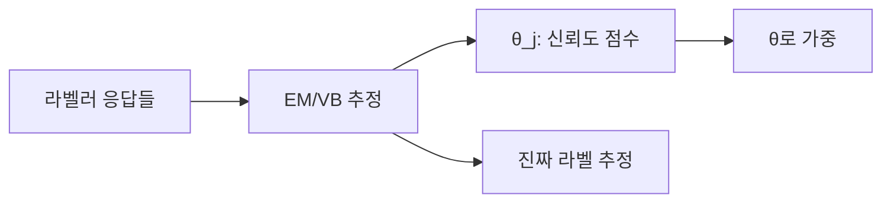
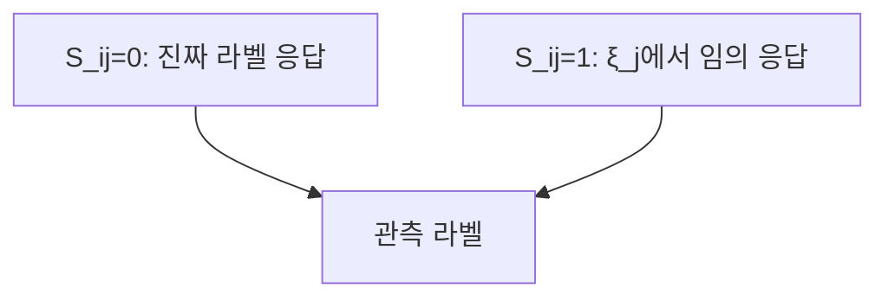

# 라벨러 품질 점수

> 정답 없이 여러 라벨러의 응답만으로 "각 라벨러가 얼마나 믿을 만한가"를 숫자로 추정한 값이다. MACE의 θ는 라벨러가 아무 답이나 찍지 않을 확률을 나타낸다.

## 쉽게 말하면
시험 정답을 몰라도 응시자들의 답 일치 패턴으로 "누가 성실하게 푼 사람인지" 점수를 매기는 것이다. 점수가 낮은 사람의 답은 덜 반영한다.

## 자세히
(Hovy 외, "Learning Whom to Trust with MACE", NAACL 2013 PDF를 하위 에이전트가 원문으로 읽은 노트 기준.)
- **모델**: 항목 i, 라벨러 j에 대해 S_ij ~ Bernoulli(1−θ_j)는 "아무 답이나 찍음(spamming)" 지시자. θ_j는 **스패밍하지 않을 확률**(신뢰도·역량). S=0이면 진짜 라벨 T_i를 답하고, S=1이면 진짜 라벨과 무관한 라벨러별 분포 ξ_j에서 답을 뽑는다. EM 또는 변분 베이즈(θ에 Beta 사전분포)로 학습하며 VB가 일관되게 낫다.
- **점수의 타당성**: 라벨러의 실제 역량(골드 정답률)과의 피어슨 상관이 θ가 Cohen의 κ나 단순 일치율보다 훨씬 높다고 보고. 표 1 발췌 예(열은 RTE/시간순서/단어의미로 추정): 일치율 0.78/0.73/0.81, κ 0.70/0.80/0.13, MACE-EM 0.87/0.88/0.44(VB 행은 추출 실패로 미확인).
- **라벨 정확도(표 2, Snow 2008 데이터)**: 다수결 0.90/0.93/0.99, MACE-EM@90 0.95/0.97/0.99, MACE-VB@90 0.96/0.97/1.0, MACE-VB@75 0.98/0.98/1.0. @n은 사후 엔트로피로 가장 확신하는 상위 n%만 평가한 값이라 전체 커버리지와 비교할 수 없다. 전체 커버리지에서 RTE 0.93, 시간순서 0.94.
- **라벨러를 버리지 않는다**: 일치율 기준 가지치기는 정지 기준이 없지만 MACE는 가중치만 조정.
- **합성 실험**: 라벨러 20명, "좋은" 라벨러 정답률 95%, 좋은 라벨러 수 0~10명, 방해 라벨러는 무작위·항상 같은 라벨; 다수결보다 견고(그림 5 수치는 미확인).

## 그림으로 보기

## 예시
- 크라우드 라벨러별 θ가 0.3 미만이면 작업 제외·재교육 후보로 표시하고 골드 문항으로 확인.
- 교육 활용: "합의 점수가 높은 사람이 믿을 만한가?"를 κ와 θ로 비교.

## 헷갈리는 것과 비교
| 개념 | 차이 |
|---|---|
| MACE θ | 스패밍하지 않을 확률 |
| [혼동 행렬](#confusion-matrix-annotator) | 클래스별 오답 패턴(더 풍부, 추정 어려움) |
| Cohen κ | 쌍별 일치 보정 지표 |

## 더 읽을거리
- [Learning Whom to Trust with MACE (NAACL 2013)](https://aclanthology.org/N13-1132.pdf) — 모델·표 1~2.
