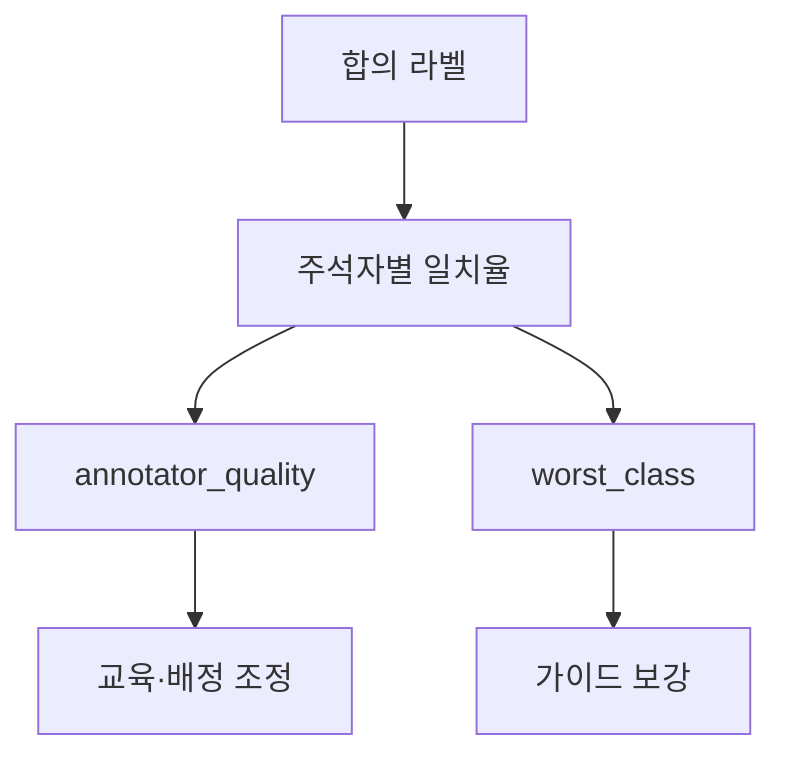
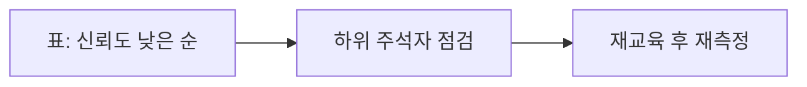

# 주석자 품질 통계

> 주석자 품질 통계는 라벨을 단 사람(주석자)마다 신뢰도·합의 일치율·가장 약한 클래스를 계산한 표다. 누구에게 교육이 필요한지, 누구의 라벨을 덜 믿을지 정하는 근거가 된다.

## 쉽게 말하면
학급 전체 채점을 도운 조교마다 "다른 조교·교수 판정과 얼마나 일치했는가"를 적은 성적표다. 어떤 문제 유형에서 유독 틀리는지도 나온다. 그 조교에게 그 유형을 다시 알려 주면 된다.

## 자세히
- **표의 열(cleanlab 튜토리얼 `annotator_stats`)**: 주석자마다 한 행. `annotator_quality`(그 주석자 라벨 전반에 대한 신뢰도), `agreement_with_consensus`(합의 라벨과 일치 비율), `worst_class`(가장 못하는 클래스), `num_examples_labeled`(라벨 수). 신뢰도가 낮은 주석자가 위로 오도록 정렬된다.
- **합의 라벨에 기대는 계산(해석)**: 이 통계는 합의 라벨([CROWDLAB](#crowdlab))이 대체로 맞다는 가정에 의존한다. 합의가 틀리면 올바르게 답한 주석자가 낮게 평가될 수 있다.
- **해석의 주의(해석)**: 라벨 수가 적은 주석자(예: 20개 이하)의 통계는 흔들린다. 어려운 샘플을 많이 맡은 주석자도 낮게 나오므로 샘플 배정이 같은지 확인한다([주석자 배정 공정성](#assignment-fairness)).
- **활용(해석)**: ① `worst_class`를 가이드 보강 대상 클래스 선정에 쓴다 ② 신뢰도가 낮은 주석자는 교육 후 재측정 ③ 반복해서 낮으면 담당 배정 조정 ④ 신뢰도를 가중치로 쓴 합의는 CROWDLAB이 이미 반영한다.

## 그림으로 보기

## 예시
- 주석자 C의 `worst_class`가 "중립"이면 중립 예시를 보충해 교육한다.
- 교육 활용: 학습자별 일치율 표를 만들고 "사람이 아니라 가이드의 문제인 경우"를 구분해 보게 한다.

## 헷갈리는 것과 비교
| 개념 | 차이 |
| --- | --- |
| 주석자 품질 통계 | 사람별 신뢰도·약점 |
| 샘플 합의 품질 점수 | 샘플별 합의 라벨의 확신도 |
| [평가자 간 일치도](#inter-annotator-agreement) | 주석자 전체의 일치 정도 |
| [CROWDLAB](#crowdlab) | 두 통계를 만드는 알고리즘 |

## 더 읽을거리
- [cleanlab multiannotator 튜토리얼](https://docs.cleanlab.ai/stable/tutorials/multiannotator.html) — annotator_stats 열의 의미
