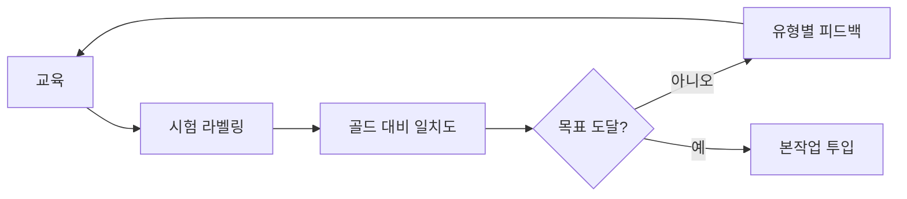
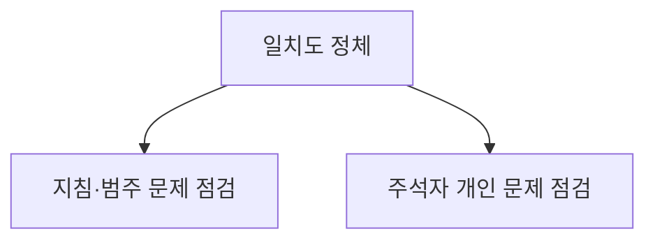

# 라벨러 훈련 라운드

> 라벨러 훈련 라운드는 주석자에게 지침을 교육하고 시험 라벨링을 시킨 뒤 골드 스탠더드나 서로의 라벨과의 일치도를 재서, 목표 수준에 이를 때까지 교육과 측정을 반복하는 과정이다.

## 쉽게 말하면
새 직원에게 업무 매뉴얼을 알려 주고 연습 문제를 풀게 한 뒤 채점해서, 틀리는 유형을 다시 알려 주는 것을 합격할 때까지 되풀이하는 것이다.

## 자세히
- **근거(Finlayson & Erjavec, arXiv 1602.05753)**: Annotate 단계에는 "주석자를 워크플로·도구·체계에 훈련시켜 허용 가능한 IAA에 이르게 하기"가 포함된다. 훈련은 대면, 완전 원격, 혼합일 수 있고, 몇 주에 걸쳐 시험과 재훈련을 계속하는 경우도 있고 몇 문장 안내로 끝나기도 한다. 훈련이 복잡·원격·장기일수록 관리 기능이 유용하며, 최소한 훈련용 텍스트를 배정하고 골드 스탠더드에 대한 일치도를 재야 한다. 이상적으로는 흔한 실수에 대한 맞춤 피드백, 핵심 예시·지침 부분 안내, 신뢰할 수 없는 주석자 걸러내기까지 해야 한다.
- **한 바퀴(해석)**: ① 지침·예시 교육 ② 같은 시험 문서 20~50개를 각자 독립 라벨링 ③ 골드(또는 전문가 라벨) 대비 일치도·혼동 행렬 계산([라벨러 간 혼동 행렬](#annotator-confusion-matrix)) ④ 틀린 유형별 피드백 ⑤ 목표 일치도([목표 일치도 정하기](#target-agreement-setting))에 도달하면 통과, 아니면 다시 ① — 같은 문서를 다시 쓰면 외워 버리므로 새 시험 문서를 쓴다.
- **주의(해석)**: 훈련 중 지침이 자주 바뀌면 이전 라벨과 일관성이 깨지므로 지침 버전을 기록한다. 일치도가 오르지 않으면 사람이 아니라 지침·범주 문제일 수 있다([불일치 샘플 토론](#disagreement-discussion)).
- **종료(해석)**: 라운드 수 상한과 합격선을 미리 정한다([시범 라운드 종료 조건](#round-stopping-criteria)).

## 그림으로 보기

## 예시
- 라운드 1 일치도 0.52 → 피드백 → 라운드 2 0.68 → 라운드 3 0.79(합격선 0.75)로 본작업 투입(가정한 예).
- 교육 활용: 학습자들이 라벨링 → 골드와 비교 → 피드백 라운드를 직접 돌려 본다.

## 헷갈리는 것과 비교
| 개념 | 차이 |
| --- | --- |
| 라벨러 훈련 라운드 | 사람을 교육·측정하는 반복 |
| [MATTER·MAMA 순환](#matter-mama-cycle) | 체계·지침을 다듬는 반복 |
| [작업자 품질 관리](#worker-quality-control) | 작업 중 필터링 |
| [시범 라운드 종료 조건](#round-stopping-criteria) | 반복 종료 기준 |

## 더 읽을거리
- [Overview of Annotation Creation: Processes & Tools (arXiv 1602.05753)](https://arxiv.org/abs/1602.05753) — 주석자 훈련 관리와 측정
