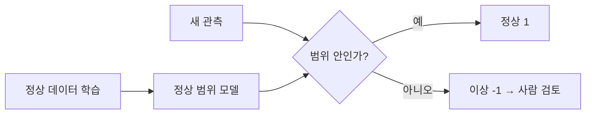
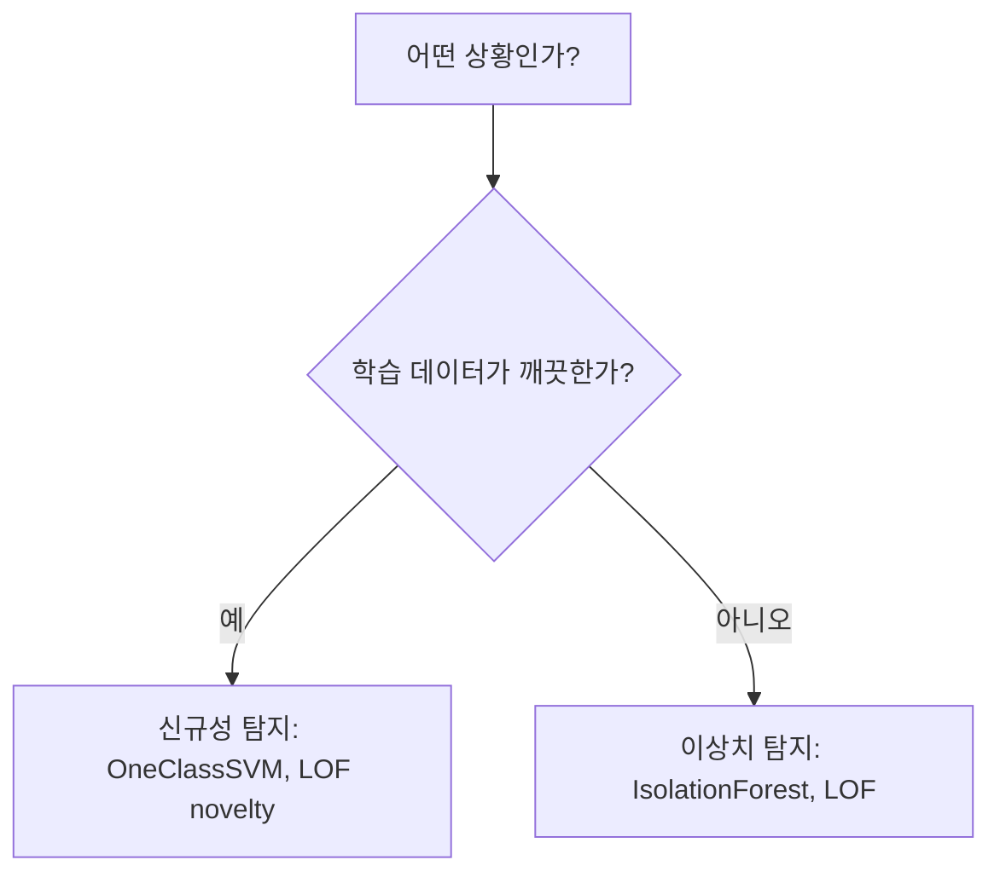

# 이상 탐지

> 이상 탐지(Anomaly Detection)는 "정상"의 패턴을 익힌 뒤, 거기서 크게 벗어난 데이터를 골라내는 문제다. 정답 라벨이 거의 없는 상황에서 자주 쓴다.

## 쉽게 말하면
공항 보안 검색대를 생각하면 된다. 수만 개의 평범한 가방이 어떤 모습인지 익숙해진 검색원은, 모양이 다른 가방 하나를 바로 알아본다. "위험물 사진"을 많이 본 적이 없어도 "평소와 다르다"는 것만으로 잡아낸다. 신용카드 사기, 공장 설비 고장, 서버 침입처럼 나쁜 사례가 드물어서 라벨을 모으기 어려운 곳에 맞는 방식이다.

## 자세히
scikit-learn 문서는 이 문제를 두 가지로 나눈다.
- **이상치 탐지(outlier detection, 비지도)**: 학습 데이터에 이상치가 섞여 있다. 밀집한 영역을 맞추고 벗어난 점을 무시한다.
- **신규성 탐지(novelty detection, 준지도)**: 학습 데이터는 깨끗하다. 새로 들어온 관측이 낯선지 판단한다. 낯선 점이 모여 군집을 이뤄도, 학습 분포에서 밀도가 낮으면 신규로 본다.

대표 알고리즘(scikit-learn 기준):
- **IsolationForest**: 특성과 분할값을 무작위로 골라 나무를 만든다. 이상 점은 적은 분할로 고립되므로 평균 경로 길이가 짧다. 고차원에서 무난한 기본값.
- **LocalOutlierFactor(LOF)**: 각 점의 국소 밀도를 이웃 k개(기본 20)의 밀도와 비교한다. 새 데이터에 쓰려면 `novelty=True`.
- **OneClassSVM**: 정상 데이터를 감싸는 경계를 학습. `nu` 조정이 필요하고 이상치에 민감.
- **EllipticEnvelope**: 가우시안 분포를 가정하고 마할라노비스 거리로 판정.

공통 API: `predict`는 정상 1, 이상 -1을 돌려주고 `contamination`이 임계값을 정한다. 주의: `novelty=True`인 LOF는 학습 데이터에 `predict`를 부르면 틀린 결과가 나온다.

## 그림으로 보기



## 예시
- 매출 로그에서 하루 중 비정상 결제 금액 찾기: `IsolationForest(contamination=0.01).fit_predict(X)`로 -1인 행만 모아 담당자에게 보낸다.
- LLM 서비스 운영: 요청 길이·응답 시간·토큰 비용을 모아 평소와 다른 호출을 경보로 띄운다.
```python
from sklearn.ensemble import IsolationForest
labels = IsolationForest(contamination=0.05, random_state=0).fit_predict(X)  # -1이 이상
```

## 헷갈리는 것과 비교
| 개념 | 차이 |
| --- | --- |
| [이상치 처리](#outlier-handling) | 이미 찾은 이상치를 제거·완화. 이상 탐지는 찾는 것 자체가 목적 |
| 분류 | 라벨이 충분할 때. 이상 탐지는 라벨이 거의 없을 때 |
| 이상치 탐지 vs 신규성 탐지 | 학습 데이터에 이상이 섞였는가 깨끗한가 |

## 더 읽을거리
- [scikit-learn: Novelty and Outlier Detection](https://scikit-learn.org/stable/modules/outlier_detection.html) — 알고리즘과 API 정리
