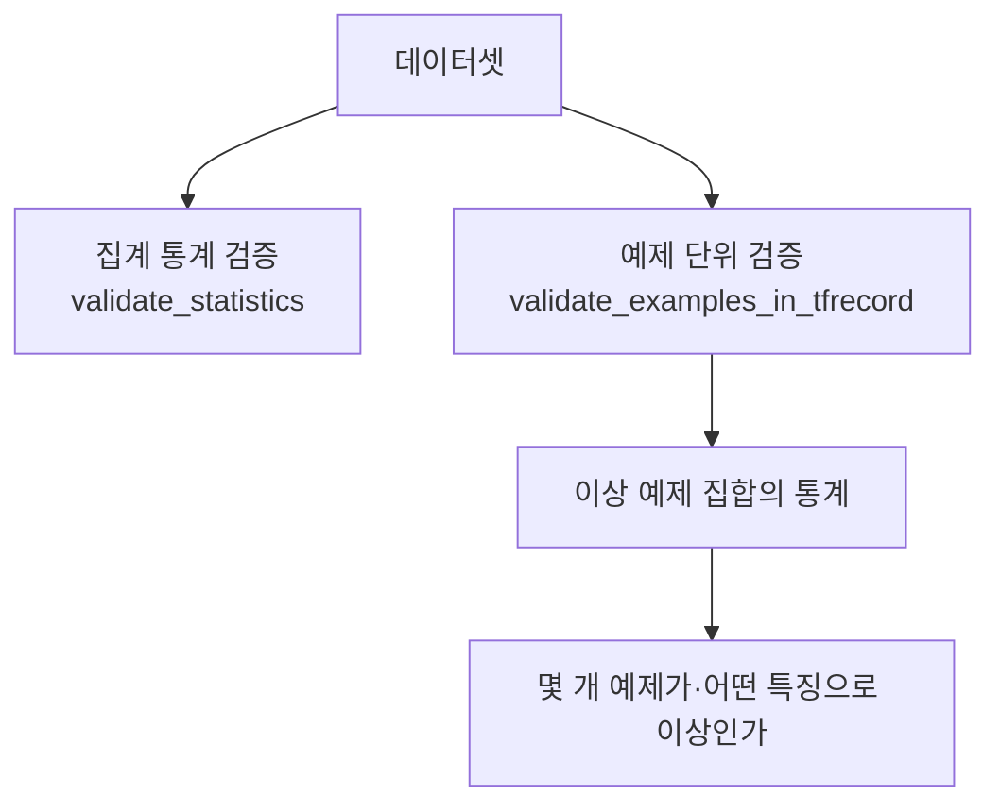
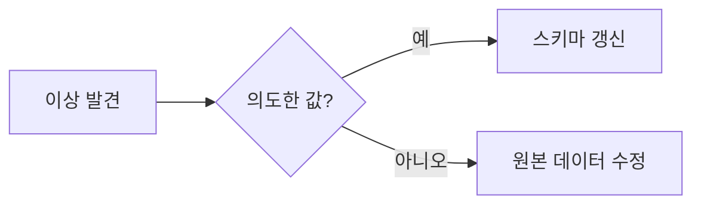

# 예제 단위 검증

> 데이터셋 **전체 통계**를 스키마와 맞춰 보는 대신, **예제(행) 하나씩** 스키마에 맞는지 검사해 이상이 있는 예제만 모아 그 통계를 보는 방법이다. TFDV의 `validate_examples_in_tfrecord`가 이 일을 한다.

## 쉽게 말하면
학급 평균 점수만 보면 "전체적으로 문제없다"고 나올 수 있다. 학생 한 명씩 답안지를 점검해 "형식이 틀린 답안지만" 따로 모아 보면 어떤 종류의 오류가 몇 장 있는지 알 수 있다. 통계 비교가 건강검진 결과표라면, 예제 단위 검증은 이상 소견이 나온 환자만 따로 분류한 명단이다.

## 자세히
(TensorFlow Data Validation(TFDV) 공식 시작 가이드를 직접 읽었다.)
- **두 가지 검사 방식(문서)**: 스키마와 대조해 이상을 찾는 방법은 ① **집계 방식** — 데이터셋의 통계를 스키마와 맞춰 불일치를 표시(`tfdv.validate_statistics`) ② **예제별 방식** — 예제마다 검사. 문서는 "데이터셋 전체 통계를 스키마와 비교하는 대신 예제 단위로 검증하는 옵션도 제공한다"고 적는다.
- **코드(문서 예)**
  ```python
  options = tfdv.StatsOptions(schema=schema)
  anomalous_example_stats = tfdv.validate_examples_in_tfrecord(
      data_location=input, stats_options=options)
  ```
- **반환값(문서)**: `DatasetFeatureStatisticsList` 프로토콜 버퍼이며, 각 데이터셋은 **특정 이상을 보이는 예제들의 집합**이다. 이를 이용해 어떤 이상이 데이터셋에 **몇 개의 예제**에서 나타나는지, 그 예제들의 특징이 무엇인지 알 수 있다.
- **집계 방식 예(문서)**: `payment_type`에 스키마 도메인에 없는 값이 있으면 "Unexpected string values — Examples contain values missing from the schema: Prcard (<1%)" 같은 이상이 나온다. 의도한 값이면 스키마에 값을 추가(`tfdv.get_domain(schema, 'payment_type').value.append('Prcard')`), 진짜 데이터 오류면 학습 전에 데이터를 고친다.
- **언제 예제 단위가 필요한가(해석)**: 집계 통계는 "1% 미만"이라는 숫자만 주지만, 예제 단위는 그 1%를 **직접 꺼내 보게** 한다. 원인 분석, 이상 예제 제외 여부 결정, 수정 우선순위 정하기에 유용하다. 대신 예제마다 검사하므로 데이터가 크면 비용이 더 든다(일반 원칙, 문서가 비용 수치를 주진 않음).
- **스키마 환경과의 관계(문서)**: 학습에는 있는 레이블 특징(`tips`)이 서빙 데이터에는 없을 때, 환경(`TRAINING`/`SERVING`)을 지정해 `not_in_environment`로 제외해야 불필요한 이상이 안 난다. 예제 단위 검증에서도 같은 스키마 정의가 기준이다.

## 그림으로 보기



## 예시
```python
import tensorflow_data_validation as tfdv
options = tfdv.StatsOptions(schema=schema)
anomalous_stats = tfdv.validate_examples_in_tfrecord(
    data_location="train.tfrecord", stats_options=options)
```
- 교육 소재: "평균만 보면 안 보이는 1%를 꺼내 보는 법".

## 헷갈리는 것과 비교
| 개념 | 차이 |
|---|---|
| 예제 단위 검증 | 예제마다 스키마 검사, 이상 예제 통계 반환 |
| 집계 통계 검증 | 데이터셋 통계를 스키마와 비교 |
| [skew 임계값](#acceptable-skew-threshold) | 두 데이터셋 분포 차이를 임계값으로 경보 |
| [스키마 vs 데이터 수정 판단](#schema-vs-data-fix-decision) | 이상 발견 후의 결정 |

## 더 읽을거리
- [Get started with TensorFlow Data Validation](https://www.tensorflow.org/tfx/data_validation/get_started) — 예제별 검증·스키마 환경(직접 읽음).
