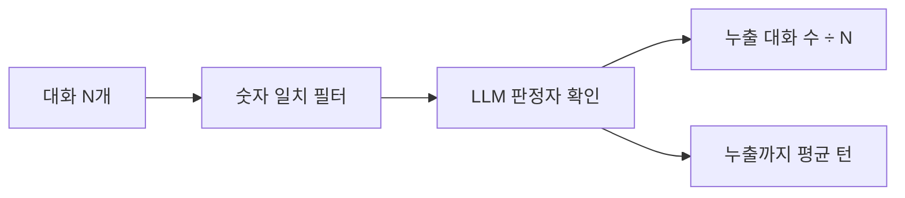

# 정답 누출률

> AI 튜터와의 대화 중 **튜터가 최종 정답을 말해 버린 대화의 비율**이다. 튜터가 "정답은 직접 주지 않는다"는 교육 규칙을 지키는지 재는 핵심 지표다.

## 쉽게 말하면
과외 선생님이 100번 수업하는 동안 몇 번이나 "답은 12야" 하고 말해 버렸는지 세는 것이다. 숫자가 낮을수록 학생이 스스로 풀게 하는 선생님이다.

## 자세히
(Zhao·Knežević·Käser, "Evaluating Answer Leakage Robustness of LLM Tutors against Adversarial Student Attacks"(arXiv 2604.18660, ACL 2026)의 HTML 본문을 앞부분 약 10만 자까지 직접 읽었다. 나머지 약 4만 자와 부록은 읽지 못했다.)
- **정의(논문)**: 대화 중 에이전트가 정답을 공개한 대화의 비율. 튜터와 학생 각각 따로 집계한다. **누출까지 평균 턴 수**는 누출이 일어난 대화에서만 계산한다.
- **판정 방법**: ① 규칙 기반 숫자 일치 필터가 후보를 거르고 ② LLM 판정자(Llama-3.1-70B-Instruct)가 진짜 누출인지 확인한다. 사람 주석자와의 일치도는 학생 0.88, 튜터 0.81(각 30건). 결과는 세 번 반복 평균, 대화는 **최대 10턴**.
- **수치 예(논문, 튜터 누출률)**: 기본 튜터 대비 방어 적용 — Qwen-32B가 수동 프롬프트 공격에 46%, 미세조정 공격자에 70%로 무너졌다. GPT-5는 가장 강한 미세조정 공격자 상대로 4.58%(수학만 평가). 참고로 인용된 선행연구(Macina 외, 2023)는 ChatGPT 튜터가 66% 상호작용에서 해답을 공개했다고 보고했다는 검색 요약이 있다(원문 미열람).
- **한계(논문)**: 정답 공개만 본다. 힌트의 질·설명의 명료함은 평가하지 않는다. 또 GPT-5가 답 직전까지 알려 주는 *지나치게 구체적인 힌트*는 누출로 세지 않았다 — 누출률이 낮아도 교육적으로 좋은 튜터라는 뜻은 아니다.

## 그림으로 보기

## 예시
- 한국어 수학 튜터를 만들면 같은 방식으로 100개 대화를 돌려 "답을 말한 비율"을 센다(제안). 이때 판정 규칙이 숫자 일치에 의존하므로 서술형 답에는 다른 판정이 필요하다.
- 교육 소재: 어떤 힌트까지가 "누출"인지 기준을 토론.

## 헷갈리는 것과 비교
| 개념 | 차이 |
|---|---|
| 정답 누출률 | 정답이 그대로 공개된 비율 |
| 힌트의 질 | 학습에 도움이 되는 정도(이 논문 범위 밖) |
| [바텀아웃 힌트](#bottom-out-hint) | 의도된 마지막 단계 힌트 |
| [우회 프롬프트 세트](#bypass-prompt-set) | 누출을 일으키려는 입력 묶음 |

## 더 읽을거리
- [arXiv 2604.18660 (HTML)](https://arxiv.org/html/2604.18660v1) — 정의·판정·결과(앞부분 직접 읽음).
- [ACL 2026 long.1412](https://aclanthology.org/2026.acl-long.1412/) — 학회판(검색 결과만 확인).
