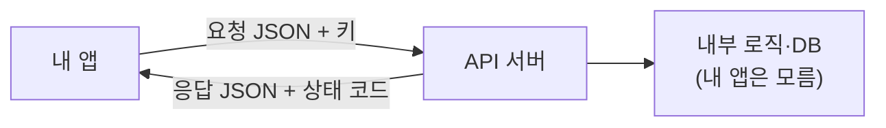

# API

> 프로그램끼리 "이렇게 요청하면 이런 응답을 준다"고 정해 둔 약속(인터페이스).

## 쉽게 말하면
식당의 주문서 양식이다. 정해진 칸에 메뉴와 수량을 적어 내면 주방이 같은 형식으로 결과를 돌려준다. 주방 내부를 몰라도 주문서만 맞추면 된다.

## 자세히
- 웹 API는 보통 HTTP로 URL을 부르고 **JSON**으로 주고받는다. 요청 요소: 주소(엔드포인트), 메서드(GET·POST…), 헤더(인증 키 등), 본문.
- 응답은 상태 코드와 본문. 200대는 성공, 400대는 요청 쪽 문제, 500대는 서버 문제.
- **인증**: 대개 API 키를 헤더에 넣는다. 키는 비밀이라 코드나 깃에 올리지 않는다([환경 변수와 비밀 관리](#secrets-env)).
- 브라우저의 `fetch()`는 기본 GET이고, HTTP 오류(404 등)에서는 예외를 던지지 않으므로 `response.ok`를 확인해야 한다(MDN).
- LLM도 API로 쓴다: 메시지를 보내면 생성된 텍스트가 돌아온다([LLM API 기초](#llm-api-basics)). AI 도구 연결 표준 [MCP](#mcp)도 "도구용 API 약속"으로 볼 수 있다.

## 그림으로 보기


## 예시
```js
const r = await fetch("https://example.org/products.json");
if (!r.ok) throw new Error(r.status);
const data = await r.json();
```
- 날씨 API로 오늘 날씨를 받아 화면에 표시한다.

## 헷갈리는 것과 비교
| 개념 | 차이 |
| --- | --- |
| API | 약속(규격) 자체 |
| SDK | API를 쓰기 쉽게 감싼 라이브러리 |
| 웹훅 | 서버가 거꾸로 내 주소를 불러 알림을 줌 |

## 더 읽을거리
- [Using the Fetch API (MDN)](https://developer.mozilla.org/en-US/docs/Web/API/Fetch_API/Using_Fetch) — 요청·JSON 응답·오류 처리
- [Client-Server overview (MDN)](https://developer.mozilla.org/en-US/docs/Learn_web_development/Extensions/Server-side/First_steps/Client-Server_overview) — 요청·응답 구조
